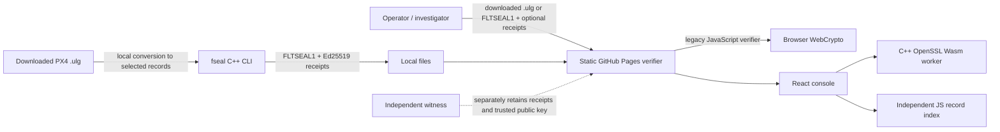
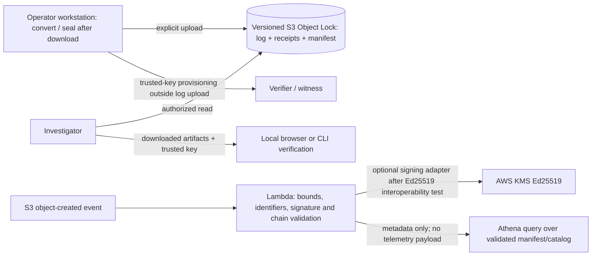

# Architecture and readiness

**Status (2026-11-14):** the current verifier is a static browser application. The native C++ CLI and the new
WebAssembly bridge and React console are implemented under `wasm/`, `newweb/` and `docs/console/`. No AWS account or credentials are configured, and no cloud resources
have been created. AWS below is an optional proposal, not the deployed architecture.

## Current system

The legacy verifier runs in the user's browser, reads selected files locally, and has no upload or backend API.
It verifies the FLTSEAL1 hash chain and can authenticate receipts with a supplied trusted public key. The C++ core
and the browser's current JavaScript implementation are separate readers. The new C++/OpenSSL WebAssembly bridge
is compiled (about 1.93 MB module), has native/Node parity coverage, and is used by the console.
Missing-key receipts remain unchecked: the application reports overall UNVERIFIED separately from the unchanged
native chain-only result. It never fabricates a native receipt-verification result.
Its browser path uses a dedicated worker and streaming native file I/O. A 500 MiB / 500-record probe (roughly 1 MiB payload per record) measured 32 MiB of native
Wasm heap in Chrome with WORKERFS and took 6.06 seconds on the test Mac. Native Linux verification used 7,976 KiB
maximum RSS and 2.88 seconds; Node/Wasm took 4.85 seconds with a 32 MiB native heap. These are single-machine
measurements, not whole-browser memory, a record-rate benchmark, device coverage, or a production capacity claim.

PX4 `.ulg` conversion is currently a local post-download step. The converter selects and decodes records; FlightSeal
does not authenticate the source `.ulg` bytes, attest that telemetry was true, or cover events before sealing.
The append format can accept a stream, but on-drone or live ground-station sealing has not been validated. The hash
structure is a sequential SHA-256 chain, not a Merkle tree. A receipt binds a record count and chain head; an
independently held receipt and independently trusted public key are required for protection against a complete
rewrite.

## Optional AWS archive design (not deployed)

This is a possible archive and review workflow, not a real-time sealing service. A completed object event cannot
provide receipts throughout a flight. If a future service is asked to seal, its witness and signing trust boundary
must be designed separately so one compromised operator role cannot replace both the log and its receipts. Use
S3 Object Lock with versioning and a deliberately selected retention mode: governance mode allows principals with
the bypass permission to change retention/delete; compliance mode prevents deletion of a protected version during
retention, including by the account root. Object Lock protects object versions from specified changes/deletion;
it does not show that contents are accurate or that the first uploaded version was honest ([AWS Object Lock
overview](https://docs.aws.amazon.com/AmazonS3/latest/userguide/object-lock.html), [retention modes](https://docs.aws.amazon.com/AmazonS3/latest/userguide/object-lock.html#object-lock-retention-modes)).

AWS KMS now documents `ECC_NIST_EDWARDS25519` with `ED25519_SHA_512` (`MessageType: RAW`) and
`ED25519_PH_SHA_512` (`MessageType: DIGEST`). These are not interchangeable. Before mapping KMS to receipt v1,
verify a real KMS signature over the exact v1 message against the existing OpenSSL/browser verifier and confirm
public-key serialization. ECDSA is not a substitute: v1 requires Ed25519. Until that fixture passes, keep KMS as an
unapproved integration point ([AWS KMS key specs and algorithms](https://docs.aws.amazon.com/kms/latest/developerguide/symm-asymm-choose-key-spec.html), [KMS Sign API](https://docs.aws.amazon.com/kms/latest/APIReference/API_Sign.html)).

Lambda should process an S3 object reference rather than accept a large log in an API request. Bound object size,
receipt count, execution time, retries, and concurrent jobs; make processing idempotent by object version ID. Athena
should query small manifests/operational metadata, not parse arbitrary raw flight payloads. Do not publish a static
JSON “metrics” file as a substitute for live telemetry or a metrics endpoint. Cloudflare Pages is a possible static
hosting alternative only; it does not provide the proposed private archive/signing backend by itself.

## Readiness and trust boundaries

- Current free public static pages do not promise an unlimited free cloud backend. No billing, email, payment, or
  cloud account action is part of this design.
- The signing private key is not persisted by the sandbox browser: its generated key is ephemeral and lost when its
  worker is terminated. A downloaded log/receipt after the fact is not an independent witness.
- Key theft permits forged future receipts. It does not invalidate receipts already held by an independent witness,
  unless that witness copy is also replaced. There is no built-in certificate registry, identity binding, revocation
  service, or trusted timestamp. Key rotation/revocation therefore needs an external operator process and a trusted
  key history; a verifier must not infer identity from a key supplied alongside the log.
- Receipts do not include a flight identifier, so two flights sealed with one key can be confused operationally.
  A signed count/head mismatch can indicate a rewrite or receipts from another flight.
- No human customer validation or outreach has occurred. Proposed browser sandbox examples are synthetic; keep
  their events separate from real-user analytics.

## Static deployment preparation

`amplify.yml`, `customHttp.yml`, and `python3 tools/package_static.py` prepare the same `/flightseal/` paths for
AWS Amplify static hosting. The package command was locally checked against every public source file by hash.
No Amplify app/account was created. Deployment and response-header enforcement remain untested on AWS.
The custom header file specifies CSP, HSTS, nosniff, no framing, and a restrictive permissions policy; the existing
GitHub Pages deployment only applies HTML CSP and provider-controlled headers. Do not report custom headers as
active there. The console allows only same-origin resources and local blob media; no external analytics request
is enabled. See [Amplify header format](https://docs.aws.amazon.com/amplify/latest/userguide/custom-header-YAML-format.html).

The optional full PX4 fixture contains 64,542 converted records, 13 receipts, and 30,294,365 sealed bytes.
Its source, conversion and output hashes are in `docs/samples/px4-full-provenance.json`. It is loaded only on request;
the 800-record synthetic example remains the quick default. The included public key authenticates this generated
demo artifact, not the original flight identity or any pre-sealing history.

## Video utility boundary

The browser inspects local playback metadata and reports unknown codecs honestly. Local FFmpeg tools under
`tools/video/` inspect actual codecs and convert a new H.264/AAC MP4 with input, duration, pixel, output, and timeout
limits. They expose no server route and are not invoked by the static host. Run untrusted media in the documented
restricted container. `native/VideoAssetInspector.swift` typechecks against the local macOS SDK; there is no iOS
app target, App Store package, or verified iOS build in this repository.
