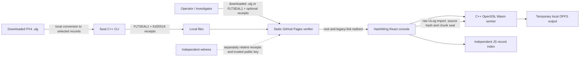
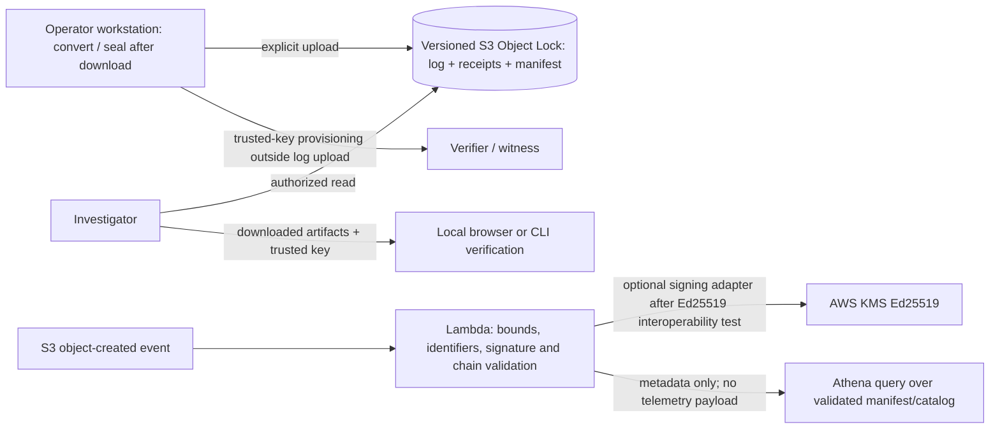
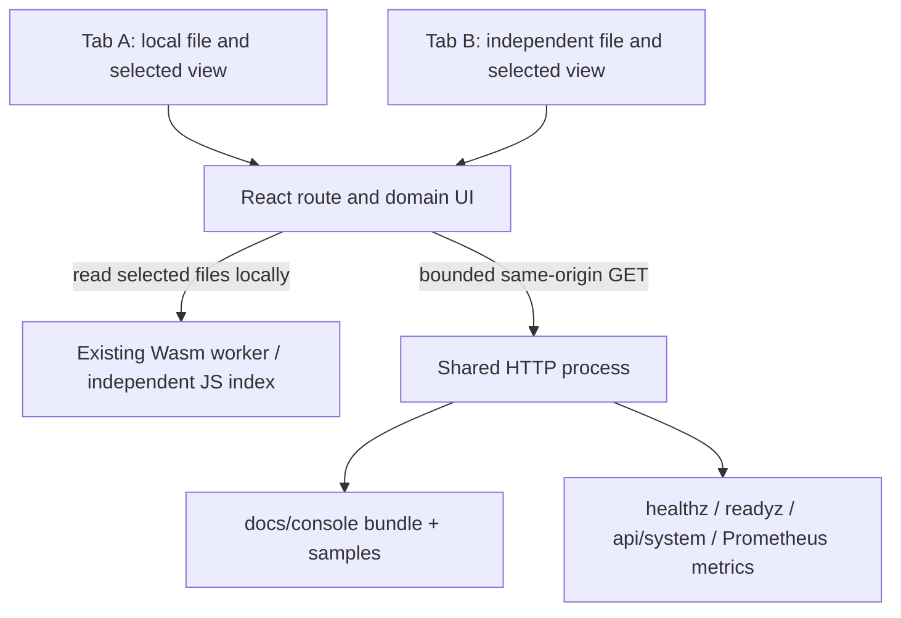

# Architecture and readiness

**Status (2026-11-15):** verification and sealing remain browser-local. The local product adds an HTTP serving process for direct routes and live operational health; GitHub Pages remains a static deployment. The native C++ CLI and the new
WebAssembly bridge and React console are implemented under `wasm/`, `newweb/` and `docs/console/`. No AWS account or credentials are configured, and no cloud resources
have been created. AWS below is an optional proposal, not the deployed architecture.

## Current system

The single console runs in the user's browser and reads selected files locally. The local HTTP adapter serves assets plus read-only `/healthz`, `/readyz`, `/metrics` and `/api/system`; it receives no flight-log uploads or signing keys.
It verifies the FLTSEAL1 hash chain and can authenticate receipts with a supplied trusted public key. The C++ core
and the independent JavaScript reader are separate implementations used for finite parity tests and indexing.
The C++/OpenSSL WebAssembly bridge is compiled (about 1.97 MB module) and is used by every console verification,
sealing and mutation operation. PDF generation loads separately when requested.
Missing-key receipts remain unchecked: the application reports overall UNVERIFIED separately from the unchanged
native chain-only result. It never fabricates a native receipt-verification result.
Its browser path uses a dedicated worker and buffered native file I/O. In a fresh task-owned Chrome profile on
the test Mac, a 1 GiB sealed-file verification took about 12.5 seconds; a separate 1 GiB raw-ULog import, source
hash, seal, verification and cleanup took about 38.6 seconds, producing 1,026 records and two receipts. Both
reported a 32 MiB native Wasm heap. Main-thread heartbeat delays stayed below the test's 250 ms threshold.
These finite local probes are not whole-browser memory measurements, hardware coverage or a service capacity
guarantee. Private windows or devices with less storage can reject the same workload.

PX4 `.ulg` processing is a local post-download step. The Python converter selects and decodes records. The native
raw importer instead preserves every source byte in `FSRAW001` chunk envelopes plus a final SHA-256 digest record;
receipt coverage binds those envelopes, not the truth or origin of the source bytes. Supported PX4 scalar fields
provide a bounded telemetry preview using PX4 unit conventions; custom units and sensor truth are not validated.
An imported chunk can contain many telemetry samples, so its integrity boundary is not an individual sensor sample.
Large output is written directly to OPFS through a worker-only synchronous file adapter, with quota checks and an
explicit clear action. Web Locks protect active outputs in other tabs; abandoned owned outputs are recovered on
the next visit. Raw import is capped at 1 GiB, verification at 1,025 MiB, and operations have a five-minute deadline.
No path attests telemetry truth or covers events before sealing.
The append format can accept a stream, but on-drone or live ground-station sealing has not been validated. The hash
structure is a sequential SHA-256 chain, not a Merkle tree. A receipt binds a record count and chain head; an
independently held receipt and independently trusted public key are required for protection against a complete
rewrite.

## Optional AWS archive design (not deployed)

This is a possible archive and review workflow, not a real-time sealing service. A completed object event cannot
provide receipts throughout a flight. If a future service is asked to seal, its witness and signing trust boundary
must be designed separately so one compromised operator role cannot replace both the log and its receipts. Use
S3 Object Lock with versioning and a deliberately selected retention mode: governance mode allows principals with
the bypass permission to change retention/delete; compliance mode prevents deletion of a protected version during
retention, including by the account root. Object Lock protects object versions from specified changes/deletion;
it does not show that contents are accurate or that the first uploaded version was honest ([AWS Object Lock
overview](https://docs.aws.amazon.com/AmazonS3/latest/userguide/object-lock.html), [retention modes](https://docs.aws.amazon.com/AmazonS3/latest/userguide/object-lock.html#object-lock-retention-modes)).

AWS KMS now documents `ECC_NIST_EDWARDS25519` with `ED25519_SHA_512` (`MessageType: RAW`) and
`ED25519_PH_SHA_512` (`MessageType: DIGEST`). These are not interchangeable. Before mapping KMS to receipt v1,
verify a real KMS signature over the exact v1 message against the existing OpenSSL/browser verifier and confirm
public-key serialization. ECDSA is not a substitute: v1 requires Ed25519. Until that fixture passes, keep KMS as an
unapproved integration point ([AWS KMS key specs and algorithms](https://docs.aws.amazon.com/kms/latest/developerguide/symm-asymm-choose-key-spec.html), [KMS Sign API](https://docs.aws.amazon.com/kms/latest/APIReference/API_Sign.html)).

Lambda should process an S3 object reference rather than accept a large log in an API request. Bound object size,
receipt count, execution time, retries, and concurrent jobs; make processing idempotent by object version ID. Athena
should query small manifests/operational metadata, not parse arbitrary raw flight payloads. Do not publish a static
JSON “metrics” file as a substitute for live telemetry or a metrics endpoint. Cloudflare Pages is a possible static
hosting alternative only; it does not provide the proposed private archive/signing backend by itself.

## Readiness and trust boundaries

- Current free public static pages do not promise an unlimited free cloud backend. No billing, email, payment, or
  cloud account action is part of this design.
- The signing private key is not persisted by the sandbox browser: its generated key is ephemeral and lost when its
  worker is terminated. A downloaded log/receipt after the fact is not an independent witness.
- Key theft permits forged future receipts. It does not invalidate receipts already held by an independent witness,
  unless that witness copy is also replaced. There is no built-in certificate registry, identity binding, revocation
  service, or trusted timestamp. Key rotation/revocation therefore needs an external operator process and a trusted
  key history; a verifier must not infer identity from a key supplied alongside the log.
- Receipts do not include a flight identifier, so two flights sealed with one key can be confused operationally.
  A signed count/head mismatch can indicate a rewrite or receipts from another flight.
- No human customer validation or outreach has occurred. Proposed browser sandbox examples are synthetic; keep
  their events separate from real-user analytics.

## Static deployment preparation

`amplify.yml`, `customHttp.yml`, and `python3 tools/package_static.py` prepare the same `/flightseal/` paths for
AWS Amplify static hosting. The package command was locally checked against every public source file by hash.
No Amplify app/account was created. Deployment and response-header enforcement remain untested on AWS.
The custom header file specifies CSP, HSTS, nosniff, no framing, and a restrictive permissions policy; the existing
GitHub Pages deployment only applies HTML CSP and provider-controlled headers. Do not report custom headers as
active there. The console allows only same-origin resources and local blob media; no external analytics request
is enabled. See [Amplify header format](https://docs.aws.amazon.com/amplify/latest/userguide/custom-header-YAML-format.html).

The optional full PX4 fixture contains 64,542 converted records, 13 receipts, and 30,294,365 sealed bytes.
Its source, conversion and output hashes are in `docs/samples/px4-full-provenance.json`. It is loaded only on request;
the 800-record synthetic example remains the quick default. The included public key authenticates this generated
demo artifact, not the original flight identity or any pre-sealing history.

## Video utility boundary

The browser inspects local playback metadata and reports unknown codecs honestly. Local FFmpeg tools under
`tools/video/` inspect actual codecs and convert a new H.264/AAC MP4 with input, duration, pixel, output, and timeout
limits. They expose no server route and are not invoked by the static host. Run untrusted media in the documented
restricted container. `native/VideoAssetInspector.swift` typechecks against the local macOS SDK; there is no iOS
app target, App Store package, or verified iOS build in this repository.

## Enterprise console acceptance (2026-11-14)

The console uses Lucide navigation without decorative step numbers and a collapsible text report. Video sync is an
HTML5 playback aid: it subtracts actual indexed flight timestamps, then applies a manual offset. A generated H.264
clip was actually decoded and sought across record navigation; metadata and playback were not mocked in the final
regression. This does not prove physical association or authenticate video capture time.

The native and browser nine-case matrices cover both PX4 sizes, mutations, torn-write/receipt semantics, reversed
timestamps, malformed uploads, and native custom sealing. A valid reversed timestamp remains an intact chain;
chronology and receipt completeness are separate evidence. UI responsiveness observations are workload-specific,
not an uptime/latency guarantee. Pricing/notary panels show an actual local receipt and explicitly unavailable cloud
services. No private pilot email endpoint or AWS signer is configured.

## Local direct routes and operational view (2026-11-15)

The same Vite bundle is built into `docs/console/`; `/flightseal/` remains the asset prefix for Pages
compatibility. The shared local serving process maps only `/`, `/verify`, `/benchmarks` and `/system`
to the SPA entry. Unknown API routes and missing assets are not HTML fallback candidates. Legacy
hash routes remain parsed by `newweb/src/routes.mjs`; product navigation uses History API paths and
listens to popstate/hashchange. Sample and record URL values are allowlisted/numeric; source content,
paths and keys never enter URLs. Runtime file/result state is held independently in each tab.

The system page fetches all four health/operational endpoints with an eight-second deadline and
explicit refresh; dependency failures stay visible. It rejects unexpected HTML endpoint responses.
Counters, uptime and latency buckets describe the HTTP process, not the browser engine or signature
validity. No historical latency chart or synthetic health status is supplied. Prometheus error rate is
`sum(rate(app_http_requests_total{status_class=~"4xx|5xx"}[5m])) / sum(rate(app_http_requests_total[5m]))`.
Monitor transfer failures separately with `sum(rate(app_http_transfer_errors_total[5m]))`:
a download aborted after its headers retains its sent HTTP status, including200, and increments
this counter. Do not add the two rates as a unique-failure count; some failures appear in both.
Latency p50/p99 use `histogram_quantile(0.50|0.99, sum by (le) (rate(app_http_request_duration_seconds_bucket[5m])))`;
low-traffic windows do not establish a useful tail estimate.

The benchmark page runs the actual C++/Wasm verifier against a bounded included sample (one warm-up,
three measured sequential runs, no receipts, 60-second deadline). Timings include worker/file costs,
exclude fetch and are retained only in that tab. They do not measure crash safety, durable ingestion,
or native throughput. A separate native crash/recovery benchmark was exercised on task-owned
storage; its workload and platform-specific measurements belong to the verification report, not
this browser timing panel.

No AWS runtime integration is added by the frontend. The proposed archive/signing services above
remain proposals and need their own compatibility and operational validation. Local Space Grotesk
and JetBrains Mono font assets include their SIL OFL notices under `newweb/public/fonts/`.
