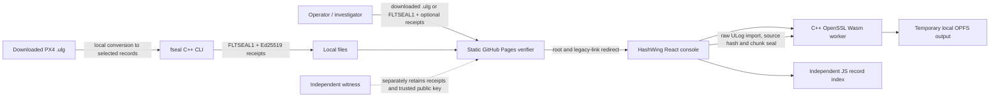
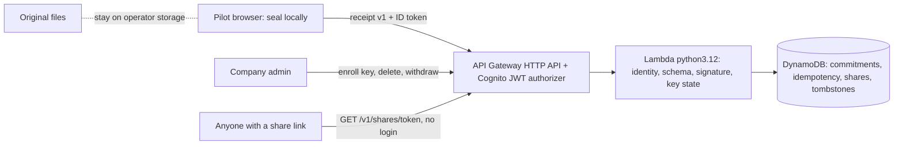
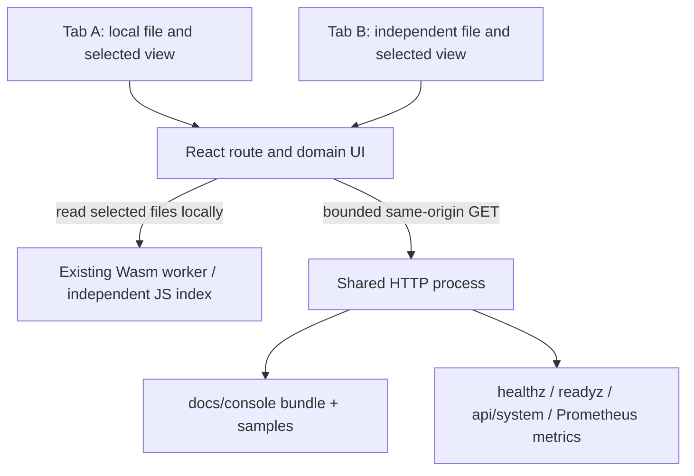

# Architecture and readiness

**Status (2026-11-17):** verification and sealing remain browser-local. The optional HTTP runtime now adds session-owned SQLite workspaces, explicit source/result uploads, durable sessions and logical snapshots alongside direct routes and process health. GitHub Pages remains a static deployment. The native C++ CLI and the new
WebAssembly bridge and React console are implemented under `wasm/`, `newweb/` and `docs/console/`. No AWS account or credentials are configured, and no cloud resources
have been created. The optional receipt registry below is implemented and tested locally and in LocalStack, not deployed.

## Current system

The single console runs in the user's browser and reads selected files locally. The HTTP adapter serves assets/probes and, when configured with private storage, accepts explicitly saved checked logs, receipts and result metadata. Private signing keys and video are excluded. The server authorizes storage; saved results remain browser-computed, not server-verified.
It verifies the FLTSEAL1 hash chain and can authenticate receipts with a supplied trusted public key. The C++ core
and the independent JavaScript reader are separate implementations used for finite parity tests and indexing.
The C++/OpenSSL WebAssembly bridge is compiled (about 1.97 MB module) and is used by every console verification,
sealing and mutation operation. PDF generation loads separately when requested.
Missing-key receipts remain unchecked: the application reports overall UNVERIFIED separately from the unchanged
native chain-only result. It never fabricates a native receipt-verification result.
Its browser path uses a dedicated worker and buffered native file I/O. In a fresh task-owned Chrome profile on
the test Mac, a 1 GiB sealed-file verification took about 12.5 seconds; a separate 1 GiB raw-ULog import, source
hash, seal, verification and cleanup took about 38.6 seconds, producing 1,026 records and two receipts. Both
reported a 32 MiB native Wasm heap. Main-thread heartbeat delays stayed below the test's 250 ms threshold.
These finite local probes are not whole-browser memory measurements, hardware coverage or a service capacity
guarantee. Private windows or devices with less storage can reject the same workload.

PX4 `.ulg` processing is a local post-download step. The Python converter selects and decodes records. The native
raw importer instead preserves every source byte in `FSRAW001` chunk envelopes plus a final SHA-256 digest record;
receipt coverage binds those envelopes, not the truth or origin of the source bytes. Supported PX4 scalar fields
provide a bounded telemetry preview using PX4 unit conventions; custom units and sensor truth are not validated.
An imported chunk can contain many telemetry samples, so its integrity boundary is not an individual sensor sample.
Large output is written directly to OPFS through a worker-only synchronous file adapter, with quota checks and an
explicit clear action. Web Locks protect active outputs in other tabs; abandoned owned outputs are recovered on
the next visit. Raw import is capped at 1 GiB, verification at 1,025 MiB, and operations have a five-minute deadline.
No path attests telemetry truth or covers events before sealing.
The append format can accept a stream, but on-drone or live ground-station sealing has not been validated. The hash
structure is a sequential SHA-256 chain, not a Merkle tree. A receipt binds a record count and chain head; an
independently held receipt and independently trusted public key are required for protection against a complete
rewrite.

## Optional receipt registry on AWS (not deployed)

`registry/` (Python Lambda) and `infra/` (CDK) implement an optional witness server for receipts. A pilot's sealer
sends a receipt v1 line; the registry checks its Ed25519 signature against the company's enrolled key and stores only
the commitment: org, key fingerprint, head, count and the time the server received it. A company can hand out
unguessable share links that show only that commitment. The registry never receives logs, files, manifests, salts,
per-file digests, file names, GPS or notes, and the browser seals and verifies without it.

**Status.** The code and its tests run locally. The CDK stack synthesises with no credentials. A LocalStack 4.12.0
community run exercised the Lambda and DynamoDB through a REST API v1 stand-in with a dev-only HS256 identity
adapter; the HTTP API and Cognito are designed and synthesised only. Nothing has been deployed to real AWS. The
registry's received time is its own clock, not a trusted timestamp; RFC 3161 and S3 Object Lock are not built.
$5 a month is a workload target, not a cap.

- [docs/aws/ARCHITECTURE_AWS.md](docs/aws/ARCHITECTURE_AWS.md): trust boundaries, identity adapter, data stored and never stored, idempotency, withdrawal, deletion and restore
- [docs/aws/COVERAGE.md](docs/aws/COVERAGE.md): what was checked locally, in LocalStack, on real AWS (nothing) and designed only
- [docs/aws/COST.md](docs/aws/COST.md): us-east-1 estimate, error and abuse scenarios
- [docs/aws/RUNBOOK_AWS.md](docs/aws/RUNBOOK_AWS.md): deploy, destroy, roll back, restore, LocalStack
- [Architecture spine](_bmad-output/initiative-hashwing-aws/architecture-hashwing-aws/architecture-hashwing-aws.md): the binding decisions for further AWS work

An earlier idea for an S3 Object Lock archive with Lambda validation, KMS Ed25519 signing and Athena queries
([decision 17](DECISIONS.md)) was not built and is not part of the registry. If KMS signing is ever proposed, a real
KMS signature over the exact receipt v1 message must first pass the existing verifiers.

## Readiness and trust boundaries

- Current free public static pages do not promise an unlimited free cloud backend. No billing, email, payment, or
  cloud account action is part of this design.
- The signing private key is not persisted by the sandbox browser: its generated key is ephemeral and lost when its
  worker is terminated. A downloaded log/receipt after the fact is not an independent witness.
- Key theft permits forged future receipts. It does not invalidate receipts already held by an independent witness,
  unless that witness copy is also replaced. The local tools have no built-in certificate registry, identity binding,
  revocation service, or trusted timestamp; the optional registry adds key enrollment and compromise reporting but
  is not deployed and does not certify company identity. Key rotation/revocation therefore needs an external operator process and a trusted
  key history; a verifier must not infer identity from a key supplied alongside the log.
- Receipts do not include a flight identifier, so two flights sealed with one key can be confused operationally.
  A signed count/head mismatch can indicate a rewrite or receipts from another flight.
- No human customer validation or outreach has occurred. Proposed browser sandbox examples are synthetic; keep
  their events separate from real-user analytics.

## Static deployment preparation

`amplify.yml`, `customHttp.yml`, and `python3 tools/package_static.py` prepare the same `/flightseal/` paths for
AWS Amplify static hosting. The package command was locally checked against every public source file by hash.
No Amplify app/account was created. Deployment and response-header enforcement remain untested on AWS.
The custom header file specifies CSP, HSTS, nosniff, no framing, and a restrictive permissions policy; the existing
GitHub Pages deployment only applies HTML CSP and provider-controlled headers. Do not report custom headers as
active there. The console allows only same-origin resources and local blob media; no external analytics request
is enabled. See [Amplify header format](https://docs.aws.amazon.com/amplify/latest/userguide/custom-header-YAML-format.html).

The optional full PX4 fixture contains 64,542 converted records, 13 receipts, and 30,294,365 sealed bytes.
Its source, conversion and output hashes are in `docs/samples/px4-full-provenance.json`. It is loaded only on request;
the 800-record synthetic example remains the quick default. The included public key authenticates this generated
demo artifact, not the original flight identity or any pre-sealing history.

## Video utility boundary

The browser inspects local playback metadata and reports unknown codecs honestly. Local FFmpeg tools under
`tools/video/` inspect actual codecs and convert a new H.264/AAC MP4 with input, duration, pixel, output, and timeout
limits. They expose no server route and are not invoked by the static host. Run untrusted media in the documented
restricted container. `native/VideoAssetInspector.swift` typechecks against the local macOS SDK; there is no iOS
app target, App Store package, or verified iOS build in this repository.

## Enterprise console acceptance (2026-11-14)

The console uses Lucide navigation without decorative step numbers and a collapsible text report. Video sync is an
HTML5 playback aid: it subtracts actual indexed flight timestamps, then applies a manual offset. A generated H.264
clip was actually decoded and sought across record navigation; metadata and playback were not mocked in the final
regression. This does not prove physical association or authenticate video capture time.

The native and browser nine-case matrices cover both PX4 sizes, mutations, torn-write/receipt semantics, reversed
timestamps, malformed uploads, and native custom sealing. A valid reversed timestamp remains an intact chain;
chronology and receipt completeness are separate evidence. UI responsiveness observations are workload-specific,
not an uptime/latency guarantee. Pricing/notary panels show an actual local receipt and explicitly unavailable cloud
services. No private pilot email endpoint or AWS signer is configured.

## Local direct routes and operational view (2026-11-15)

The same Vite bundle is built into `docs/console/`; `/flightseal/` remains the asset prefix for Pages
compatibility. The shared local serving process maps only `/`, `/verify`, `/benchmarks` and `/system`
to the SPA entry. Unknown API routes and missing assets are not HTML fallback candidates. Legacy
hash routes remain parsed by `newweb/src/routes.mjs`; product navigation uses History API paths and
listens to popstate/hashchange. Sample and record URL values are allowlisted/numeric; source content,
paths and keys never enter URLs. Runtime file/result state is held independently in each tab.

The system page fetches all four health/operational endpoints with an eight-second deadline and
explicit refresh; dependency failures stay visible. It rejects unexpected HTML endpoint responses.
Counters, uptime and latency buckets describe the HTTP process, not the browser engine or signature
validity. No historical latency chart or synthetic health status is supplied. Prometheus error rate is
`sum(rate(app_http_requests_total{status_class=~"4xx|5xx"}[5m])) / sum(rate(app_http_requests_total[5m]))`.
Monitor transfer failures separately with `sum(rate(app_http_transfer_errors_total[5m]))`:
a download aborted after its headers retains its sent HTTP status, including200, and increments
this counter. Do not add the two rates as a unique-failure count; some failures appear in both.
Latency p50/p99 use `histogram_quantile(0.50|0.99, sum by (le) (rate(app_http_request_duration_seconds_bucket[5m])))`;
low-traffic windows do not establish a useful tail estimate.

The benchmark page runs the actual C++/Wasm verifier against a bounded included sample (one warm-up,
three measured sequential runs, no receipts, 60-second deadline). Timings include worker/file costs,
exclude fetch and are retained only in that tab. They do not measure crash safety, durable ingestion,
or native throughput. A separate native crash/recovery benchmark was exercised on task-owned
storage; its workload and platform-specific measurements belong to the verification report, not
this browser timing panel.

No AWS runtime integration is added by the frontend. The optional receipt registry above is not
deployed and needs real-AWS validation. Local Space Grotesk
and JetBrains Mono font assets include their SIL OFL notices under `newweb/public/fonts/`.

## Implemented private server mode

Four product routes (`/overview`, `/workbench`, `/reports`, `/settings`) expose actual workflows and stored evidence. Optional server persistence uses SQLite WAL on a private UID10001 volume, opaque durable Beaker sessions and Argon2 accounts. Origin/CSRF/owner checks, quotas and idempotent saves are enforced by the server. No reconnect upload, private signing-key storage or private API caching occurs. Snapshots stay on the same local volume; they are not an independent device backup. See [server workspaces](SERVER_WORKSPACES.md) for contracts, launch, limits and recovery. The AWS receipt registry is a separate, optional service and is not deployed.
