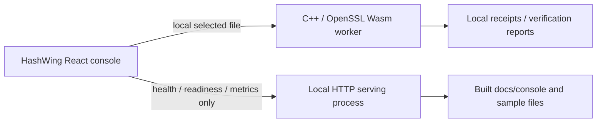
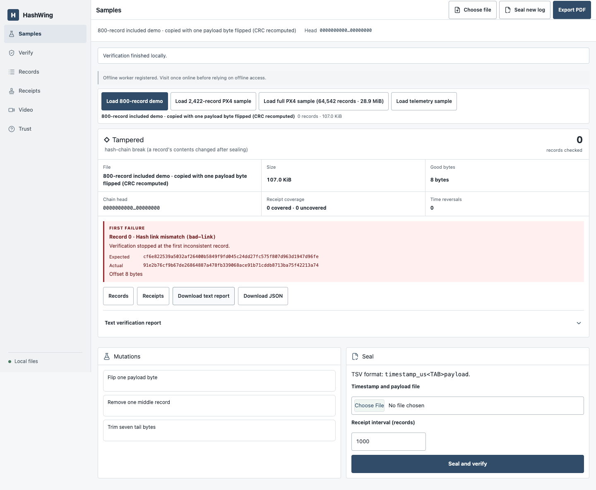

# HashWing

Flight-log reviews need a way to spot changes after a log is collected. HashWing checks sealed records and independently retained signed receipts, with file processing kept on the reviewer’s device. It helps reviewers identify the first detected inconsistency; it does not establish sensor truth, operator identity or events before sealing.

## Local product routes (2026-11-15)

The React console supports `/` (uploader/sealer), `/verify` (tamper and Ed25519 receipt auditor),
`/benchmarks` (real browser verification measurements) and `/system` (current serving-process health).
Legacy `/flightseal/console/#/app/...` links remain supported. The existing Pages build is still static;
HTTP health data is available only when using the local serving process. The four direct routes need
that process’s exact-path fallback; unknown API requests must remain JSON 404s.

Files, receipt checks and private signing keys stay in the existing browser/Wasm workflow. Selecting
a file is local processing rather than upload to the HTTP server. Tabs keep independent route/sample/
record selection; named local profile preferences remain explicitly shared on the device.



`/benchmarks` measures one warm-up and three sequential checks of the included 800-record file,
excluding its network fetch and receipt checks. It reports each sample, median elapsed time and log
MiB/s for this browser/device. It cannot establish p99, native disk durability, crash recovery or server
capacity. Historical native VM measurements below remain a separate workload.

The local frontend quickstart requires Node.js compatible with the installed Vite version, npm,
and Python with `requirements-web.txt` installed. Prepare that Python environment using the
[portable runtime verification instructions](docs/verification/runtime.md). From this repository:

```sh
npm --prefix newweb ci
npm --prefix newweb run build
python3 tools/http_server.py --root docs --app hashwing --port 3001
```

Do not start a second instance if port 3001 is already serving this stack. Stop a foreground instance
with Ctrl-C. The root project owns container and simultaneous five-app launch instructions. Build
assets retain `/flightseal/console/` URLs; the server maps `/flightseal/` to `docs/` and exact product
routes to `docs/console/index.html`.

See the [runtime verification summary](docs/verification/runtime.md) for the focused server
checks and portable setup; local run artifacts are not published. Reproduce direct-route
checks with `HASHWING_BASE_URL=http://127.0.0.1:3001 node newweb/tests/product-routes.mjs`.
These checks do not establish complete WCAG conformance or human screen-reader coverage.

Local flight-log integrity, verified in your browser. The repository and `fseal` CLI retain their existing names; FLTSEAL1 and receipt v1 stay compatible.

**A post-download seal and reference file format for drone flight logs: edit, delete or reorder one record and
verification fails when checked against receipts held elsewhere.**


Status: public beta (0.1.0), maintained by one student on a best-effort basis. To report a way to fool verification,
see [SECURITY.md](SECURITY.md), which also lists what is in and out of scope; contributions:
[CONTRIBUTING.md](CONTRIBUTING.md).

Drone flight logs end up as evidence: after a crash, an airspace violation, an insurance claim or a delivery dispute,
someone has to decide whether the log in front of them is the log the drone wrote. A hash of the whole file only
shows that it changed since the hash was taken, not where, and whoever holds both the file and the hash can replace
both.

HashWing chains every record to the one before it, and every few thousand records a signed receipt goes to someone
else (an investigator, the operator's company, an insurer). Later, anyone with the log, the receipts and the drone's
public key can check that nothing was changed, removed or reordered since sealing, and find the exact record where
tampering starts. In this repository a log is sealed after it is downloaded from the drone; nothing before that
moment is covered. Raw PX4 `.ulg` import preserves source bytes in bounded chunks; the older Python converter
instead selects decoded records. The format is append-only and `fseal append` reads any
`timestamp<TAB>payload` stream, so sealing on the drone or ground station while the log is written is possible, but it
has not been tried.

C++17 core (OpenSSL SHA-256 and Ed25519), Python tools for PX4 flight logs, tests under AddressSanitizer and UBSan.

## See it work

Output from [`tools/demo.sh`](tools/demo.sh) on a public PX4 flight log (69 s of flight, 64,542 logged samples), with
paths and the key shortened and a few lines trimmed:

```
$ fseal append flight.fseal --key drone.pem --receipts flight.receipts --every 5000
sealed 64542 records (log now has 64542), issued 13 receipt(s) to flight.receipts

$ fseal verify flight.fseal --receipts flight.receipts --pubkey eed39ebf…681397
  records      64542 intact
  receipts     13 of 13 match; 0 record(s) after the last receipt are not covered
RESULT: INTACT

# Attack 1: lower one altitude reading by 10 m and recompute that record's checksum
$ fseal verify edited.fseal
  first problem  record 33843, byte 13382731: hash-chain break (a record's contents changed after sealing) [bad-link]
RESULT: TAMPERED

# Attack 2: the file's holder makes the same edit and recomputes every link after it
$ fseal verify rewritten.fseal                      # the hash chain alone cannot tell
RESULT: INTACT
$ fseal verify rewritten.fseal --receipts flight.receipts --pubkey eed39ebf…681397
  receipt 7 (count 35000): log does not match this receipt: it was rewritten after the receipt was issued, or these receipts belong to another log sealed with the same key
RESULT: TAMPERED

# Attack 3: delete the last 2000 records (the end of the flight)
$ fseal verify short.fseal --receipts flight.receipts --pubkey eed39ebf…681397
  receipt 13 (count 64542): log is shorter than the receipt: records were removed from the end, or these receipts belong to another log sealed with the same key
RESULT: TAMPERED
```

Attack 2 is the reason receipts exist: whoever holds the file can always rebuild a self-consistent chain. What they
cannot change is the receipts someone else already holds.

## Interactive security console

**[Open the sandbox](https://anirudh763.github.io/flightseal/console/)** to check an included 800-record synthetic
log immediately. Change a copy with a payload byte flip, middle-record deletion, or tail truncation; inspect the
first failure and its record, then download a text or JSON summary. No account or upload is needed.



The React/Tailwind console calls the same C++/OpenSSL core compiled to WebAssembly. It also checks its record index
against the existing independent JavaScript reader. Verify, Records, Receipts, Video and Trust have separate
addresses. The optional full PX4 example contains **64,542 converted records and 13 receipts** and downloads
28.9 MiB only when requested; [provenance](docs/samples/px4-full-provenance.json) records its source and transforms.
The bundled key verifies this demo artifact, not the original flight identity or events before sealing.

Browser sealing accepts raw PX4 `.ulg` or `timestamp_us<TAB>payload` text and returns a new log, receipts and public
key. Raw import preserves every source byte and a SHA-256 source digest in signed, bounded chunk records. Supported
PX4 position/battery fields feed a limited telemetry view; the synthetic telemetry sample is labelled separately.
Its private key is ephemeral and is discarded with the worker. Downloading receipts after sealing is not an
independent witness or a durable signing deployment. Raw import is bounded to 1 GiB and uses temporary local OPFS
storage where supported; verification allows 1,025 MiB for envelope overhead. Quota, browser and timeout limits
still apply. See [measured limits and trust boundaries](wasm/README.md).

With Docker installed, build and run the native, Python, JavaScript/Wasm, frontend-build and static-package checks:

```sh
./scripts/check_docker.sh
```

For the console locally (Node 24 and Python 3; no AWS account):

```sh
npm --prefix newweb ci
npm --prefix newweb run build
npm --prefix newweb run preview
```

Open `http://127.0.0.1:4173/flightseal/console/`. Browser regression tests are `npm --prefix newweb run test:browser`
after installing Playwright Chromium. The root URL and compatible old sample/record links redirect into this
single console; the independent JavaScript reader remains a test oracle.

Local [FFmpeg video tools](tools/video/README.md) inspect actual codecs and convert a bounded local video to a new
H.264/AAC MP4. The browser Video screen checks playback metadata, aligns a selected record with a manual offset, and warns when it cannot identify or play a codec;
it does not upload or convert media. The [AVFoundation helper](native/README-video.md) was compiled and its local-URL
guards exercised on macOS; there is no Xcode/iOS app target in this repository.

[Architecture](ARCHITECTURE.md), [decisions](DECISIONS.md), [failure modes](FAILURE_MODES.md),
[runbook](RUNBOOK.md), and [FinOps/pricing hypotheses](FINOPS_AND_PRICING.md) separate implemented behavior from
possible cloud services. Amplify manifests prepare static artifacts; no AWS deployment, paid plan, analytics
collection, or email waitlist is active.

## Check a log in your browser

**[Open HashWing](https://anirudh763.github.io/flightseal/)**: choose a sealed log and optionally its receipts and
an independently trusted public key. The canonical light console runs the C++/OpenSSL verifier locally in a worker;
files are never uploaded. Samples, Verify, Records, Receipts, Video and Trust each have an address.
After a successful online visit, the console and small examples can reload offline. The full PX4 download is opt-in.

The 800-record example is synthetic. The 2,422-record and 64,542-record examples are selected/converted public PX4
records, with documented provenance. The separate telemetry demo is synthetic ULog, not a physical flight. Records
and receipt details use bounded indexed reads; text, JSON and PDF reports contain actual verification results.
The PDF is an integrity summary, not a legal certificate or trusted timestamp.

Chain consistency, trusted receipt coverage and an uncovered suffix are separate conclusions. A hash chain locates
the first broken link, not every altered record. A receipt mismatch narrows an edit to an interval but does not
identify every changed byte. Without trusted independent receipts, a complete rewrite or removal of whole tail
records can remain undetectable. Missing or untrusted keys never become a successful receipt-authentication claim.

## What it proves, and what it does not

| Change made after sealing | Caught by | Reported at |
|---|---|---|
| Accidental damage, flipped bits | CRC-32 per record | that record |
| Edited value, even with the checksum fixed | SHA-256 hash chain | that record |
| Deleted, reordered or duplicated record | sequence numbers | that record |
| Records deleted from the end | a receipt kept by someone else | that receipt |
| Whole log rewritten after an edit | a receipt kept by someone else | first receipt after the edit |
| Forged or altered receipt, or one signed by another key | Ed25519 signature, checked against a key you trust | that receipt, as UNVERIFIED (exit 3): a receipt anyone could write proves nothing about the log |
| Crash in the middle of a write | torn final record | `fseal recover` trims only that |

It does **not** prove that the data was true when it was sealed (a spoofed sensor or an edit before sealing looks
normal), it cannot protect records written after the last receipt, and it cannot help if the signing key leaks and
the receipt holder is compromised too. Timestamps are stored but not trusted: clocks reset at boot, so ordering uses
sequence numbers and `verify` reports timestamps that go backwards. The full list is in
[THREAT_MODEL.md](THREAT_MODEL.md).

Limits of this project:

- The PX4 converter seals selected decoded ULog records, sorted by timestamp, after the log was downloaded; it does not preserve or authenticate every byte of the original .ulg file, or anything that happened before sealing. This describes the Python converter; the separate native raw ULog importer preserves source bytes and a source digest in chunk envelopes, so integrity localization is at sealed-chunk granularity. Neither path authenticates events before sealing. The ULog format is described in the [PX4 ULog specification](https://docs.px4.io/main/en/dev_log/ulog_file_format).
- Keeping receipts with a separate witness is an operational assumption: the CLI writes receipts to a local file, and the protection holds only if someone other than the log's holder keeps a copy.
- The tests use one real PX4 flight log (a public pyulog fixture); the browser examples are a synthetic 800-record flight and 2,422 records selected from that PX4 log, with no position or GPS topics.
- HashWing is a narrow, documented workflow to support experiments. It is not proof of safe flight or of an accident's cause, and it is not a reproduction of RVFuzzer or PGFuzz. No user or field validation has been done.

## How it works

```
file     = "FLTSEAL1" record*
record   = length u32 | seq u64 | timestamp_us u64 | payload | link (32 bytes) | crc32 u32     (little-endian)
link[i]  = SHA-256(link[i-1] | seq | timestamp_us | length | payload),  link[-1] = 32 zero bytes
receipt  = fseal-receipt v1 count=N head=link[N-1] key=<Ed25519 public key> sig=<signature over count and head>
```

- **Checks, in order:** checksum, then sequence number, then link. The first failure names the record and the reason.
- **Receipts** are issued only after the records they cover are on disk (`fsync`), so a crash never leaves an honest
  log shorter than its receipts. A crash can leave a torn final record: `fseal verify` reports that as INCOMPLETE
  without receipts, and as TAMPERED when receipts are given (it reports any problem as tampering then) until
  `fseal recover` trims the torn record. If `append` cannot write a receipt, it stops with an error instead of
  reporting the receipt as issued.
- **Recovery** trims a final record that a crash cut short, and nothing else. A bad record in the middle, or a complete
  final record with a bad checksum, is reported and left in place: truncating it would destroy evidence. A length
  field that runs past the end of the file is a torn record only if no intact record follows it; if one does, the
  length was corrupted and nothing is trimmed. Residual: a crash whose torn final record happens to contain bytes that
  look like a valid next record makes `recover` refuse; that fails safe (nothing is deleted), is very unlikely by
  accident, and can be caused by a crafted payload.
- **Durability:** records are buffered and made durable every 1,000 records (or after every record with
  `--sync every`). Records acknowledged by a sync survive a crash; the kill -9 test checks exactly that.

Every design choice, the alternative that was rejected and why, is in [DECISIONS.md](DECISIONS.md).

## Install

Build and install `fseal` (needs CMake, a C++17 compiler and OpenSSL):

```
sudo apt-get install cmake g++ libssl-dev
cmake -S . -B build -DCMAKE_BUILD_TYPE=Release && cmake --build build -j
cmake --install build --prefix ~/.local          # installs ~/.local/bin/fseal
fseal --version                                  # fseal 0.1.0; fseal --help lists the commands
```

Each tagged version (`v*`) also gets a Linux x86_64 binary and its SHA-256 file on the Releases page, built and
checked in a clean `ubuntu:24.04` container by [`.github/workflows/release.yml`](.github/workflows/release.yml). The
binary is dynamically linked and needs OpenSSL 3 (`libssl3t64` on Ubuntu 24.04). Changes are listed in
[CHANGELOG.md](CHANGELOG.md).

## Quick start

```
sudo apt-get install cmake g++ libssl-dev libsqlite3-dev
pip install pyulog pytest pyyaml
cmake -S . -B build && cmake --build build -j
ctest --test-dir build && python -m pytest -q    # C++ and Python tests
tools/demo.sh                                    # the demo above
node --test tests/web/verifier.test.mjs          # browser verifier against the CLI and the Python reader (Node 22)
(cd tests/web && npm ci && npx playwright install chromium) && node tests/web/e2e.mjs   # the page itself
node tests/web/routes.mjs                         # the screens: routes, focus, Menu, Back/Forward, theme, axe
```

Seal your own PX4 log:

```
build/fseal keygen drone.pem          # keep drone.pem secret; give the printed public key to investigators
python3 tools/ulog_to_records.py flight.ulg | build/fseal append flight.fseal --key drone.pem --receipts flight.receipts
build/fseal verify flight.fseal --receipts flight.receipts --pubkey <public key>
```

`fseal append` reads `timestamp_us<TAB>payload` lines, so any telemetry source can feed it.

Unknown options are rejected, `--receipts` and `--pubkey` go together, and a receipts file with no receipts is an
error, so a typo can never skip the receipts check. `fseal verify` exit status: 0 intact, 1 tampered or incomplete,
2 usage or I/O error, 3 unverified (receipts not
validly signed by the key you trust, so they prove nothing either way).

## Results

Measured with `build-release/fseal-bench records.tsv <dir> 5` on the PX4 flight above (64,542 records, mean payload
413 bytes), median of 5 runs. Environment: Intel Xeon @ 2.10 GHz, 2 vCPUs, ext4 on a cloud VM disk, SQLite 3.45.1.

| system | made durable every | records | records/s | MB/s of payload | file size |
|---|---|---|---|---|---|
| plain append log (CRC only, no tamper evidence) | 1,000 records | 64,542 | 419,931 | 173.6 | 27.7 MB |
| **FlightSeal** | 1,000 records | 64,542 | **266,036** | **110.0** | 30.3 MB |
| SQLite, WAL mode, `synchronous=FULL` | 1,000 records | 64,542 | 271,519 | 112.2 | 30.4 MB |
| plain append log | every record | 5,000 | 5,313 | 3.2 | 3.1 MB |
| **FlightSeal** | every record | 5,000 | **5,605** | **3.4** | 3.3 MB |
| SQLite, WAL mode, `synchronous=FULL` | every record | 5,000 | 6,284 | 3.8 | 3.6 MB |

- Tamper evidence costs about 37% of raw append speed, and FlightSeal ingests at roughly the same rate as SQLite with
  the same durability. With one `fsync` per record, all three are limited by the disk.
- Verifying the whole flight (checksums, sequence numbers, SHA-256 chain): **213 ms**. Recovering after a torn final
  record (scan, trim, `fsync`): **339 ms**.
- The sample flight logged about 935 samples per second (64,542 in 69 s), far below either rate. These numbers come
  from one cloud VM; a drone's flight computer will be slower, so rerun the benchmark on the target hardware.

## Tests

- **C++** ([tests/test_fseal.cpp](tests/test_fseal.cpp)), built with AddressSanitizer and UBSan in CI: a flipped bit,
  an edit with a recomputed checksum, a deleted, reordered or duplicated record, a torn final record at every byte
  offset, corruption in the middle (never truncated), a wrong key, an altered receipt, records deleted from the end,
  a full rewrite, and **kill -9 at 25 random moments** with no acknowledged record lost. The kill test was checked
  against a deliberately broken `sync()`: it failed all 25 rounds.
- **Python** ([tests/test_tools.py](tests/test_tools.py)): an independent reader written from the format description
  ([tools/fseal_py.py](tools/fseal_py.py), no shared code) must agree with the CLI on 7 attacks; the real PX4 flight
  is sealed and an altitude edit is found at the right record. `append` must refuse a receipts path it cannot open
  (before sealing anything) and fail when a receipt cannot be written (`/dev/full`).
- **JavaScript** ([tests/web/verifier.test.mjs](tests/web/verifier.test.mjs), 101 tests): the browser verifier must
  print exactly the same report as `fseal verify` and find the same first problem, record, byte and head as the
  Python reader. The cases are the 7 attacks with and without receipts, a full rewrite, a deleted tail, receipts
  from another key, an altered signature and count, edits at the edges of the verifier's 256-record hashing batches,
  13 hostile files, 9 malformed receipt files, the shipped samples and the real PX4 flight (skipped, with a
  message, until `python3 tools/fetch_sample.py tests/.data` has downloaded it). Unsigned and forged receipts are
  checked with Ed25519 switched off: they must never yield INTACT, and a mismatch must not be called tampering.
  Deliberate bugs in the verifier (skipping the CRC, sequence, key or truncation check, or the link check at the
  start of each hashing batch) each make tests fail. These checks compare three readers with each other, so they
  cannot catch a mistake that all of them share, such as a misreading of the format description itself.
- **Release** ([tests/test_release.py](tests/test_release.py) and ctest): `--help` and `--version` exit 0 on stdout;
  the version in `src/fseal.h`, CMakeLists.txt, `fseal --version` and the top CHANGELOG entry match; an `fseal`
  installed with `cmake --install` verifies the samples exactly as the build tree does; the release workflow runs
  only on `v*` tags, pins every action to a commit SHA and gives write access to its publishing job only. CI runs the
  release build and the clean-container check ([`tools/release_build.sh`](tools/release_build.sh)) on every push.
- **Copy** ([tests/web/copy.test.mjs](tests/web/copy.test.mjs)): fails if the limits listed above are removed from
  this README or from the verifier page.
- **Browser** ([tests/web/e2e.mjs](tests/web/e2e.mjs), Playwright, 45 checks): every sample, including the two
  real PX4 examples, shows the same broken record or receipt and the same text report as the CLI; hostile, empty and torn files, a forged signature, an empty receipts file, a
  network failure, no Ed25519, no Web Workers and JavaScript turned off each give the right result; after one visit
  the page reloads with the network off and still verifies a sample; Cancel during the receipt checks stops them and
  shows no verdict; keyboard-only use works; a 1,000,000-record log has
  no task over 200 ms and Cancel answers within 200 ms; no horizontal scroll at 375 and 320 px or at 200% text. The
  page passes automated axe-core checks with 0 violations in light and dark themes, at 1280 and 375 px wide. A manual screen-reader check
  has not been done.
- **Screens** ([tests/web/routes.mjs](tests/web/routes.mjs), Playwright, 24 checks): each route sets the title,
  marks its nav item and moves focus to its heading; Back and Forward restore the screen, the selected record and
  form text; deep links and old `?sample=` links load directly; unknown routes show Not found; the Menu sheet keeps
  focus inside and Escape returns focus to the Menu button; no page scrolls sideways at 320, 768 or 1440 px; light
  is the default under an OS dark preference; axe-core reports 0 violations on every screen, light and dark, at
  1280 and 320 px.

## Security review

Scanned with semgrep (rule packs from semgrep/semgrep-rules for C, JavaScript, Python, HTML, Bash, GitHub Actions
and secrets), `npm audit` (0 vulnerabilities) and the AddressSanitizer/UBSan build, and the code that reads files
was reviewed by hand for hostile input. No high-severity findings. Fixed:

- `parse_line()` threw `std::out_of_range` on a receipt count above 2^64-1 instead of rejecting the line.
- `scan()` and `recover()` threw on a path that cannot be read (a directory) instead of returning `IoError`.
- `fseal append` ignored failures writing the receipts file and still counted the receipts as issued; it now checks
  the path before sealing and every write, and exits with an error.
- The CI workflow pins its GitHub Actions to commit SHAs and runs with read-only permissions.
- From an independent audit: `recover` and `append` trimmed complete records after one corrupted length field (now
  reported as corruption and left in place); `verify` ignored a misspelt `--receipt`, a lone `--pubkey` or an empty
  receipts file and printed INTACT (now exit 2); `append` could leave sealed records without a receipt when the key
  was missing or a line was bad (the key is checked first, and a receipt is issued before stopping); receipts from
  another flight sealed with the same key were called a rewrite (the message now names both causes).
- From a second review: Cancel did not stop the receipt checks, and the page could still show a verdict after Cancel
  (10,000 receipts kept being checked for about 1.5 s); a receipts file with a 16-million-digit count blocked the page
  for about 3 s before it was rejected (counts with more than 20 significant digits are now rejected at once, as the
  CLI does); a receipt past the end of the log now says it may belong to another log sealed with the same key, as a
  head mismatch already did.

The browser page treats dropped files as hostile: it reads the log in 16 MB slices, never trusts a length field over
1 MiB, caps receipts files at 16 MB and the table at 2,000,000 records, shows file contents only as text, and has a
Content-Security-Policy with no inline script and no network access beyond its own files.

## Why not immudb, Trillian or Sigstore Rekor?

They are services: an immutable database (immudb) and transparency logs (Trillian, Rekor) that run on servers and
answer queries. A drone or its ground station is often offline, and what an investigator receives is a file.
The underlying FlightSeal core is a small library and a single-file format that works offline, and its receipts are one line of text that
can be emailed. Publishing those receipts to a transparency log like Rekor would remove the need to trust a single
receipt holder; that is a next step.

## Next steps

- Detect edits made *before* sealing by cross-checking sensors (GPS against IMU, barometer against GPS altitude,
  both against the flight controller's own position estimate).
- Merkle-tree proofs, so a single record can be checked without the whole log.
- Publish receipts to a public transparency log.
- Test durability under real power loss, not only process kills and torn writes.

## How this was built

Built by Anirudh Yadav Boosa with AI assistance (Claude) for design review and code. The design was pressure-tested
before any code was written, every decision is written down in [DECISIONS.md](DECISIONS.md), and every number in this
README comes from a run of the commands above.

## License

MIT. The verifier page uses the Atkinson Hyperlegible font (Braille Institute), under the SIL Open Font License 1.1
([docs/OFL-atkinson-hyperlegible.txt](docs/OFL-atkinson-hyperlegible.txt)). The PX4 sample flight log used by the tests and the demo is downloaded at run time from
[PX4/pyulog](https://github.com/PX4/pyulog) (BSD-3-Clause), pinned by commit and SHA-256. The verifier's PX4
examples (`docs/samples/px4-*`) are 2,422 records selected from it and sealed; pyulog's licence is in
[docs/samples/LICENSE-pyulog.txt](docs/samples/LICENSE-pyulog.txt). The sealed selection has no position or GPS
topics or fields (checked by tests/test_web_samples.py).

Local verification: [2026-11-15 checks and limits](docs/verification/release-2026-11-15.md).


### Private server workspaces

The optional HTTP image adds owned saved runs, source artifacts, durable guest/account sessions and real workspace snapshots. Explicit Save controls uploads; domain checks stay in the browser. See [server configuration, API bounds and recovery](SERVER_WORKSPACES.md). Static Pages remains usable without these APIs.
