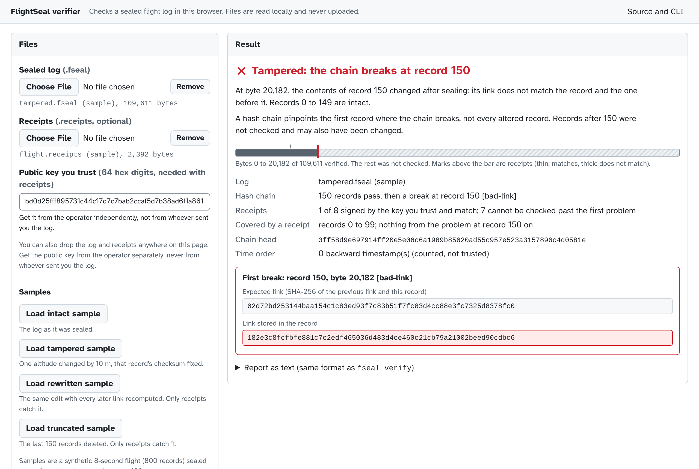

# FlightSeal

**An evidence seal for drone flight logs: edit, delete or reorder one record and verification fails.**


Drone flight logs end up as evidence: after a crash, an airspace violation, an insurance claim or a delivery dispute,
someone has to decide whether the log in front of them is the log the drone wrote. The usual practice is to hash the
file when an investigator receives it, which says nothing about what happened to it before that.

FlightSeal seals the log while it is being written. Every record is chained to the one before it, and every few
thousand records a signed receipt goes to someone else (an investigator, the operator's company, an insurer). Later,
anyone with the log, the receipts and the drone's public key can check that nothing was changed, removed or
reordered, and find the exact record where tampering starts.

C++17 core (OpenSSL SHA-256 and Ed25519), Python tools for PX4 flight logs, tests under AddressSanitizer and UBSan.

## See it work

Output from [`tools/demo.sh`](tools/demo.sh) on a public PX4 flight log (69 s of flight, 64,542 logged samples), with
paths and the key shortened and a few lines trimmed:

```
$ fseal append flight.fseal --key drone.pem --receipts flight.receipts --every 5000
sealed 64542 records (log now has 64542), issued 13 receipt(s) to flight.receipts

$ fseal verify flight.fseal --receipts flight.receipts --pubkey eed39ebf…681397
  records      64542 intact
  receipts     13 of 13 match; 0 record(s) after the last receipt are not covered
RESULT: INTACT

# Attack 1: lower one altitude reading by 10 m and recompute that record's checksum
$ fseal verify edited.fseal
  first problem  record 33843, byte 13382731: hash-chain break (a record's contents changed after sealing) [bad-link]
RESULT: TAMPERED

# Attack 2: the file's holder makes the same edit and recomputes every link after it
$ fseal verify rewritten.fseal                      # the hash chain alone cannot tell
RESULT: INTACT
$ fseal verify rewritten.fseal --receipts flight.receipts --pubkey eed39ebf…681397
  receipt 7 (count 35000): log does not match this receipt: it was rewritten after the receipt was issued, or these receipts belong to another log sealed with the same key
RESULT: TAMPERED

# Attack 3: delete the last 2000 records (the end of the flight)
$ fseal verify short.fseal --receipts flight.receipts --pubkey eed39ebf…681397
  receipt 13 (count 64542): log is shorter than the receipt (records were removed from the end)
RESULT: TAMPERED
```

Attack 2 is the reason receipts exist: whoever holds the file can always rebuild a self-consistent chain. What they
cannot change is the receipts someone else already holds.

## Check a log in your browser

**[Open the verifier](https://anirudh763.github.io/flightseal/)**: drop a sealed log, and optionally its receipts and
the public key you trust. It runs in the page with the browser's WebCrypto (SHA-256, Ed25519); files are read
locally and never uploaded.



- It opens on a built-in sample with one altitude changed by 10 m. It shows the first record where the chain breaks,
  the expected and stored link, and a paged list of every record checked. Three more samples: the intact log, a full
  rewrite that only the receipts catch, and a log with its last 150 records deleted that only the receipts catch.
  They are a synthetic 8-second flight (800 records) sealed by the real CLI with
  [`tools/make_web_samples.py`](tools/make_web_samples.py).
- It reports three things separately: whether the hash chain is consistent (no key needed), which records are
  covered by receipts signed by the key you trust, and which records come after the last such receipt and are not
  protected. A hash chain pinpoints the first record where the chain breaks, not every altered record; a receipt
  mismatch narrows an edit to the records between two receipts but cannot say which one. Truncation of the tail is
  only caught with receipts, and the page says so when none are loaded.
- If the browser's WebCrypto has no Ed25519, receipts are reported as not authenticated (neither proof of tampering
  nor of integrity) and the chain is still verified.
- [`docs/verifier.js`](docs/verifier.js) is plain JavaScript with no dependencies and no build step. On the
  64,542-record PX4 flight (30 MB) the page verified the chain in 0.90 to 1.27 s in headless Chromium on the
  benchmark VM (5 runs). The scan runs in a Web Worker, so the page stays responsive and Cancel stops it at once.

## What it proves, and what it does not

| Change made after sealing | Caught by | Reported at |
|---|---|---|
| Accidental damage, flipped bits | CRC-32 per record | that record |
| Edited value, even with the checksum fixed | SHA-256 hash chain | that record |
| Deleted, reordered or duplicated record | sequence numbers | that record |
| Records deleted from the end | a receipt kept by someone else | that receipt |
| Whole log rewritten after an edit | a receipt kept by someone else | first receipt after the edit |
| Forged or altered receipt, or one signed by another key | Ed25519 signature, checked against a key you trust | that receipt, as UNVERIFIED (exit 3): a receipt anyone could write proves nothing about the log |
| Crash in the middle of a write | torn final record | `fseal recover` trims only that |

It does **not** prove that the data was true when it was sealed (a spoofed sensor or an edit before sealing looks
normal), it cannot protect records written after the last receipt, and it cannot help if the signing key leaks and
the receipt holder is compromised too. Timestamps are stored but not trusted: clocks reset at boot, so ordering uses
sequence numbers and `verify` reports timestamps that go backwards. The full list is in
[THREAT_MODEL.md](THREAT_MODEL.md).

Limits of this project:

- The PX4 converter seals selected decoded ULog records, sorted by timestamp, after the log was downloaded; it does not preserve or authenticate every byte of the original .ulg file, or anything that happened before sealing. The ULog format is described in the [PX4 ULog specification](https://docs.px4.io/main/en/dev_log/ulog_file_format).
- Keeping receipts with a separate witness is an operational assumption: the CLI writes receipts to a local file, and the protection holds only if someone other than the log's holder keeps a copy.
- The tests use one real PX4 flight log (a public pyulog fixture); the browser samples are a synthetic 800-record flight.
- FlightSeal is a narrow, documented workflow to support experiments. It is not proof of safe flight or of an accident's cause, and it is not a reproduction of RVFuzzer or PGFuzz. No user or field validation has been done.

## How it works

```
file     = "FLTSEAL1" record*
record   = length u32 | seq u64 | timestamp_us u64 | payload | link (32 bytes) | crc32 u32     (little-endian)
link[i]  = SHA-256(link[i-1] | seq | timestamp_us | length | payload),  link[-1] = 32 zero bytes
receipt  = fseal-receipt v1 count=N head=link[N-1] key=<Ed25519 public key> sig=<signature over count and head>
```

- **Checks, in order:** checksum, then sequence number, then link. The first failure names the record and the reason.
- **Receipts** are issued only after the records they cover are on disk (`fsync`), so a crash never leaves an honest
  log shorter than its receipts. A crash can leave a torn final record: `fseal verify` reports that as INCOMPLETE
  without receipts, and as TAMPERED when receipts are given (it reports any problem as tampering then) until
  `fseal recover` trims the torn record. If `append` cannot write a receipt, it stops with an error instead of
  reporting the receipt as issued.
- **Recovery** trims a final record that a crash cut short, and nothing else. A bad record in the middle, or a complete
  final record with a bad checksum, is reported and left in place: truncating it would destroy evidence. A length
  field that runs past the end of the file is a torn record only if no intact record follows it; if one does, the
  length was corrupted and nothing is trimmed. Residual: a crash whose torn final record happens to contain bytes that
  look like a valid next record makes `recover` refuse; that fails safe (nothing is deleted), is very unlikely by
  accident, and can be caused by a crafted payload.
- **Durability:** records are buffered and made durable every 1,000 records (or after every record with
  `--sync every`). Records acknowledged by a sync survive a crash; the kill -9 test checks exactly that.

Every design choice, the alternative that was rejected and why, is in [DECISIONS.md](DECISIONS.md).

## Quick start

```
sudo apt-get install cmake g++ libssl-dev libsqlite3-dev
pip install pyulog pytest
cmake -S . -B build && cmake --build build -j
ctest --test-dir build && python -m pytest -q    # C++ and Python tests
tools/demo.sh                                    # the demo above
node --test tests/web/verifier.test.mjs          # browser verifier against the CLI and the Python reader (Node 22)
(cd tests/web && npm ci && npx playwright install chromium) && node tests/web/e2e.mjs   # the page itself
```

Seal your own PX4 log:

```
build/fseal keygen drone.pem          # keep drone.pem secret; give the printed public key to investigators
python3 tools/ulog_to_records.py flight.ulg | build/fseal append flight.fseal --key drone.pem --receipts flight.receipts
build/fseal verify flight.fseal --receipts flight.receipts --pubkey <public key>
```

`fseal append` reads `timestamp_us<TAB>payload` lines, so any telemetry source can feed it.

Unknown options are rejected, `--receipts` and `--pubkey` go together, and a receipts file with no receipts is an
error, so a typo can never skip the receipts check. `fseal verify` exit status: 0 intact, 1 tampered or incomplete,
2 usage or I/O error, 3 unverified (receipts not
validly signed by the key you trust, so they prove nothing either way).

## Results

Measured with `build-release/fseal-bench records.tsv <dir> 5` on the PX4 flight above (64,542 records, mean payload
413 bytes), median of 5 runs. Environment: Intel Xeon @ 2.10 GHz, 2 vCPUs, ext4 on a cloud VM disk, SQLite 3.45.1.

| system | made durable every | records | records/s | MB/s of payload | file size |
|---|---|---|---|---|---|
| plain append log (CRC only, no tamper evidence) | 1,000 records | 64,542 | 419,931 | 173.6 | 27.7 MB |
| **FlightSeal** | 1,000 records | 64,542 | **266,036** | **110.0** | 30.3 MB |
| SQLite, WAL mode, `synchronous=FULL` | 1,000 records | 64,542 | 271,519 | 112.2 | 30.4 MB |
| plain append log | every record | 5,000 | 5,313 | 3.2 | 3.1 MB |
| **FlightSeal** | every record | 5,000 | **5,605** | **3.4** | 3.3 MB |
| SQLite, WAL mode, `synchronous=FULL` | every record | 5,000 | 6,284 | 3.8 | 3.6 MB |

- Tamper evidence costs about 37% of raw append speed, and FlightSeal ingests at roughly the same rate as SQLite with
  the same durability. With one `fsync` per record, all three are limited by the disk.
- Verifying the whole flight (checksums, sequence numbers, SHA-256 chain): **213 ms**. Recovering after a torn final
  record (scan, trim, `fsync`): **339 ms**.
- The sample flight logged about 935 samples per second (64,542 in 69 s), far below either rate. These numbers come
  from one cloud VM; a drone's flight computer will be slower, so rerun the benchmark on the target hardware.

## Tests

- **C++** ([tests/test_fseal.cpp](tests/test_fseal.cpp)), built with AddressSanitizer and UBSan in CI: a flipped bit,
  an edit with a recomputed checksum, a deleted, reordered or duplicated record, a torn final record at every byte
  offset, corruption in the middle (never truncated), a wrong key, an altered receipt, records deleted from the end,
  a full rewrite, and **kill -9 at 25 random moments** with no acknowledged record lost. The kill test was checked
  against a deliberately broken `sync()`: it failed all 25 rounds.
- **Python** ([tests/test_tools.py](tests/test_tools.py)): an independent reader written from the format description
  ([tools/fseal_py.py](tools/fseal_py.py), no shared code) must agree with the CLI on 7 attacks; the real PX4 flight
  is sealed and an altitude edit is found at the right record. `append` must refuse a receipts path it cannot open
  (before sealing anything) and fail when a receipt cannot be written (`/dev/full`).
- **JavaScript** ([tests/web/verifier.test.mjs](tests/web/verifier.test.mjs), 98 tests): the browser verifier must
  print exactly the same report as `fseal verify` and find the same first problem, record, byte and head as the
  Python reader. The cases are the 7 attacks with and without receipts, a full rewrite, a deleted tail, receipts
  from another key, an altered signature and count, edits at the edges of the verifier's 256-record hashing batches,
  13 hostile files, 9 malformed receipt files, the shipped samples and the real PX4 flight (skipped, with a
  message, until `python3 tools/fetch_sample.py tests/.data` has downloaded it). Unsigned and forged receipts are
  checked with Ed25519 switched off: they must never yield INTACT, and a mismatch must not be called tampering.
  Deliberate bugs in the verifier (skipping the CRC, sequence, key or truncation check, or the link check at the
  start of each hashing batch) each make tests fail. These checks compare three readers with each other, so they
  cannot catch a mistake that all of them share, such as a misreading of the format description itself.
- **Copy** ([tests/web/copy.test.mjs](tests/web/copy.test.mjs)): fails if the limits listed above are removed from
  this README or from the verifier page.
- **Browser** ([tests/web/e2e.mjs](tests/web/e2e.mjs), Playwright, 37 checks): every sample shows the same broken
  record or receipt as the CLI; hostile, empty and torn files, a forged signature, an empty receipts file, a
  network failure, no Ed25519 and no Web Workers each give the right result; keyboard-only use works; a 1,000,000-record log has
  no task over 200 ms and Cancel answers within 200 ms; no horizontal scroll at 375 and 320 px or at 200% text. The
  page passes automated axe-core checks with 0 violations in light and dark themes, at 1280 and 375 px wide. A manual screen-reader check
  has not been done.

## Security review

Scanned with semgrep (rule packs from semgrep/semgrep-rules for C, JavaScript, Python, HTML, Bash, GitHub Actions
and secrets), `npm audit` (0 vulnerabilities) and the AddressSanitizer/UBSan build, and the code that reads files
was reviewed by hand for hostile input. No high-severity findings. Fixed:

- `parse_line()` threw `std::out_of_range` on a receipt count above 2^64-1 instead of rejecting the line.
- `scan()` and `recover()` threw on a path that cannot be read (a directory) instead of returning `IoError`.
- `fseal append` ignored failures writing the receipts file and still counted the receipts as issued; it now checks
  the path before sealing and every write, and exits with an error.
- The CI workflow pins its GitHub Actions to commit SHAs and runs with read-only permissions.
- From an independent audit: `recover` and `append` trimmed complete records after one corrupted length field (now
  reported as corruption and left in place); `verify` ignored a misspelt `--receipt`, a lone `--pubkey` or an empty
  receipts file and printed INTACT (now exit 2); `append` could leave sealed records without a receipt when the key
  was missing or a line was bad (the key is checked first, and a receipt is issued before stopping); receipts from
  another flight sealed with the same key were called a rewrite (the message now names both causes).

The browser page treats dropped files as hostile: it reads the log in 16 MB slices, never trusts a length field over
1 MiB, caps receipts files at 16 MB and the table at 2,000,000 records, shows file contents only as text, and has a
Content-Security-Policy with no inline script and no network access beyond its own files.

## Why not immudb, Trillian or Sigstore Rekor?

They are services: an immutable database (immudb) and transparency logs (Trillian, Rekor) that run on servers and
answer queries. A drone or its ground station is often offline, and what an investigator receives is a file.
FlightSeal is a small library and a single-file format that works offline, and its receipts are one line of text that
can be emailed. Publishing those receipts to a transparency log like Rekor would remove the need to trust a single
receipt holder; that is a next step.

## Next steps

- Detect edits made *before* sealing by cross-checking sensors (GPS against IMU, barometer against GPS altitude,
  both against the flight controller's own position estimate).
- Merkle-tree proofs, so a single record can be checked without the whole log.
- Publish receipts to a public transparency log.
- Test durability under real power loss, not only process kills and torn writes.

## How this was built

Built by Anirudh Yadav Boosa with AI assistance (Claude) for design review and code. The design was pressure-tested
before any code was written, every decision is written down in [DECISIONS.md](DECISIONS.md), and every number in this
README comes from a run of the commands above.

## License

MIT. The verifier page uses the Atkinson Hyperlegible font (Braille Institute), under the SIL Open Font License 1.1
([docs/OFL-atkinson-hyperlegible.txt](docs/OFL-atkinson-hyperlegible.txt)). The PX4 sample flight log used by the tests and the demo is downloaded at run time from
[PX4/pyulog](https://github.com/PX4/pyulog) (BSD-3-Clause), pinned by commit and SHA-256, and is not included here.
