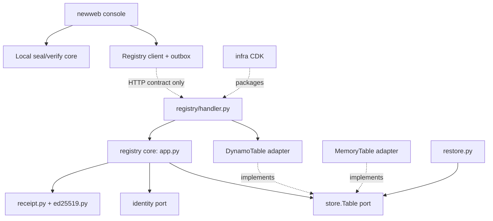
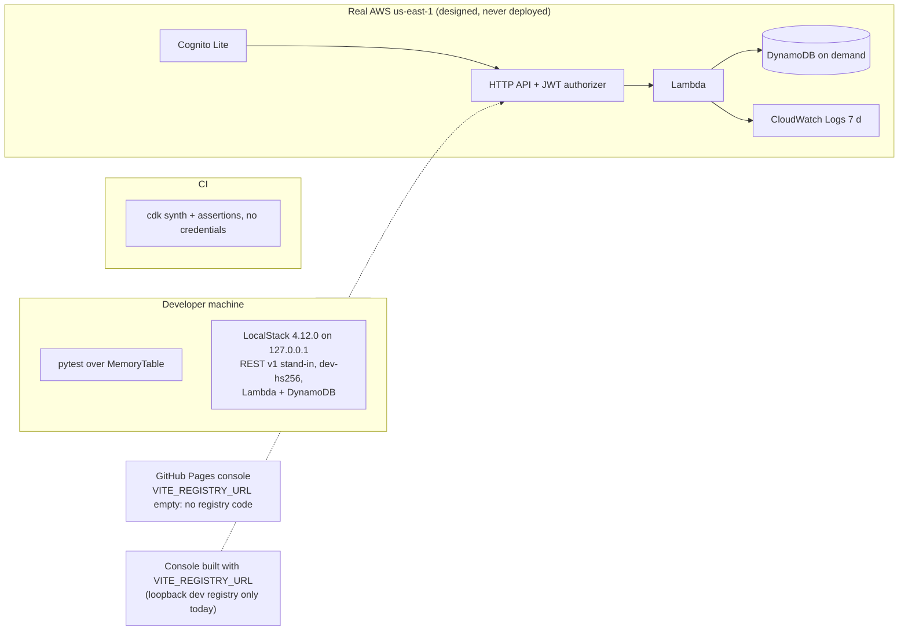
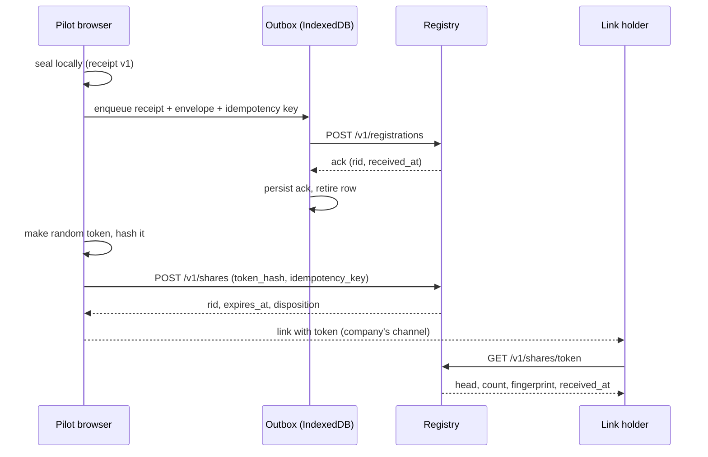
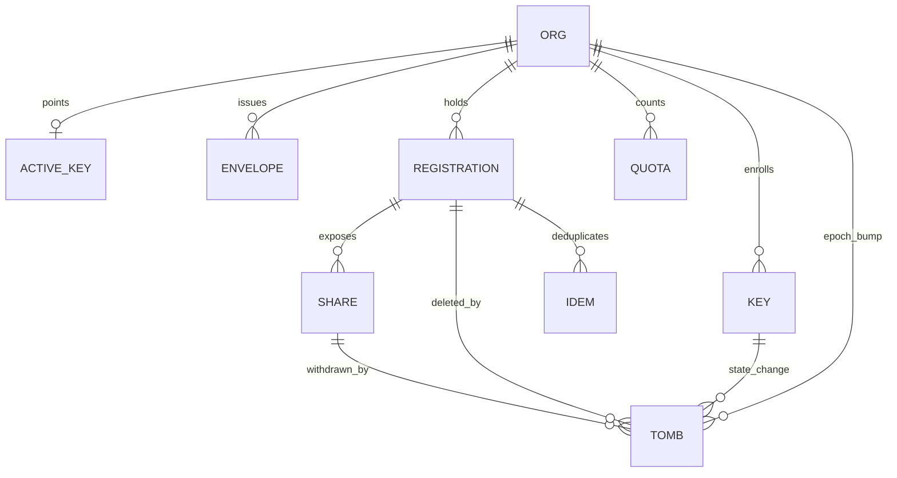

# Architecture Spine — HashWing on AWS

## Design Paradigm

**Ports and adapters.** Sealing and verifying are a browser/CLI core that never needs a server. The receipt registry is a separate, optional service whose core talks to the outside only through two ports.

| Layer | Lives in | May depend on |
| --- | --- | --- |
| Local core (seal, verify, manifest) | `src/`, `wasm/`, `docs/*.js`, `newweb/` | nothing on the network |
| Registry client (outbox, fetch wrapper) | `newweb/src/` | registry HTTP contract only |
| Registry core | `registry/registry/app.py`, `receipt.py`, `ed25519.py` | `store.Table` port, `identity.identify` port |
| Table port + adapters | `registry/registry/store.py` (`MemoryTable`, `DynamoTable`) | boto3 (DynamoTable only) |
| Identity port + adapters | `registry/registry/identity.py` (`cognito`, `dev-hs256`) | verified claims or dev secret |
| Composition root | `registry/handler.py` | core + DynamoTable |
| Recovery tool | `registry/registry/restore.py` | `store.Table` port |
| Infrastructure | `infra/` (CDK) | `registry/` as an asset |

## Invariants & Rules

### AD-1 — Originals stay local; the registry is optional [ADOPTED]

- **Binds:** R2, R11, all browser and server units
- **Prevents:** a unit adding file upload, a cloud locker, or a sealing/verifying step that fails without the registry
- **Rule:** No registry route accepts file bytes, manifests or logs. Sealing, verifying and manifest checks work with the registry absent. The separate self-hosted workspace upload mode (`SERVER_WORKSPACES.md`) is a different mode and is labelled as such, never folded into the registry. `tools/persistence.py` is not part of the registry and is never deployed on AWS.

### AD-2 — Receipt-only storage, opaque ids only [ADOPTED]

- **Binds:** R3, `registry/`, `newweb/src/registry-client.mjs`, the outbox
- **Prevents:** a unit storing or sending names, manifests, salts, per-file digests, GPS, notes, the receipt line, public keys or share tokens
- **Rule:** The registry receives receipt v1 plus allowlisted opaque ids and ack metadata. The Data table in `docs/aws/ARCHITECTURE_AWS.md` is the canonical list of stored items and fields: key fingerprint, head, count, `received_at`, state, timestamps, the caller's opaque `sub` on challenge, envelope and key items (`enrolled_by`), idempotency, quota, epoch and active-key records, `sha256(token)` for shares, and tombstones. Every route rejects unknown body fields with 400. A field not in that table needs an AD amendment and a matching doc change in the same PR. How long `sub` stays in never-expiring key tombstones is an open retention-policy item.

### AD-3 — Org identity comes from the verified token, through one adapter [ADOPTED]

- **Binds:** R4, R10, `registry/registry/identity.py`, `infra/`
- **Prevents:** a route reading `org_id` from the body, two competing account authorities, or the dev adapter reaching AWS
- **Rule:** `identify()` is the only path from a request to `Identity(sub, org_id, role)`. `IDENTITY_ADAPTER=cognito` reads claims already verified by the API Gateway JWT authorizer. Clients send the Cognito **ID token** only (the Lite plan's custom attributes are in it); an access token passes the authorizer but has no `custom:org_id`, so it fails closed. `dev-hs256` is local/LocalStack only; the CDK stack never sets it or any `DEV_` variable (synth test). Unset or unknown adapter: every request 401 with one body. A body `org_id` is 400.

### AD-4 — Key enrollment, rotation and compromise [ADOPTED]

- **Binds:** R4, key routes, restore
- **Prevents:** an attacker enrolling a key, two active keys after a race, a compromised key that keeps registering
- **Rule:** Enrollment needs an admin and a single-use 5-minute challenge bound to the admin's `sub`, signed by the new key. At most one active key per org, held by a conditional `ACTIVE_KEY` pointer; replacing it needs `confirm_replace`. Compromise is `POST /v1/keys/<fp>/compromised` and blocks new registrations; earlier registrations keep their `received_at`. Weak (small-order or non-canonical) keys are refused before any signature check (DECISIONS 23).

### AD-5 — Registration is one idempotent transaction [ADOPTED]

- **Binds:** R7, `app.py` register path, outbox
- **Prevents:** duplicate registrations after a lost ack, a second share from a replay, a quota charged twice, a partial write on 429
- **Rule:** The registration id is derived from org, fingerprint, head and count. One `TransactWriteItems` puts REG, puts IDEM and increments the month's quota, all or nothing. Same idempotency key and payload returns the original ack and `received_at`; same key, different payload 409. The same receipt under a new idempotency key returns the original ack (or 410 if deleted) when its envelope has expired, or when its envelope is valid and its signing key is still active; with a valid envelope after a rotation or compromise it answers 403. The server's payload hash covers exactly the receipt and `envelope_id`, so the client key is base64url(SHA-256(owner, receipt, `envelope_id`)): it is kept for every retry under one bound envelope and changes only when `retryNow(id)` binds a new envelope after `envelope_expired`, `sub_mismatch` or `epoch_mismatch`. A stored key is never sent with a different `envelope_id`. A retry never creates a share.

### AD-6 — Withdrawal and deletion are state plus tombstone, checked on read [ADOPTED]

- **Binds:** R6, R8, share and delete routes, restore
- **Prevents:** relying on DynamoDB TTL for privacy deadlines, a revoked link that still resolves, distinguishable 404s
- **Rule:** Withdraw sets the share `withdrawn` and writes a TOMB item in the same transaction. Admin delete marks the registration `deleted`, removes `received_at`, withdraws its shares and tombstones each, keeping the registration as a tombstone. Every read checks `expires_at` itself; TTL is cleanup only. Unknown, expired, withdrawn, deleted and malformed share links return the identical 404. Targets, not statutory deadlines: withdrawal takes effect on the next read; eligible deletion within 24 hours of an approved request. A recipient's exported evidence cannot be erased remotely; privacy-law applicability is unreviewed.

### AD-7 — Every revocation is tombstoned; restore fails closed until tombstones are re-applied [ADOPTED]

- **Binds:** R6, `restore.py`, `infra/` restore context, RUNBOOK_AWS.md, any new revoking route
- **Prevents:** an old backup republishing withdrawn shares, deleted registrations, a rotated or compromised key, or an old epoch
- **Rule:** Every write that revokes or advances security state (share withdrawal, registration deletion, key enroll, rotate or compromise, epoch bump) writes a TOMB item in the same transaction, and every TOMB kind gets a handler in `registry.restore` in the same change (restore copies unknown kinds without applying them). A restored table is served only with `RESTORED_FROM` and a new `RESTORE_ID`; every route answers 503 `restore_pending` until `registry.restore` copies and re-applies all TOMB items from the served table and writes a `SYSTEM/RESTORE` marker naming this target and restore id. Unreadable source tombstones: no marker, stay closed.

### AD-8 — Fail closed on store errors; strongly consistent reads [ADOPTED]

- **Binds:** all registry reads
- **Prevents:** serving a share or ack from a partial or stale read
- **Rule:** Any store error reading share, registration, key, idempotency, envelope or restore-marker state is 503. All reads are strongly consistent.

### AD-9 — Public check by link, minimal disclosure [ADOPTED]

- **Binds:** R8, `GET /v1/shares/<token>`, console share view
- **Prevents:** checks behind login, a share view leaking metadata, guessable links
- **Rule:** `GET /v1/shares/<token>` is the only unauthenticated route. It returns only head, count, key fingerprint and `received_at`, and only for an active, unexpired share on an active registration. The client generates the 256-bit token (`crypto.getRandomValues`, 43 base64url chars) and sends only its SHA-256 with an idempotency key on `POST /v1/shares` (`registry/registry/app.py` `create_share`, `newweb/src/registry-client.mjs`), so creation never shows the server the token and only its hash is stored. Opening (`GET`) and withdrawing (`DELETE /v1/shares/<token>`) carry the raw token in the request path, so no access log may record the path (docs/aws/ARCHITECTURE_AWS.md). The same (idempotency key, registration id, token hash) returns the same share and its current disposition, a different payload under that key is 409 `idempotency_conflict`, and a replay never reopens a withdrawn or expired share. Share records have no TTL and withdrawal keeps the record (deletion and restore write a permanent withdrawn record too), so a used token hash is never free again. The public route has its own stage throttle, rate 2 and burst 5 (`PUBLIC_THROTTLE` in `infra/lib/stack.ts`, asserted in `infra/test/stack.test.ts`); signed-in routes keep the stage default. Extra disclosure is per field, opt-in by the sharer, and needs an AD amendment before any field is added.

### AD-10 — Time and retention are separate mechanisms [ADOPTED]

- **Binds:** R5, all UI copy and docs about time
- **Prevents:** calling a DynamoDB write immutable or a trusted timestamp, or calling Object Lock a time service
- **Rule:** No doc, label or demo calls a DynamoDB write immutable, append-only, tamper-proof or a trusted timestamp. `received_at` comes only from the Lambda clock, never from the client, and is labelled the registry's own clock. "Existed before T" from a third party needs an RFC 3161 token over the exact commitment digest, validated before display. Retention/WORM, if ever needed, is S3 Object Lock, never for personal payloads while retention policy is unresolved. Landing, local-seal, `received_at` and RFC 3161 times are separate fields. Device or operator times, and intervals computed from them, are shown as reported, never verified, and never clamped to zero.

### AD-11 — Envelope and quota bounds [ADOPTED]

- **Binds:** R7, R9, envelope and register routes, outbox
- **Prevents:** unbounded offline replay, a departed pilot registering, runaway writes
- **Rule:** A registration needs a server-issued envelope (sub, org epoch, default 7-day expiry). `POST /v1/epoch` (admin) invalidates outstanding envelopes and `GET /v1/epoch` (any member) reads the current one, so a client can drop stale cached envelopes before sending. An unusable envelope is 422 with a split code: `envelope_expired` (expired or unknown), `sub_mismatch` or `epoch_mismatch` (`_envelope_error` in `app.py`). It blocks new registrations but not the retry of a committed one, which still gets its ack. Monthly quota per org (`REG_QUOTA_PER_MONTH`, default 2000) returns 429 with nothing written. Request bodies over 4096 bytes are 413.

### AD-12 — AWS envelope: us-east-1, pay-per-use only, $5 is a target [ADOPTED]

- **Binds:** R9, `infra/`, COST.md
- **Prevents:** a fixed-fee service (WAF, NAT, custom domain, KMS key, provisioned capacity) slipping in, or a doc calling the budget a cap
- **Rule:** One stack in us-east-1: HTTP API (`$default` stage rate 2, burst 5; public share route its own rate 2, burst 5), Lambda python3.12 arm64 128 MB 5 s, one on-demand DynamoDB table, Cognito Lite, 7-day log retention, optional Budget alert. IAM: item actions on the table ARN only. CORS has two layers with one rule (exact origins only, never `*` for signed-in routes, no credentials, headers `authorization`, `content-type`, `idempotency-key`): on the deployed HTTP API, `corsPreflight` in `infra/lib/stack.ts` (`corsOrigins`, default `https://anirudh763.github.io`, validated at synth) is authoritative, because API Gateway answers preflight and overrides integration CORS headers; the Lambda's `CORS_ORIGINS` allowlist in `app.py` is authoritative only where no API Gateway CORS is configured (the dev server and the LocalStack REST stand-in), and the stack does not set it. The Lambda gives the public share view `access-control-allow-origin: *`; on the HTTP API that route is limited to the allowlist. A change to allowed origins or headers updates both layers in the same PR. Adding any service with a monthly fee needs an AD. $5/month is a workload target; budgets and stage throttles notify or slow, they never cap spend. CI holds no AWS credentials and only synthesises; only the owner deploys, after itemized cost approval. Until real customer data, pilot data is disposable (PITR off by default, table `RemovalPolicy.DESTROY`, as the code has it). Proposed, pending owner confirmation: before real data, PITR on, the table RETAIN, and the backup window declared in RUNBOOK_AWS.md with tombstones kept at least that long.

### AD-13 — Claims match the coverage matrix [ADOPTED]

- **Binds:** R1, every doc, PR and demo
- **Prevents:** presenting LocalStack or synth results as real-AWS behaviour, or the REST stand-in as the HTTP API
- **Rule:** Every behaviour claim cites a column of `docs/aws/COVERAGE.md`: Local, LocalStack 4.12.0 community (REST API v1 `{proxy+}` stand-in, dev-hs256), Real AWS, Designed only. Real AWS stays "not verified" until an owner-approved deployment runs. LocalStack is the pinned 4.12.0 community image, a tag from before LocalStack moved to one auth-token image (2026-03); it gets no further fixes. It binds to 127.0.0.1 with dummy credentials; tokens are never printed. A Hobby token is personal and non-commercial and is not assumed valid for the pilot or CI. No other emulator (including the `aws-emulator` product) is substituted and reported as LocalStack, unit or direct-Lambda tests never fill an end-to-end row, and a mock registry is never shown as an integration. LocalStack proves wiring, never IAM, Cognito, TLS or throttling. Every network claim names the mode tested: registry, manifest-only, or self-hosted workspace upload.

### AD-14 — An ack is a registry assertion, not a verdict [ADOPTED]

- **Binds:** R4, R5, R8, every ack, share view, console label, doc and demo
- **Prevents:** a unit presenting registration as proof of company identity, file contents or flight truth
- **Rule:** An ack or share view says only that a receipt with this head and count, signed by a key enrolled to this org, arrived at `received_at` by the registry's clock. It never claims the registry inspected files, verified the company's real-world identity, or that the log was truthful before sealing. A recipient trusts a fingerprint only after pinning it from an independently known company channel, never from the same message as the receipt. Rotated or compromised key state is shown with its history, not as a verdict on older proofs.

### AD-15 — Client and outbox contract [ADOPTED]

- **Binds:** R7, R10, `newweb/src/outbox.mjs`, `newweb/src/registry-client.mjs`, console registry UI
- **Prevents:** queued work counted as witnessed, cross-owner dispatch, private data in browser storage, client and server disagreeing on what a response means
- **Rule:** An outbox row holds only the envelope id, expiry and epoch, receipt v1, one owner/payload-bound idempotency key and retry state; never original media, manifests, salts or signing keys, and none of these go to telemetry. Enqueue and ack-persist are each one transaction. Logout or owner change stops dispatch and drops late results; the token's owner must match the outbox owner before every send. Attempts and storage are bounded, with exponential backoff and jitter. Queued work reads "Not yet registered" until an ack is persisted; after storage eviction the UI never implies the lost queue can still export. Response handling, as merged in `outbox.mjs`: 429 `quota_exceeded` moves the row to `needs_attention` (reason `quota_exceeded`) and is never retried automatically, only by an explicit `retryNow(id)`; any other 429 (API Gateway throttling), network errors, timeouts, 408 and 5xx back off with exponential delay and jitter until `attempts_exhausted`; the three envelope codes move to `needs_attention` and need a new envelope via `retryNow(id)`; 403 `key_not_enrolled` and `key_not_active` move to `needs_attention` and are retried only by an explicit `retryNow(id)` with the same binding; the remaining 4xx (410 `registration_deleted`, 409, 400, 413, 422 `bad_signature`) are terminal `needs_attention`. A 200 ack with `disposition: "deleted"` reads "Registered, later deleted". The epoch is read once per open before dispatch. `busy()` reports whether a dispatch pass is running, and callers use it instead of guessing from row states. Share creation reuses one client token, hash and idempotency key per attempt (AD-9). The "Registry acceptance" line on Verify and in every report comes only from this device's saved outbox row whose receipt line matches a checked one (`registryTimeField` in `newweb/src/registry-ui.jsx`), never from a live registry lookup: "Registered at" plus the saved `received_at`, with basis "the registry's clock; the registry's statement, not proof of the files", "Registered, later deleted", "Needs attention" or "Not yet registered" from a row or this tab's unsent in-memory list, otherwise "Not signed in", "Not available yet" or "No registry record on this device". A build without a registry keeps "Not registered" / "no registry was used".

### AD-16 — Registry UI ships only with a baked-in URL; test sign-in only on loopback [ADOPTED]

- **Binds:** R2, R10, `newweb/vite.config.js`, `newweb/src/main.jsx`, `newweb/src/registry-ui.jsx`, the Pages build
- **Prevents:** registry code, requests or an outbox database in a build without a registry, a runtime switch turning the registry on, or a paste-a-token form pointed at a real registry
- **Rule:** Every registry render and call in `main.jsx` sits behind the build-time constant `__REGISTRY_URL__`, set from `VITE_REGISTRY_URL` (a public URL, origin plus optional path, not a secret: https, or http only on a loopback host; no credentials, query or fragment; checked in `vite.config.js`). Empty, as on GitHub Pages, means no registry code ships (`newweb/tests/registry-wiring.mjs` scans `docs/console`). "Test sign-in (local only)", which takes a pasted token kept in tab memory and `sessionStorage` only, appears only when that URL's host is `localhost`, `127.0.0.1` or `[::1]`; any other registry says sign-in is not available in this build. Real sign-in (Cognito, AD-3) needs its own change.

### AD-17 — Sign-out and logout reach every tab without a token [ADOPTED]

- **Binds:** R7, R10, `newweb/src/registry-ui.jsx`, every `main.jsx` path that calls `registryLogout()` (through `clearSensitiveWorkspace()`)
- **Prevents:** a duplicated tab still sending as a signed-out user, a token crossing tabs, or the unsent proofs of a user who logged out sent or shown under the next app user
- **Rule:** Registry sign-out and app logout are broadcast on `BroadcastChannel('hashwing-registry')`. Binding: a message never carries a token, and a registry sign-out stops every open tab of that owner (`<org>/`) from sending. Saved outbox rows are closed, not deleted, and stay bound to their owner (AD-15). Receivers are idempotent.
- **Current behaviour, open (not binding):** today the messages are `{type: 'signout', owner}` and `{type: 'logout'}`. On `logout` every open tab discards the unsent proofs held in memory and the display names. `logout` is sent by every path through `clearSensitiveWorkspace()`: app logout, logout from another tab, app sign-in or account switch, and starting the demo while a session is open. It reaches tabs of other local profiles, and a frozen, discarded or `BroadcastChannel`-less tab misses it and signs back in with its saved `sessionStorage` token (docs/OUTBOX.md, Limits). The memory wipe is a known lost-work case, and which paths send `logout`, whether it should reach other profiles' tabs, and whether in-memory proofs should be tagged with the registry owner they were sealed under are all open (Deferred), to be settled by the lost-work fixes.

## Consistency Conventions

| Concern | Convention |
| --- | --- |
| Routes | `/v1/...` only; `registry/registry/app.py` ROUTES and `infra/lib/stack.ts` ROUTES/PUBLIC_ROUTE list the same method+path set and the same single public route (a CI diff test is deferred) |
| Ids | fingerprints and heads 64 lowercase hex; registration id 32 hex; share token URL-safe, stored as sha256 |
| Times | ISO 8601 UTC in responses; `expires_at` checked in code on every read |
| Errors | Lambda errors are exactly `{"error": "<code>"}` with codes from `app.py`; all Lambda 401 bodies identical; one 404 for every non-viewable share; API Gateway's own 401 and 429 bodies differ and are classified by status |
| Request order | CORS preflight (Lambda layer, before identity) → restore 503 → size 413 → route 404 → identity 401/403 → schema 400 → idempotency replay → receipt 400 → signature 422 → envelope 422 `envelope_expired` / `sub_mismatch` / `epoch_mismatch` (or committed ack) → key state 403 → transaction; nothing reveals whether a registration exists before the signature check |
| Config | environment variables only (`IDENTITY_ADAPTER`, `TABLE_NAME`, `REG_QUOTA_PER_MONTH`, `DEDUPE_SECONDS`, `ENVELOPE_SECONDS`, `RESTORED_FROM`, `RESTORE_ID`, `CORS_ORIGINS` for the Lambda layer only); `DEV_*` never in the stack |
| Crypto | stdlib-only Ed25519 in the Lambda; no native wheels |
| Client labels | "Not registered" only when the build has no registry (flag off, basis "no registry was used"); "Not yet registered" while a proof waits, until an ack is persisted; Sealed locally / Waiting for connection / Registering / Registered / Needs attention; registry key states are `active`, `rotated`, `compromised` in the API and data; "replaced" is the UI display label for `rotated` (the recipient pin store in `newweb/src/trusted-keys.mjs` uses `replaced` as its own status); the other Verify-line values are listed in AD-15 |

## Stack

Versions from `infra/package.json`, `.github/workflows/ci.yml` and `docs/aws/COVERAGE.md`; npm pins checked current on 2026-11-17.

| Name | Version |
| --- | --- |
| Python (Lambda runtime and CI tests) | 3.12 |
| Node.js | 22 (infra and most CI jobs); 24 (console CI job) |
| boto3 in Lambda | runtime-included, unpinned |
| aws-cdk-lib | 2.277.0 |
| constructs | 10.8.1 |
| aws-cdk (CLI) | 2.1148.1 |
| aws-cdk-local | 3.1.0 |
| TypeScript | 7.0.2 |
| LocalStack community image | 4.12.0, frozen (digest pinned in COVERAGE.md) |

## Structural Seed

### Deployment and environments

### Registration and check flow

### Core entities

## Capability → Architecture Map

| Capability / Area | Lives in | Governed by |
| --- | --- | --- |
| R1 IaC + LocalStack + coverage | `infra/`, `registry/localstack/`, `docs/aws/COVERAGE.md` | AD-13 |
| R2 originals local, registry optional | local core, `newweb/` | AD-1, AD-16, paradigm |
| R3 receipt-only storage | `registry/registry/app.py`, `store.py` | AD-2 |
| R4 key enrollment, org from token | `identity.py`, key routes | AD-3, AD-4, AD-14 |
| R5 time vs retention | docs, console labels | AD-10, AD-14 |
| R6 withdrawal, deletion, restore | `app.py`, `restore.py`, RUNBOOK_AWS.md | AD-6, AD-7, AD-8 |
| R7 idempotent retries | `app.py`, outbox | AD-5, AD-11, AD-15, AD-17 |
| R8 public check by link | `GET /v1/shares/<token>`, `create_share`, public route throttle | AD-9, AD-12 |
| R9 region and cost envelope | `infra/lib/stack.ts`, COST.md | AD-12, AD-11 |
| R10 identity adapter | `identity.py`, `infra/`, console sign-in | AD-3, AD-16, AD-17 |
| R11 static hosting | GitHub Pages; Amplify artifacts prepared | AD-1 |

## Deferred

| Item | Why it can wait | Revisit when |
| --- | --- | --- |
| Real-AWS deployment and validation (IAM, Cognito, JWT authorizer, throttling, TLS, billing, `cdk destroy`) | Needs owner-approved credentials and spend | Owner authorizes a sandbox deploy |
| CORS on the deployed HTTP API (synthesised and asserted only; the Lambda layer is browser-tested against the dev server) | HTTP API is not in LocalStack community | With the real-AWS sandbox |
| Cognito end-to-end run | Not available in LocalStack community; designed and synthesised only | Owner-approved real-AWS sandbox (LocalStack proves wiring, not Cognito) |
| `token_use == "id"` check in the Cognito adapter | Access tokens fail closed today only because they lack `custom:org_id` | Before a real-AWS deploy, or if access tokens gain custom claims |
| RFC 3161 timestamping | Not built; AD-10 fixes how it must be added | A user needs third-party "existed before T" |
| S3 Object Lock retention | Not built; retention policy unresolved | Retention policy is decided |
| Lambda and API persistence across LocalStack restart | Community 4.12.0 drops them; DynamoDB data survives | Owner supplies an auth token for the current `localstack/localstack` image (and `deploy_cdklocal.sh` is re-pinned), or a redeploy script |
| One answer for a deleted registration: today an original-key replay within `DEDUPE_SECONDS` is 200 `disposition: "deleted"` (with `received_at`) and any other path is 410 | AD-15 fixes how the client shows each; no data is exposed beyond the original ack | Next change to the register path |
| CI test that diffs the `app.py` and `stack.ts` route lists | Today only the authorizer split is asserted, not set equality with `app.py` | Next change to either route list |
| Data-loss fixes | Named by the owner. One found in review: a backup restore replays only revoking tombstones, so registrations and shares created after the backup are lost while the client shows Registered. Proposed: journal creations as never-expiring TOMB items and re-create them before revocations | Owner lists the defects; fix before PITR or real data |
| Static hosting on Amplify | Artifacts prepared; Pages is enough while the registry is local | Owner wants custom headers enforced |
| Per-user rate limits, WAF, custom domain, managed keys (KMS) | Fixed-fee or out of scope under AD-12 | Abuse or a customer requirement appears |
| Multi-region and disaster recovery (PITR is off by default; Cognito Lite user pools have no point-in-time restore, so org assignments cannot be restored) | Single-company pilot with disposable data (AD-12) | Before real customer data |
| Python 3.12 Lambda runtime end of support (2028-10-31) | Years away | Next runtime bump, or before 2028-10 |
| Node.js 22 end of life (2027-04-30) | Infra and most CI jobs; the console job already runs Node 24 | Before 2027-04 |
| Owner of an unsent in-memory proof: today it has none, so a registry sign-out keeps it and the next registry sign-in in that tab, under any owner, enqueues it | Pilot is one company; app logout already discards these | Before more than one registry user shares a browser, or real sign-in lands |
| Scope of the every-tab `logout`: it also fires on app sign-in, account switch and demo start, and reaches tabs of other local profiles; a receiving tab re-announces it | Lost work is limited to unsent in-memory proofs (docs/OUTBOX.md, Limits) | Next change to the logout paths |
| A Verify line that is only one tab's view: another tab's new ack, or acks pruned past 1000, are not reflected; the report of a manifest check that did not verify is built without the registry line and can read "Not registered" in a flag-on build | Display only; nothing is sent or stored wrongly | Next change to `registryTimeField` or the reports |
| Test for the non-loopback branch of AD-16 ("Registry sign-in isn't available in this build yet") | `registry-wiring.mjs` builds only flag-off and loopback flag-on | Next change to the registry panel, or before any non-loopback build |
