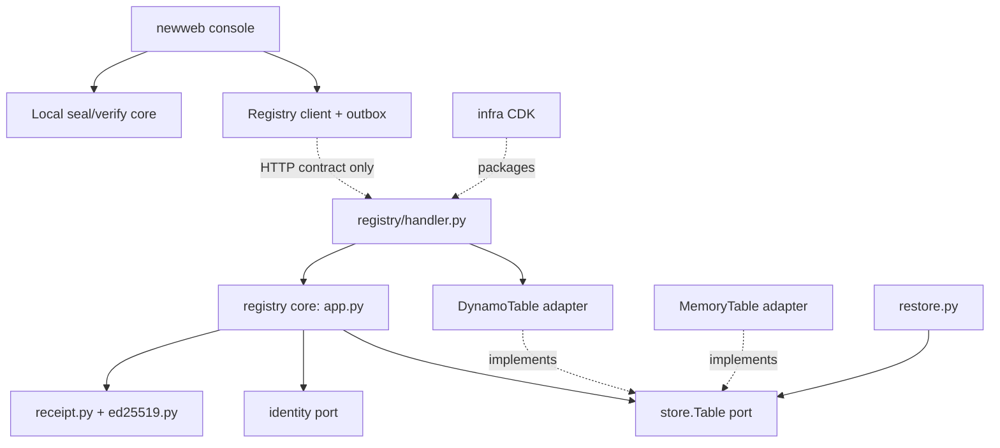
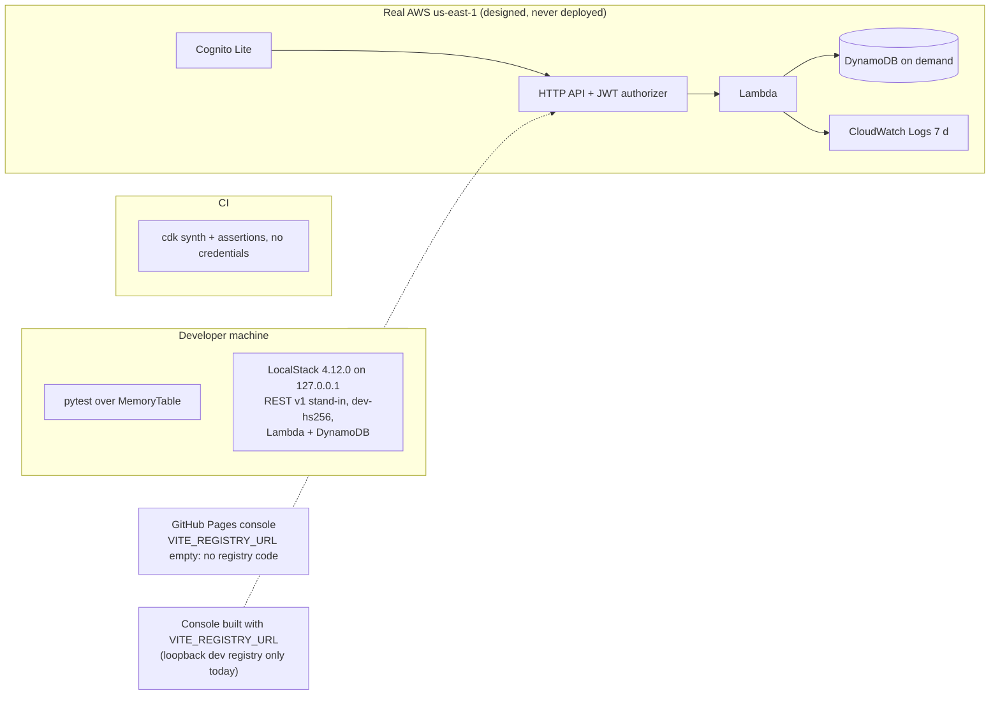
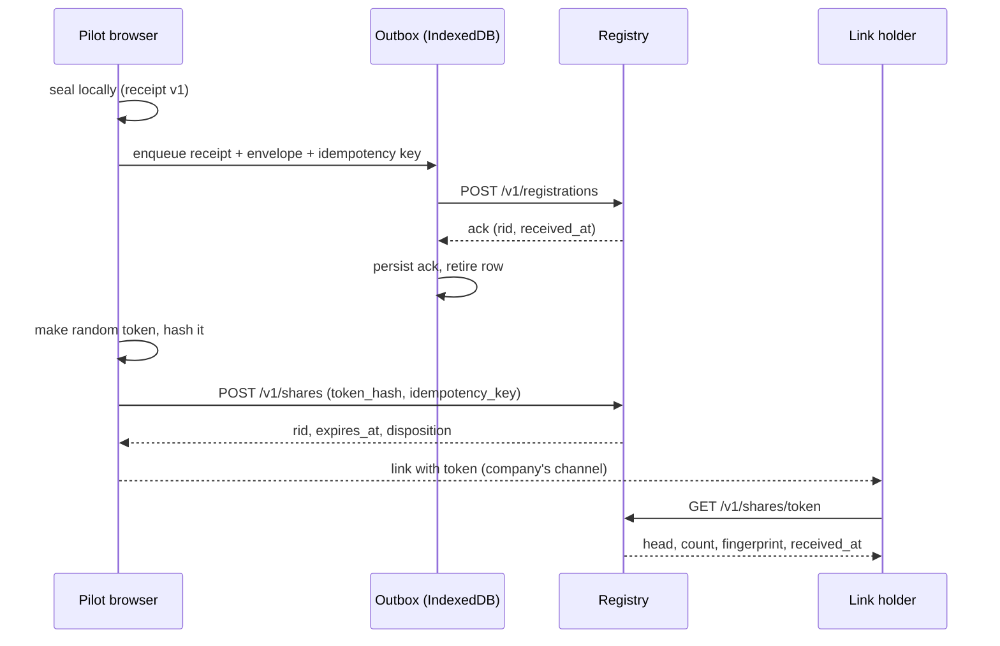
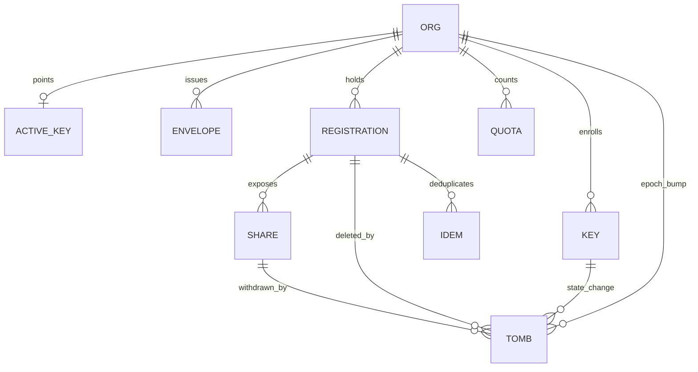

# Architecture Spine — HashWing on AWS

## Design Paradigm

**Ports and adapters.** Sealing and verifying are a browser/CLI core that never needs a server. The receipt registry is a separate, optional service whose core talks to the outside only through two ports.

| Layer | Lives in | May depend on |
| --- | --- | --- |
| Local core (seal, verify, manifest) | `src/`, `wasm/`, `docs/*.js`, `newweb/` | nothing on the network |
| Registry client (outbox, fetch wrapper) | `newweb/src/` | registry HTTP contract only |
| Registry core | `registry/registry/app.py`, `receipt.py`, `ed25519.py` | `store.Table` port, `identity.identify` port |
| Table port + adapters | `registry/registry/store.py` (`MemoryTable`, `DynamoTable`) | boto3 (DynamoTable only) |
| Identity port + adapters | `registry/registry/identity.py` (`cognito`, `dev-hs256`) | verified claims or dev secret |
| Composition root | `registry/handler.py` | core + DynamoTable |
| Recovery tool | `registry/registry/restore.py` | `store.Table` port |
| Infrastructure | `infra/` (CDK) | `registry/` as an asset |

## Invariants & Rules

### AD-1 — Originals stay local; the registry is optional [ADOPTED]

- **Binds:** R2, R11, all browser and server units
- **Prevents:** a unit adding file upload, a cloud locker, or a sealing/verifying step that fails without the registry
- **Rule:** No registry route accepts file bytes, manifests or logs. Sealing, verifying and manifest checks work with the registry absent. The separate self-hosted workspace upload mode (`SERVER_WORKSPACES.md`) is a different mode and is labelled as such, never folded into the registry. `tools/persistence.py` is not part of the registry and is never deployed on AWS.

### AD-2 — Receipt-only storage, opaque ids only [ADOPTED]

- **Binds:** R3, `registry/`, `newweb/src/registry-client.mjs`, the outbox
- **Prevents:** a unit storing or sending names, manifests, salts, per-file digests, GPS, notes, the receipt line, public keys or share tokens
- **Rule:** The registry receives receipt v1 plus allowlisted opaque ids and ack metadata. The Data table in `docs/aws/ARCHITECTURE_AWS.md` is the canonical list of stored items and fields: key fingerprint, head, count, `received_at`, state, timestamps, the caller's opaque `sub` on challenge, envelope and key items (`enrolled_by`), idempotency, quota, epoch and active-key records, `sha256(token)` for shares, and tombstones. Every route rejects unknown body fields with 400. A field not in that table needs an AD amendment and a matching doc change in the same PR. AD-23 adds, when built, `kind`, `company_fp` and `not_after` on KEY items and key tombstones, and `kind` on CHAL items; never a public key. **Actor IDs (owner decision 2026-11-17; decided, not built):** the only long-lived operational actor ID is `enrolled_by`, held on KEY items and copied into key tombstones (`_key_tomb` in `app.py`; `registry.restore` writes the placeholders `restore` or `unknown` when it has none). Share, registration and epoch tombstones carry no user ID. `enrolled_by` is kept 90 days counted from `enrolled_at` (a key tombstone's `at` moves on every state change, and a rotation tombstone may lack `enrolled_at`, so the anchor is the KEY item's `enrolled_at` or the earliest one known), then replaced by a fixed placeholder in KEY items, key tombstones, the security journal (AD-20) and any record a restore brings back; the restore runs the scrub before it writes its marker. The security state itself (key state, fingerprint, times, tombstone kind and target) is kept for good, because restore and anti-reuse need it. CHAL (`sub`, 5 minutes) and ENV (`sub`, 7 days) are checked on read and also scrubbed if TTL has not removed them by day 90. The scrub is its own small Lambda function on an EventBridge schedule, with `dynamodb:Scan` and item updates on the two tables; the request Lambda keeps item-level actions only. It is idempotent, safe to rerun, and reports its count. Backups (PITR, 35 days in production) can still hold IDs up to that window after the scrub; Cognito keeps users until an admin deletes them; logs expire in 7 days and individual log events are not rewritten. An opaque `sub` is pseudonymous, not anonymous. This is product policy, not a compliance certification. Today the code keeps `enrolled_by` with no expiry.

### AD-3 — Org identity comes from the verified token, through one adapter [ADOPTED]

- **Binds:** R4, R10, `registry/registry/identity.py`, `infra/`
- **Prevents:** a route reading `org_id` from the body, two competing account authorities, or the dev adapter reaching AWS
- **Rule:** `identify()` is the only path from a request to `Identity(sub, org_id, role)`. `IDENTITY_ADAPTER=cognito` reads claims already verified by the API Gateway JWT authorizer. Clients send the Cognito **ID token** only (the Lite plan's custom attributes are in it); an access token passes the authorizer but has no `custom:org_id`, so it fails closed. `dev-hs256` is local/LocalStack only; the CDK stack never sets it or any `DEV_` variable (synth test). Unset or unknown adapter: every request 401 with one body. A body `org_id` is 400.

### AD-4 — Key enrollment, rotation and compromise [ADOPTED]

- **Binds:** R4, key routes, restore
- **Prevents:** an attacker enrolling a key, two active keys after a race, a compromised key that keeps registering
- **Rule:** Enrollment needs an admin and a single-use 5-minute challenge bound to the admin's `sub`, signed by the new key. At most one active company key per org, held by a conditional `ACTIVE_KEY` pointer (pilot keys, AD-23, are never in it); replacing it needs `confirm_replace`. Compromise is `POST /v1/keys/<fp>/compromised` and blocks new registrations; earlier registrations keep their `received_at`. Weak (small-order or non-canonical) keys are refused before any signature check (DECISIONS 23). **Pilot signing (owner decision 2026-11-18; decided):** Option A for the supervised pilot. One designated company computer holds the company key (backup under the signer's control); it is never copied to pilots' devices. Pilots elsewhere seal with a one-time key, which reads "signer not confirmed" and is refused by the registry (`key_not_enrolled`). Only that computer's key is enrolled. `ACTIVE_KEY` and this route hold company keys only. Option B (AD-23) is built before independent company signing from several pilots is offered, and stays off until the owner switches it on. Membership comes first: an operator script creates users only for an org on an allow-list, with role `pilot` by default and an explicit `TemporaryPasswordValidityDays`; it is built before the key controls (onboarding packet).

### AD-5 — Registration is one idempotent transaction [ADOPTED]

- **Binds:** R7, `app.py` register path, outbox
- **Prevents:** duplicate registrations after a lost ack, a second share from a replay, a quota charged twice, a partial write on 429
- **Rule:** The registration id is derived from org, fingerprint, head and count. One `TransactWriteItems` puts REG, puts IDEM and increments the month's quota, all or nothing. Same idempotency key and payload returns the original ack and `received_at`; same key, different payload 409. The same receipt under a new idempotency key returns the original ack (or 410 if deleted) when its envelope has expired, or when its envelope is valid and its signing key is still active; with a valid envelope after a rotation or compromise it answers 403. The server's payload hash covers exactly the receipt and `envelope_id`, so the client key is base64url(SHA-256(owner, receipt, `envelope_id`)): it is kept for every retry under one bound envelope and changes only when `retryNow(id)` binds a new envelope after `envelope_expired`, `sub_mismatch` or `epoch_mismatch`. A stored key is never sent with a different `envelope_id`. A retry never creates a share.

### AD-6 — Withdrawal and deletion are state plus tombstone, checked on read [ADOPTED]

- **Binds:** R6, R8, share and delete routes, restore
- **Prevents:** relying on DynamoDB TTL for privacy deadlines, a revoked link that still resolves, distinguishable 404s
- **Rule:** Withdraw sets the share `withdrawn` and writes a TOMB item in the same transaction. Admin delete marks the registration `deleted`, removes `received_at`, withdraws its shares and tombstones each, keeping the registration as a tombstone. Every read checks `expires_at` itself; TTL is cleanup only. Unknown, expired, withdrawn, deleted and malformed share links return the identical 404. Targets, not statutory deadlines: withdrawal takes effect on the next read; eligible deletion within 24 hours of an approved request. A recipient's exported evidence cannot be erased remotely; privacy-law applicability is unreviewed.

### AD-7 — Every revocation is tombstoned; restore fails closed until tombstones are re-applied [ADOPTED]

- **Binds:** R6, `restore.py`, `infra/` restore context, RUNBOOK_AWS.md, any new revoking route
- **Prevents:** an old backup republishing withdrawn shares, deleted registrations, a rotated or compromised key, or an old epoch
- **Rule:** Every write that revokes or advances security state (share withdrawal, registration deletion, key enroll, rotate or compromise, epoch bump) writes a TOMB item in the same transaction, and every TOMB kind or key state (including AD-24's `retired` and pilot `kind`) gets a handler in `registry.restore` in the same change (restore copies unknown kinds without applying them). A restored table is served only with `RESTORED_FROM` and a new `RESTORE_ID`; every route answers 503 `restore_pending` until `registry.restore` copies and re-applies all TOMB items from the served table and writes a `SYSTEM/RESTORE` marker naming this target and restore id. Unreadable source tombstones: no marker, stay closed.

### AD-8 — Fail closed on store errors; strongly consistent reads [ADOPTED]

- **Binds:** all registry reads
- **Prevents:** serving a share or ack from a partial or stale read
- **Rule:** Any store error reading share, registration, key, idempotency, envelope or restore-marker state is 503. All reads are strongly consistent.

### AD-9 — Public check by link, minimal disclosure [ADOPTED]

- **Binds:** R8, `GET /v1/shares/<token>`, console share view
- **Prevents:** checks behind login, a share view leaking metadata, guessable links
- **Rule:** `GET /v1/shares/<token>` is the only unauthenticated route. It returns only head, count, key fingerprint and `received_at`, and only for an active, unexpired share on an active registration. The client generates the 256-bit token (`crypto.getRandomValues`, 43 base64url chars) and sends only its SHA-256 with an idempotency key on `POST /v1/shares` (`registry/registry/app.py` `create_share`, `newweb/src/registry-client.mjs`), so creation never shows the server the token and only its hash is stored. Opening (`GET`) and withdrawing (`DELETE /v1/shares/<token>`) carry the raw token in the request path, so no access log may record the path (docs/aws/ARCHITECTURE_AWS.md). The same (idempotency key, registration id, token hash) returns the same share and its current disposition, a different payload under that key is 409 `idempotency_conflict`, and a replay never reopens a withdrawn or expired share. Share records have no TTL and withdrawal keeps the record (deletion and restore write a permanent withdrawn record too), so a used token hash is never free again. The public route has its own stage throttle, rate 2 and burst 5 (`PUBLIC_THROTTLE` in `infra/lib/stack.ts`, asserted in `infra/test/stack.test.ts`); signed-in routes keep the stage default. Extra disclosure is per field, opt-in by the sharer, and needs an AD amendment before any field is added. **Share length (owner decision 2026-11-17; decided; built 2026-11-18 in #55):** `expires_days` is at most 30, enforced by the server (400 above 30); the console offers 30 (default) and 7. Existing longer links are grandfathered: a share keeps the `expires_at` it was created with and reads still check it, so nothing is silently shortened. No registry is deployed, so no production link exists; only local and LocalStack test data could hold a longer link, and it is disposable. **Share management (PROPOSED in docs/aws/ARCHITECTURE_AWS.md):** creation, withdrawal and deletion also write an org-partition index item `ORG#<org> / SHARE#<created_at>#<hash>`, where `created_at` is zero-padded epoch seconds (12 digits) so the sort key orders by time, and a stub without `created_at` uses its `withdrawn_at`; the index item holds only the key, the rid and a copy of the state, while the `SHARE#<hash>` item stays the source of truth that every read checks. An org-wide list is one bounded query. With the index item and the security journal (AD-20), share creation is a five-item transaction (SHARE, SIDEM, the REG update, the index item, the journal creation record) and registration a four-item one (REG, IDEM, QUOTA, the journal creation record). Withdraw by `share_id` (the stored hash) requires, as transaction conditions, that `ORG#<caller org> / REG#<rid>` exists, that the hash is in its `share_hashes` or index items, and that `SHARE.org` and `SHARE.rid` match; anything else is the identical 404. Lists tolerate stubs written by deletion or restore (no `created_at`, `expires_at`, `count`, `head` or `key_fingerprint`). The raw token is never stored or redisplayed. `MAX_SHARES` (10) counts every share a registration has ever had, including withdrawn ones; this is kept as is. **Known gap after a restore (found in the PR #38 review):** if a share and its idempotency record were both created after the backup, the same client retry (same token and idempotency key) returns 201 active with a fresh 30 days, past the original expiry and so past the 30-day cap from the original creation, and a link whose share had expired works again. The fix is in AD-20: the journal brings back the original `created_at` and `expires_at`.

### AD-10 — Time and retention are separate mechanisms [ADOPTED]

- **Binds:** R5, all UI copy and docs about time
- **Prevents:** calling a DynamoDB write immutable or a trusted timestamp, or calling Object Lock a time service
- **Rule:** No doc, label or demo calls a DynamoDB write immutable, append-only, tamper-proof or a trusted timestamp. `received_at` comes only from the Lambda clock, never from the client, and is labelled the registry's own clock. "Existed before T" from a third party needs an RFC 3161 token over the exact commitment digest, validated before display. Retention/WORM, if ever needed, is S3 Object Lock, never for personal payloads while retention policy is unresolved. Landing, local-seal, `received_at` and RFC 3161 times are separate fields. Device or operator times, and intervals computed from them, are shown as reported, never verified, and never clamped to zero.

### AD-11 — Envelope and quota bounds [ADOPTED]

- **Binds:** R7, R9, envelope and register routes, outbox
- **Prevents:** unbounded offline replay, a departed pilot registering, runaway writes
- **Rule:** A registration needs a server-issued envelope (sub, org epoch, default 7-day expiry). `POST /v1/epoch` (admin) invalidates outstanding envelopes and `GET /v1/epoch` (any member) reads the current one, so a client can drop stale cached envelopes before sending. An unusable envelope is 422 with a split code: `envelope_expired` (expired or unknown), `sub_mismatch` or `epoch_mismatch` (`_envelope_error` in `app.py`). It blocks new registrations but not the retry of a committed one, which still gets its ack. Monthly quota per org (`REG_QUOTA_PER_MONTH`, default 2000) returns 429 with nothing written. Request bodies over 4096 bytes are 413.

### AD-12 — AWS envelope: us-east-1, pay-per-use only, $5 is a target [ADOPTED]

- **Binds:** R9, `infra/`, COST.md
- **Prevents:** a fixed-fee service (WAF, NAT, custom domain, KMS key, provisioned capacity) slipping in, or a doc calling the budget a cap
- **Rule:** One stack in us-east-1: HTTP API (`$default` stage rate 2, burst 5; public share route its own rate 2, burst 5), Lambda python3.12 arm64 128 MB 5 s, one on-demand DynamoDB table, Cognito Lite, 7-day log retention, optional Budget alert. IAM: item actions on the table ARN only. CORS has two layers with one rule (exact origins only, never `*` for signed-in routes, no credentials, headers `authorization`, `content-type`, `idempotency-key`): on the deployed HTTP API, `corsPreflight` in `infra/lib/stack.ts` (`corsOrigins`, default `https://anirudh763.github.io`, validated at synth) is authoritative, because API Gateway answers preflight and overrides integration CORS headers; the Lambda's `CORS_ORIGINS` allowlist in `app.py` is authoritative only where no API Gateway CORS is configured (the dev server and the LocalStack REST stand-in), and the stack does not set it. The Lambda gives the public share view `access-control-allow-origin: *`; on the HTTP API that route is limited to the allowlist. A change to allowed origins or headers updates both layers in the same PR. Adding any service with a monthly fee needs an AD. $5/month is a workload target; budgets and stage throttles notify or slow, they never cap spend. CI holds no AWS credentials and only synthesises; only the owner deploys, after itemized cost approval. **Environments (owner decision 2026-11-17; decided, not built; flips the disposable stance for production only):** an explicit environment switch at synth selects local or production. Local and pilot-test stacks stay disposable (PITR off, `RemovalPolicy.DESTROY`, as the code has it today). Production, required before any real customer data, enables DynamoDB PITR with a 35-day recovery window, table deletion protection, and `RemovalPolicy.RETAIN` on the table and the user pool (with user-pool deletion protection). Tombstones are kept at least as long as the window (they never expire). These protections apply to the served table, including a table brought in by a restore (today attached with `Table.fromTableName`, which carries no PITR, TTL, alarms or deletion protection), and to the security journal (AD-20), which also gets deletion protection and `RemovalPolicy.RETAIN` in production. `registry.restore` itself checks the restored table with `DescribeTable` (deletion protection), `DescribeContinuousBackups` (PITR on, 35 days) and `DescribeTimeToLive` (TTL on `ttl`), and checks the journal's PITR, and it refuses to write the marker if any check fails, so the gate stays closed. **Restore settings are configuration, not deploy flags:** today `restoredTableName`, `restoredFrom` and `restoreId` are CDK context, so a routine redeploy without the `-c` flags silently serves the original table again with no gate. Rule: they live in committed config (or SSM), and synth fails if a stack that has been restored is deployed without them (synth guard requested from the infra builder). Configuring production is not authorization to deploy it; only the owner deploys, after itemized cost approval. Today `infra/lib/stack.ts` has `pitr ?? false` and `RemovalPolicy.DESTROY` on the table and user pool, with no environment switch.

### AD-13 — Claims match the coverage matrix [ADOPTED]

- **Binds:** R1, every doc, PR and demo
- **Prevents:** presenting LocalStack or synth results as real-AWS behaviour, or the REST stand-in as the HTTP API
- **Rule:** Every behaviour claim cites a column of `docs/aws/COVERAGE.md`: Local, LocalStack 4.12.0 community (REST API v1 `{proxy+}` stand-in, dev-hs256), Real AWS, Designed only. Real AWS stays "not verified" until an owner-approved deployment runs. LocalStack is the pinned 4.12.0 community image, a tag from before LocalStack moved to one auth-token image (2026-03); it gets no further fixes. It binds to 127.0.0.1 with dummy credentials; tokens are never printed. A Hobby token is personal and non-commercial and is not assumed valid for the pilot or CI. No other emulator (including the `aws-emulator` product) is substituted and reported as LocalStack, unit or direct-Lambda tests never fill an end-to-end row, and a mock registry is never shown as an integration. LocalStack proves wiring, never IAM, Cognito, TLS or throttling. Every network claim names the mode tested: registry, manifest-only, or self-hosted workspace upload.

### AD-14 — An ack is a registry assertion, not a verdict [ADOPTED]

- **Binds:** R4, R5, R8, every ack, share view, console label, doc and demo
- **Prevents:** a unit presenting registration as proof of company identity, file contents or flight truth
- **Rule:** An ack or share view says only that a receipt with this head and count, signed by a key enrolled to this org, arrived at `received_at` by the registry's clock. It never claims the registry inspected files, verified the company's real-world identity, or that the log was truthful before sealing. A recipient trusts a fingerprint only after pinning it from an independently known company channel, never from the same message as the receipt. Under Option B a pilot fingerprint is trusted only through a company-key authorization checked against such a pin (AD-23). Rotated or compromised key state is shown with its history, not as a verdict on older proofs.

### AD-15 — Client and outbox contract [ADOPTED]

- **Binds:** R7, R10, `newweb/src/outbox.mjs`, `newweb/src/registry-client.mjs`, console registry UI
- **Prevents:** queued work counted as witnessed, cross-owner dispatch, private data in browser storage, client and server disagreeing on what a response means
- **Rule:** An outbox row holds only the envelope id, expiry and epoch, receipt v1, one owner/payload-bound idempotency key and retry state; never original media, manifests, salts or signing keys, and none of these go to telemetry. Enqueue and ack-persist are each one transaction. Logout or owner change stops dispatch and drops late results; the token's owner must match the outbox owner before every send. Attempts and storage are bounded, with exponential backoff and jitter. Queued work reads "Not yet registered" until an ack is persisted; after storage eviction the UI never implies the lost queue can still export. Response handling, as merged in `outbox.mjs`: 429 `quota_exceeded` moves the row to `needs_attention` (reason `quota_exceeded`) and is never retried automatically, only by an explicit `retryNow(id)`; any other 429 (API Gateway throttling), network errors, timeouts, 408 and 5xx back off with exponential delay and jitter until `attempts_exhausted`; the three envelope codes move to `needs_attention` and need a new envelope via `retryNow(id)`; 403 `key_not_enrolled` and `key_not_active` move to `needs_attention` and are retried only by an explicit `retryNow(id)` with the same binding; the remaining 4xx (410 `registration_deleted`, 409, 400, 413, 422 `bad_signature`) are terminal `needs_attention`. A 200 ack with `disposition: "deleted"` reads "Registered, later deleted". The epoch is read once per open before dispatch. `busy()` reports whether a dispatch pass is running, and callers use it instead of guessing from row states. Share creation reuses one client token, hash and idempotency key per attempt (AD-9). The "Registry acceptance" line on Verify and in every report comes only from this device's saved outbox row whose receipt line matches a checked one (`registryTimeField` in `newweb/src/registry-ui.jsx`), never from a live registry lookup: "Registered at" plus the saved `received_at`, with basis "the registry's clock; the registry's statement, not proof of the files", "Registered, later deleted", "Needs attention" or "Not yet registered" from a row or this tab's unsent in-memory list, otherwise "Not signed in", "Not available yet" or "No registry record on this device". A build without a registry keeps "Not registered" / "no registry was used". **Saved vs refreshed (owner decision 2026-11-17; decided, not built):** a saved ack is shown as "Last confirmed by this device" with the time it was observed and a Refresh action; "Registered at" plus `received_at` is shown only after a successful signed-in lookup in this session (`GET /v1/registrations/<rid>`, PROPOSED), and again falls back to the saved wording when the recovery version changes (AD-19).

### AD-16 — Registry UI ships only with a baked-in URL; test sign-in only on loopback [ADOPTED]

- **Binds:** R2, R10, `newweb/vite.config.js`, `newweb/src/main.jsx`, `newweb/src/registry-ui.jsx`, the Pages build
- **Prevents:** registry code, requests or an outbox database in a build without a registry, a runtime switch turning the registry on, or a paste-a-token form pointed at a real registry
- **Rule:** Every registry render and call in `main.jsx` sits behind the build-time constant `__REGISTRY_URL__`, set from `VITE_REGISTRY_URL` (a public URL, origin plus optional path, not a secret: https, or http only on a loopback host; no credentials, query or fragment; checked in `vite.config.js`). Empty, as on GitHub Pages, means no registry code ships (`newweb/tests/registry-wiring.mjs` scans `docs/console`). "Test sign-in (local only)", which takes a pasted token kept in tab memory and `sessionStorage` only, appears only when that URL's host is `localhost`, `127.0.0.1` or `[::1]`; any other registry says sign-in is not available in this build. Real sign-in (Cognito, AD-3) needs its own change. **Pages stays registry-free (owner decision 2026-11-17):** the public GitHub Pages build keeps `VITE_REGISTRY_URL` empty until the registry has a dedicated origin and production sign-in. A subpath of the same `github.io` origin is not origin isolation. Local history that never calls a registry (the "Sealed on this device" list, Jobs) may ship in that build; the bundle scan is split accordingly.

### AD-17 — Sign-out reaches that owner's tabs without a token; pending proofs are kept and bound to a deliberate owner [ADOPTED]

- **Binds:** R7, R10, `newweb/src/registry-ui.jsx`, `newweb/src/pending-store.mjs`, every `main.jsx` path that calls `registryLogout()` (through `clearSensitiveWorkspace()`)
- **Prevents:** a duplicated, frozen or restored tab still sending as a signed-out user, a token crossing tabs, a proof sent under an owner who did not choose it, one tab's sign-in or logout wiping another profile's tabs, and unsaved work or saved pending proofs thrown away without asking
- **Rule:** A registry sign-out is broadcast on `BroadcastChannel('hashwing-registry')` as `{type: 'signout', owner, at}` and recorded in `localStorage` `hashwing-registry-signouts` (hashed owner and time, bounded). Binding: no message or marker carries a token, and a registry sign-out stops every tab of that owner (`<org>/`) from sending, including a tab that wakes from frozen or restores a saved token from before it; a message older than a tab's current sign-in is ignored. There is no every-tab registry logout message: an app logout reaches only that local profile's tabs through the app's own logout message (`announceLocalLogout`), and each signs out of the registry itself. App sign-in, account switch and demo start sign out of the registry in that tab only. Pending proofs (not yet in an owner's outbox) are saved per local scope in IndexedDB (receipt, owner, time; at most 200; no names, media, keys or tokens) and are never deleted by sign-out or logout. Each carries the registry owner it was sealed under or none: an owned proof is sent only under that owner; an unassigned one is never sent by itself and goes to a company only by an explicit "Assign to <org>", after which the registry re-checks key enrollment and membership. Before unsaved results or memory-only proofs are discarded the app asks (reload warns; logout, switch, sign-in and demo start wait for one download; a logout this tab did not choose keeps them in tab memory for one download). Saved outbox rows are closed, not deleted, and stay bound to their owner (AD-15). Receivers are idempotent.

### AD-18 — A budget response pauses traffic; it never destroys data [ADOPTED]

- **Binds:** R9, R56, `infra/lib/stack.ts`, RUNBOOK_AWS.md, the outbox
- **Prevents:** answering a cost alert by deleting the table or user pool, or by a stage deletion that CloudFormation cannot restore
- **Rule:** Decided 2026-11-17, not built. Binding outcome: the response to a budget alert is a reversible pause of external registry traffic. The table, the security journal, tombstones, user pool and identities are untouched, and reopening is the reverse of the same step. While paused, signed-in routes answer 503 `paused`, which the outbox treats as waiting: it does not count toward `attempts_exhausted`, and after reopening a "Retry all" action sends every waiting proof. Nothing is lost or reported registered. Mechanism, PROPOSED and unverified: a Lambda setting answers 503 `paused` before any store access, and, to cut spend further, both the stage and public-route throttles can also be set to zero, in which case API Gateway's own 429 replaces the 503 and "Retry all" still covers it. How HTTP API answers, and whether throttled requests are billed, is not verified (AD-13). `cdk destroy` is a deliberate teardown, never a budget response.

### AD-19 — Clients revalidate saved acks against a recovery version [ADOPTED]

- **Binds:** R6, R48, `registry/registry/app.py`, `restore.py`, `newweb/src/registry-client.mjs`, `newweb/src/registry-ui.jsx`
- **Prevents:** a client showing "Registered" for a proof a restored table no longer holds, or reopening depending on every offline client coming back
- **Rule:** Decided 2026-11-17, not built. The recovery version is the opaque `RESTORE_ID` the function is deployed with (empty before any restore). `registry.restore` generates it itself (a UUID with a timestamp) and refuses one it has used before, so two restores never share a version. It lives in deployment configuration, outside the table, so restoring an older backup cannot bring back an older value. Every ack and `GET /v1/recovery` (PROPOSED, any member) return it. A client saves it with each ack and compares only "differs from what I saved", never order. When it differs, saved acks read "Last confirmed by this device" until a lookup confirms the record. A record missing after a restore offers re-registration and never reopens a deleted registration or withdrawn share (tombstones win, AD-7). The server reopens on its own marker, not on clients returning. Backups alone do not give zero data loss.

### AD-20 — Security journal outside the served table [ADOPTED]

- **Binds:** R6, R49, `registry/registry/app.py`, `restore.py`, `infra/lib/stack.ts`, AD-2, AD-7, AD-12
- **Prevents:** a restore that cannot open because the served table is gone, a restore from a backup's own tombstones reviving keys compromised, shares withdrawn, registrations deleted or epochs bumped after the backup, and a lost share or registration coming back with a fresh expiry or a new `received_at`
- **Rule:** Decided 2026-11-17, not built (recovery packet). A second small on-demand DynamoDB table, the security journal, holds a copy of every TOMB item and a creation record for every registration and share (org, id, `received_at` or `created_at` and `expires_at`, fingerprint, head and count; never tokens). Each journal item is written in the same `TransactWriteItems` as the write it records (transactions span tables in one account and region), so a committed write and its journal item cannot diverge. In production the journal has PITR (35 days), deletion protection and `RemovalPolicy.RETAIN` (AD-12).
  - **Union of both sources.** `registry.restore` always reads both the served table's tombstones (when readable) and the journal, and applies their union, merged by the most-revoked rule below; the journal only adds targets the served table lacks.
  - **Merge rule: most revoked state per target, independent of order.** Key `active` < `rotated` < `retired` < `compromised` (AD-24); registration `active` < `deleted`; share `active` < `withdrawn`; epoch: the highest. The replay applies the most revoked state seen for each target, so repeated or chained restores in any order give the same result. `at` is kept for display only and never decides state.
  - **Original times.** Creations come back with their original `created_at`, `expires_at` and `received_at`, so a retried share keeps its original expiry and a re-sent registration its original `received_at`.
  - **Scrub.** The journal is in AD-2's stored data and in the 90-day `enrolled_by` scrub.
  - **Residual window.** No loss for a committed write while either the served table or the journal is readable. If both are lost and restored from backups, revocations made after the later of the two restore points are lost. Procedure for that case: `registry.restore` raises every org's epoch (invalidating outstanding envelopes) and the gate stays closed until an admin of each org re-confirms the active key and re-marks any compromised ones.
  - **Today.** Restore refuses any source other than the served table (`apply_tombstones`), so a lost served table keeps the gate closed for good.

### AD-21 — Company keys on Trust: enrolled from the device that holds the key [ADOPTED]

- **Binds:** R24, R33, R71, AC-38 to AC-40, AC-59, `newweb/src/registry-ui.jsx`, `newweb/src/registry-client.mjs`, `main.jsx` Trust, key routes in `app.py`
- **Prevents:** a private key sent to the registry or another device, a lost-response retry read as failure, the compromise date moving on a repeated call, a `sub` leaking to the client, and member and admin screens disagreeing with the server
- **Rule:** Owner decisions 2026-11-18 (Option A, private keys stay on their device); mechanism PROPOSED in `design-key-enrollment-option-b.md`, not built. Trust has four sections in this order: Trusted companies, Your signing key, Company registry, Your company's keys (the last two flag-on only). Enrollment signs in the browser with the key loaded under Your signing key (WebCrypto import, non-extractable) and sends only public key, nonce and signature. The client never signs bytes the server chose: it builds the challenge bytes itself from the fixed prefix, the org in its own ID token and a nonce of exactly 32 lowercase hex, and signs nothing if the server's `message` differs; the same holds for every challenge a client signs. A 409 `key_exists` after a lost response is success only when `GET /v1/keys` (following `next_cursor`) returns that fingerprint as `active_key`; a 400 `bad_challenge` gets one fresh challenge on the user's next press, never an automatic loop. `POST /v1/keys/<fp>/compromised` on an already compromised key returns 200 with the stored `changed_at` and writes nothing. `GET /v1/keys` returns `enrolled_by_me` (bool), `active_key` and `next_cursor`, never `enrolled_by`. Actions show to admins only and are disabled offline with "You're offline. Key changes need a connection."; the server enforces roles regardless. Key states display as in Consistency Conventions; "rotated" never appears in UI or reports.

### AD-22 — The share record on Verify can only lower a result [ADOPTED]

- **Binds:** AC-37, R75, `newweb/src/recipient-trust.mjs`, Verify and its reports
- **Prevents:** registry state raising a verdict to Verified, and the share-link line being confused with the saved-ack line
- **Rule:** Owner decision 2026-11-18: `verdict()` takes no registry input and registration alone never gives Verified. When Verify is opened from a share link, a separate pure step after `verdict()` compares head, count and key fingerprint with `GET /v1/shares/<token>`: all equal adds "Matches the registry's record" and leaves the headline; any difference adds a warn line and turns a `verified` result into a warn one; a missing, withdrawn or unreadable link adds an info line only; no other result changes. Every report builder that calls `verdict()` takes the record and applies the same step, so report and screen headlines are equal. A test asserts it never raises any verdict key. It is a separate line from AD-15's "Registry acceptance". No screen or report infers that a signature predates a compromise from any time; a compromised key reads "Marked compromised on <date>" whatever the seal time.

### AD-23 — Option B: pilot keys authorized by the company key, off by default

- **Binds:** R71, `app.py` key and register paths, `infra/lib/stack.ts` ROUTES, `recipient-trust.mjs`, `trusted-keys.mjs`, receipt messages
- **Prevents:** an admin role, registry state or a crafted server challenge minting a signer, an authorization copied onto another key, a pilot key going through `POST /v1/keys` and rotating the company key, a pilot proof reading Verified without the recipient's company pin, an expiry compared with a seal time, and Option B leaking into the Option A default
- **Rule:** [ASSUMPTION] mechanism, PROPOSED in `design-key-enrollment-option-b.md`, not built; the owner decided only that Option B is built before multi-pilot signing and is off until switched on. The authority is a company-key signature over `hashwing-pilot-authorization v1` lines (pilot key, company key, `not_after` at most 30 days ahead), made on the company computer after the signer confirms the pilot's full fingerprint out of band. It travels as one extra line in the receipt message; receipt v1 is unchanged. Pilot keys are made on the pilot's device and enrolled by the pilot through `/v1/pilot-keys` with a `kind: pilot` challenge; they never enter `ACTIVE_KEY`. Encoding is canonical and a receipt message carries at most one authorization line. The registry accepts the authorization only when its `pilot_key` is the enrolling key and it is signed by the org's `ACTIVE_KEY`. A `kind: pilot` KEY item gets 403 `key_not_active` on register unless the org is switched on, its state is `active`, `not_after` is after the registry's clock and its parent company key is `active`, checked as conditions inside the registration transaction; the company-kind path is unchanged. Pilot enrollment and the 50-key cap (`PILOT_COUNT`) are one conditional transaction. Verify accepts a pilot key only when the authorization's `pilot_key` equals the receipt's signing key, its `company_key` equals a pinned, active, uncompromised company key whose pin the recipient marked "uses pilot keys" (off by default), its signature checks under that pin, `not_after` is after the verifier's clock and at most 30 days past it, and the pilot fingerprint is not on the recipient's fingerprint-only compromised list; never the seal time. One function, `trustForProof` in `trusted-keys.mjs`, owns this result and returns `trusted` with `via: 'pilot'`; `verdict()` is unchanged and a pilot proof never shows the plain company trust line. Two switches, both off: server `PILOT_KEYS_ORGS` (operator allow-list; routes answer 403 `pilot_keys_off`; the company-key register path behaves exactly as today) and build constant `PILOT_AUTHORIZATION_ACCEPTED` in `recipient-trust.mjs` (off: an authorization line is ignored, including on Pages). Off with the server switch means pilot keys answer `key_not_active` and pilot routes `pilot_keys_off`. Recipients never see registry key state, so a stolen or retired pilot key reads Verified until `not_after` (at most 30 days, default 14) or until the recipient marks its fingerprint compromised. Distinct signing prefixes for receipt, company challenge, pilot challenge and authorization.

### AD-24 — Key kinds and states survive restore

- **Binds:** R6, `app.py`, `restore.py`, the security journal (AD-20), AD-7
- **Prevents:** a restore rotating every pilot key, a retired or compromised fingerprint coming back, and two units ordering key states differently
- **Rule:** [ASSUMPTION] PROPOSED with AD-23, not built. KEY items carry `kind` (`company` when missing on items written before AD-23) and pilot keys `company_fp` and `not_after`. After AD-23 every key tombstone write carries `kind` (and the pilot fields); an item or tombstone with `company_fp` or `not_after` is a pilot key whatever `kind` says. Restore writes these fields back onto KEY items and refuses the marker if a tombstone and its KEY item disagree on kind. States are `active` < `rotated` < `retired` < `compromised`; `retired` is for pilot keys only and displays "Removed on <date>". `registry.restore` recomputes `ACTIVE_KEY` from company keys only (today it demotes every other active key to `rotated`). A fingerprint once seen in an org, in any state, is never enrolled again (409 `key_exists`).

## Consistency Conventions

| Concern | Convention |
| --- | --- |
| Routes | `/v1/...` only; `registry/registry/app.py` ROUTES and `infra/lib/stack.ts` ROUTES/PUBLIC_ROUTE list the same method+path set and the same single public route (a CI diff test is deferred) |
| Ids | fingerprints and heads 64 lowercase hex; registration id 32 hex; share token URL-safe, stored as sha256 |
| Times | ISO 8601 UTC in responses; `expires_at` checked in code on every read |
| Errors | Lambda errors are exactly `{"error": "<code>"}` with codes from `app.py`; all Lambda 401 bodies identical; one 404 for every non-viewable share; API Gateway's own 401 and 429 bodies differ and are classified by status |
| Request order | CORS preflight (Lambda layer, before identity) → restore 503 → size 413 → route 404 → identity 401/403 → schema 400 → idempotency replay → receipt 400 → signature 422 → envelope 422 `envelope_expired` / `sub_mismatch` / `epoch_mismatch` (or committed ack) → key state 403 (for a pilot key also the switch, `not_after` and parent state, AD-23) → transaction; pilot enrollment: identity → `pilot_keys_off` 403 → schema 400 → challenge and authorization signatures 422 → `key_exists` 409 → transaction; nothing reveals whether a registration exists before the signature check |
| Config | environment variables only (`IDENTITY_ADAPTER`, `TABLE_NAME`, `REG_QUOTA_PER_MONTH`, `DEDUPE_SECONDS`, `ENVELOPE_SECONDS`, `RESTORED_FROM`, `RESTORE_ID`, `CORS_ORIGINS` for the Lambda layer only, `PILOT_KEYS_ORGS` when AD-23 is built); `DEV_*` never in the stack |
| Crypto | stdlib-only Ed25519 in the Lambda; no native wheels |
| Client labels | "Not registered" only when the build has no registry (flag off, basis "no registry was used"); "Not yet registered" while a proof waits, until an ack is persisted; Sealed locally / Waiting for connection / Registering / Registered / Needs attention; registry key states are `active`, `rotated`, `retired` (pilot keys, AD-24), `compromised` in the API and data, displayed "Active", "Replaced on <date>", "Removed on <date>", "Marked compromised on <date>"; "replaced" is the UI display label for `rotated` (the recipient pin store in `newweb/src/trusted-keys.mjs` uses `replaced` as its own status); the other Verify-line values are listed in AD-15 |

## Stack

Versions from `infra/package.json`, `.github/workflows/ci.yml` and `docs/aws/COVERAGE.md`; npm pins checked current on 2026-11-17.

| Name | Version |
| --- | --- |
| Python (Lambda runtime and CI tests) | 3.12 |
| Node.js | 22 (infra and most CI jobs); 24 (console CI job) |
| boto3 in Lambda | runtime-included, unpinned |
| aws-cdk-lib | 2.277.0 |
| constructs | 10.8.1 |
| aws-cdk (CLI) | 2.1148.1 |
| aws-cdk-local | 3.1.0 |
| TypeScript | 7.0.2 |
| LocalStack community image | 4.12.0, frozen (digest pinned in COVERAGE.md) |

## Structural Seed

### Deployment and environments

### Registration and check flow

### Core entities

## Capability → Architecture Map

| Capability / Area | Lives in | Governed by |
| --- | --- | --- |
| R1 IaC + LocalStack + coverage | `infra/`, `registry/localstack/`, `docs/aws/COVERAGE.md` | AD-13 |
| R2 originals local, registry optional | local core, `newweb/` | AD-1, AD-16, paradigm |
| R3 receipt-only storage | `registry/registry/app.py`, `store.py` | AD-2 |
| R4 key enrollment, org from token | `identity.py`, key routes | AD-3, AD-4, AD-14 |
| R5 time vs retention | docs, console labels | AD-10, AD-14 |
| R6 withdrawal, deletion, restore | `app.py`, `restore.py`, RUNBOOK_AWS.md | AD-6, AD-7, AD-8, AD-19, AD-20 |
| R7 idempotent retries | `app.py`, outbox | AD-5, AD-11, AD-15, AD-17 |
| R8 public check by link | `GET /v1/shares/<token>`, `create_share`, public route throttle | AD-9, AD-12 |
| R9 region and cost envelope | `infra/lib/stack.ts`, COST.md | AD-12, AD-11, AD-18 |
| R25 registry off on Pages | `newweb/vite.config.js`, Pages build | AD-16 |
| R39 saved vs refreshed ack | `registry-ui.jsx`, `registry-client.mjs` | AD-15, AD-19 |
| R48 recovery version | `app.py`, `restore.py`, client | AD-19 |
| R49 restore without the served table, original times kept | security journal table, `restore.py` | AD-20 |
| R36 share list and withdraw by id | `app.py`, `registry-client.mjs` | AD-9 |
| R71 pilot signing and onboarding | operator script, Cognito, key routes | AD-3, AD-4, AD-23 |
| R24, R33 Trust sections and company-key controls | `main.jsx` Trust, `registry-ui.jsx`, key routes | AD-4, AD-21 |
| R34, R35, R75, AC-37 pins and Verify | `trusted-keys.mjs`, `recipient-trust.mjs` | AD-14, AD-22 |
| Option B pilot keys | `app.py`, `restore.py`, `recipient-trust.mjs` | AD-23, AD-24 |
| R73 restored-table checks | `restore.py`, RUNBOOK_AWS.md | AD-12 |
| R51 production backups and retention | `infra/lib/stack.ts` | AD-12 |
| R52 90-day actor IDs | `app.py` scrub job, `restore.py` | AD-2 |
| R54 share length | `app.py` `create_share`, `registry-ui.jsx` | AD-9 |
| R56 reversible traffic pause | `infra/lib/stack.ts`, RUNBOOK_AWS.md | AD-18 |
| R10 identity adapter | `identity.py`, `infra/`, console sign-in | AD-3, AD-16, AD-17 |
| R11 static hosting | GitHub Pages; Amplify artifacts prepared | AD-1 |

## Deferred

| Item | Why it can wait | Revisit when |
| --- | --- | --- |
| Real-AWS deployment and validation (IAM, Cognito, JWT authorizer, throttling, TLS, billing, `cdk destroy`) | Needs owner-approved credentials and spend | Owner authorizes a sandbox deploy |
| CORS on the deployed HTTP API (synthesised and asserted only; the Lambda layer is browser-tested against the dev server) | HTTP API is not in LocalStack community | With the real-AWS sandbox |
| Cognito end-to-end run | Not available in LocalStack community; designed and synthesised only | Owner-approved real-AWS sandbox (LocalStack proves wiring, not Cognito) |
| `token_use == "id"` check in the Cognito adapter | Access tokens fail closed today only because they lack `custom:org_id` | Before a real-AWS deploy, or if access tokens gain custom claims |
| RFC 3161 timestamping | Not built; AD-10 fixes how it must be added | A user needs third-party "existed before T" |
| S3 Object Lock retention | Not built; retention policy unresolved | Retention policy is decided |
| Lambda and API persistence across LocalStack restart | Community 4.12.0 drops them; DynamoDB data survives | Owner supplies an auth token for the current `localstack/localstack` image (and `deploy_cdklocal.sh` is re-pinned), or a redeploy script |
| One answer for a deleted registration: today an original-key replay within `DEDUPE_SECONDS` is 200 `disposition: "deleted"` (with `received_at`) and any other path is 410 | AD-15 fixes how the client shows each; no data is exposed beyond the original ack | Next change to the register path |
| CI test that diffs the `app.py` and `stack.ts` route lists | Today only the authorizer split is asserted, not set equality with `app.py` | Next change to either route list |
| Data-loss fixes | A restore drops registrations and shares created after the backup, and a lost share retried with its original token comes back with a fresh 30 days (PR #38 review); a resurrected deleted registration is fixed in PR #38 (pending merge). Decided in AD-19 (client) and AD-20 (security journal with original times); not built | Recovery packet, before PITR in production or real data |
| Static hosting on Amplify | Artifacts prepared; Pages is enough while the registry is local | Owner wants custom headers enforced |
| Per-user rate limits, WAF, custom domain, managed keys (KMS) | Fixed-fee or out of scope under AD-12 | Abuse or a customer requirement appears |
| Multi-region and disaster recovery (production PITR is decided in AD-12; Cognito Lite user pools have no point-in-time restore, so org assignments need their own documented recovery; the RPO 15 min / RTO 4 h targets are untested) | Single-company pilot; real-AWS drill is externally blocked (ledger R55) | Before real customer data |
| Python 3.12 Lambda runtime end of support (2028-10-31) | Years away | Next runtime bump, or before 2028-10 |
| Node.js 22 end of life (2027-04-30) | Infra and most CI jobs; the console job already runs Node 24 | Before 2027-04 |
| A Verify line that is only one tab's view: another tab's new ack, or acks pruned past 1000, are not reflected; the report of a manifest check that did not verify is built without the registry line and can read "Not registered" in a flag-on build | Display only; nothing is sent or stored wrongly | Next change to `registryTimeField` or the reports |
| Pilot authorizations in the CLI (`src/fseal.cpp`) and `docs/verifier.js` | They fail closed: a pilot-key proof is UNVERIFIED against the company key; PR 3 adds "Pilot authorization not checked by this verifier" when the line is present | Option B is switched on and a CLI user needs it |
| Test for the non-loopback branch of AD-16 ("Registry sign-in isn't available in this build yet") | `registry-wiring.mjs` builds only flag-off and loopback flag-on | Next change to the registry panel, or before any non-loopback build |
