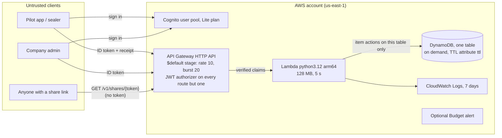

# Receipt registry on AWS (optional server)

The registry is an optional witness for HashWing receipts. A pilot's sealer sends a receipt v1 line; the registry
checks its Ed25519 signature against the company's enrolled key, stores only the commitment (who, which key, head,
count, when it arrived) and lets the company hand out short-lived, unguessable links that show that commitment.
It never sees the log, the file or anything about the flight.

**Status.** The code and its tests run locally. The CDK stack synthesises with no credentials. A LocalStack 4.12.0
community run exercised the Lambda and DynamoDB through a REST API v1 stand-in (see [COVERAGE.md](COVERAGE.md)).
Nothing has been deployed to real AWS, and no real-AWS behaviour is claimed.

## Shape

## Trust boundaries

| Boundary | What crosses it | What is checked |
|---|---|---|
| Internet to API Gateway | Bearer ID token, JSON body up to 4096 bytes | JWT signature, issuer, audience and expiry by the API Gateway authorizer; throttling at the stage |
| API Gateway to Lambda | Verified claims (`sub`, `custom:org_id`, `custom:role`) | The Lambda trusts only these claims for identity. A body field named `org_id` (or any field not on the route's allowlist) is a 400 |
| Lambda to DynamoDB | Condition-guarded writes and transactions | IAM allows GetItem, PutItem, UpdateItem, DeleteItem, Query and ConditionCheckItem on the table ARN only. Transactions are authorised through those item actions ([AWS docs](https://docs.aws.amazon.com/amazondynamodb/latest/developerguide/transaction-apis-iam.html)); there is no separate TransactWriteItems permission |
| Company to registry | A company public key | Enrollment needs an admin and a fresh, single-use challenge signed by the new key |
| Registry to the public | `{head, count, key_fingerprint, received_at}` | Only through an active, unexpired share whose registration is still active |

The `org_id` and `role` custom attributes cannot be written by the app client; only an administrator
(`AdminUpdateUserAttributes`, with IAM credentials) can set them. Self sign-up is off.

## Identity adapter

`IDENTITY_ADAPTER` chooses how a request becomes `Identity(sub, org_id, role)`:

- `cognito` (the only value the CDK stack sets): reads `requestContext.authorizer.jwt.claims`, which the HTTP API
  JWT authorizer has already verified. The client sends the **ID token**: on the Lite plan the custom attributes are
  in the ID token, not the access token.
- `dev-hs256`: development and the LocalStack run only. HS256 bearer tokens checked against `DEV_TOKEN_SECRET`
  (at least 32 bytes) with an `exp` check. The stack never sets it or any `DEV_` variable; a synth test enforces this.
- Unset or anything else: every request is 401, and the function logs a configuration error.

All 401s have the same body.

## Data

### Stored

One table, string keys `PK`/`SK`:

| Item | Holds |
|---|---|
| `ORG#o / KEY#<fp>` | key state (active, rotated, compromised), enrolled_at, enrolled_by, changed_at. `fp` is the SHA-256 of the raw 32-byte public key |
| `ORG#o / ACTIVE_KEY` | the one active fingerprint (a conditional pointer that keeps "at most one active key" true under races) |
| `ORG#o / CHAL#<nonce>` | sub and a 5-minute expiry; deleted when used |
| `ORG#o / EPOCH`, `ENV#<id>` | the org epoch; envelopes with sub, epoch and expiry (default 7 days) |
| `ORG#o / QUOTA#YYYYMM` | registrations this month (default limit 2000, `REG_QUOTA_PER_MONTH`) |
| `ORG#o / REG#<rid>` | fp, head, count, received_at, state, up to 10 share hashes |
| `ORG#o / IDEM#<key>` | payload hash, rid, received_at, expiry (`DEDUPE_SECONDS`, default 7 days) |
| `SHARE#<sha256(token)> / SHARE` | org, rid, state, expiry (default 30 days, at most 365) |
| `TOMB#<org>#<id> / TOMB` | a withdrawal, deletion, key-compromise or epoch record, never expired |

### Never stored

File names, manifests, salts, per-file digests, log contents, GPS, notes, share tokens (only their SHA-256), and
public keys (only their fingerprint). The receipt line itself is not stored either; the registry keeps its parsed
head and count.

## Requests

Order: size (413 over 4096 bytes) → identity (401/403) → body schema (400) → idempotency lookup → envelope (422) →
receipt format (400) → signature (422) → key state (403) → one transaction.

A new registration is one `TransactWriteItems`: put REG if absent, put IDEM if absent or expired, and add one to the
month's quota if it is under the limit. Either all three happen or none do, so a 429 leaves nothing behind. When the
transaction is cancelled, the function re-reads consistently: an IDEM hit returns the original ack (or 409 for a
different payload), an existing REG returns the original ack (or 410 if deleted), otherwise 429.

### Idempotency

- The same `idempotency_key` with the same `{receipt, envelope_id}` returns the original body: the same
  `registration_id`, the original `received_at`, and the current `disposition`. That covers a lost response: the
  client retries and learns what was committed. The quota is charged once.
- The same key with a different payload is 409.
- The same receipt under a new key, or after the idempotency record expired, finds the existing registration
  (`rid` is derived from org, fingerprint, head and count) and returns its ack, or 410 if it was deleted. A retry
  never creates a second registration or a new share.
- An envelope that has expired (or was invalidated by `POST /v1/epoch`) blocks new registrations but not the
  retry of one that already committed.
- After a deletion, an identical retry with the original idempotency key still returns the original ack with
  `disposition: "deleted"` until the idempotency record expires (at most `DEDUPE_SECONDS`).

## Withdrawal, deletion and backups

- **Withdraw a share:** the share becomes `withdrawn` and a TOMB item is written in the same transaction. Its link
  then returns the same 404 as an unknown, expired or malformed link: same body, same headers.
- **Delete a registration (admin):** in one transaction, the registration becomes `deleted` and loses
  `received_at`, every share it issued is withdrawn, and a TOMB item is written for each. The registration item
  stays as a tombstone (fingerprint, head, count, state) so that a replay is answered 410 instead of re-registering.
- **Backup restore:** a restored table (from PITR or an on-demand backup) brings back whatever was live at backup
  time, including shares withdrawn afterwards. So:
  1. Restore to a new table and deploy the function against it with `RESTORED_FROM=<served table>` and a new
     `RESTORE_ID`. Until a marker names this table and this restore ID, every route answers 503 `restore_pending`
     (a marker copied in from the backup names an older table, so it does not count).
  2. Run `python -m registry.restore` with the served table as source. It refuses any other source, copies every
     TOMB item, re-applies it (registrations deleted, shares withdrawn, rotated and compromised keys keep their
     state and the active key is recomputed, the org epoch moves forward), and writes the `SYSTEM/RESTORE` marker
     last. If the source's
     tombstones cannot be read, it stops with an error and writes no marker, so the function stays closed.
  3. After that, withdrawn and deleted views are 404 again and active ones are served.

  This needs the source table to still be readable. If it is gone, tombstones written after the backup are lost and
  the restored table must stay closed until someone decides what to do (see [RUNBOOK_AWS.md](RUNBOOK_AWS.md)).

## What TTL does not guarantee

DynamoDB TTL deletes expired items in the background, typically within days, with no exact deadline. The registry
never relies on it: every read checks `expires_at` itself, so an expired envelope, challenge, idempotency record or
share is treated as gone even while the item still exists, and conditional writes treat an expired-but-present
idempotency record as absent. TTL only keeps the table small. Tombstones and registrations have no TTL.

## Failure behaviour

Any DynamoDB error while reading share, registration, key, idempotency, envelope or restore-marker state is a 503;
nothing is served from a partial read. All reads are strongly consistent.

## Not built

Per-user rate limits beyond the stage throttle, a WAF, custom domains, managed keys, and a console screen. These
are either fixed-fee services excluded by the cost target or out of scope for this packet.
