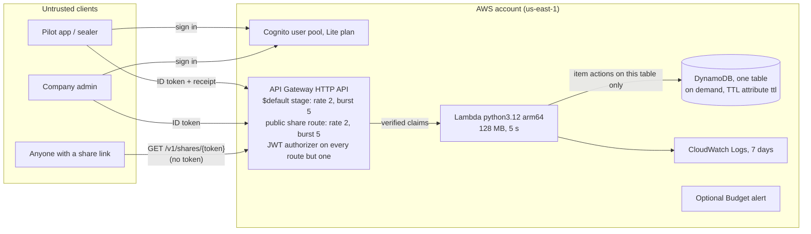

# Receipt registry on AWS (optional server)

The registry is an optional witness for HashWing receipts. A pilot's sealer sends a receipt v1 line; the registry
checks its Ed25519 signature against the company's enrolled key, stores only the commitment (who, which key, head,
count, when it arrived) and lets the company hand out short-lived, unguessable links that show that commitment.
It never sees the log, the file or anything about the flight.

**Status.** The code and its tests run locally. The CDK stack synthesises with no credentials. A LocalStack 4.12.0
community run exercised the Lambda and DynamoDB through a REST API v1 stand-in (see [COVERAGE.md](COVERAGE.md)).
Nothing has been deployed to real AWS, and no real-AWS behaviour is claimed.

## Shape

## Trust boundaries

| Boundary | What crosses it | What is checked |
|---|---|---|
| Internet to API Gateway | Bearer ID token, JSON body up to 4096 bytes | JWT signature, issuer, audience and expiry by the API Gateway authorizer; throttling at the stage; CORS for the allowlisted console origins only (see [CORS](#cors)) |
| API Gateway to Lambda | Verified claims (`sub`, `custom:org_id`, `custom:role`) | The Lambda trusts only these claims for identity. A body field named `org_id` (or any field not on the route's allowlist) is a 400 |
| Lambda to DynamoDB | Condition-guarded writes and transactions | IAM allows GetItem, PutItem, UpdateItem, DeleteItem, Query and ConditionCheckItem on the table ARN only. Transactions are authorised through those item actions ([AWS docs](https://docs.aws.amazon.com/amazondynamodb/latest/developerguide/transaction-apis-iam.html)); there is no separate TransactWriteItems permission |
| Company to registry | A company public key | Enrollment needs an admin and a fresh, single-use challenge signed by the new key |
| Registry to the public | `{head, count, key_fingerprint, received_at}` | Only through an active, unexpired share whose registration is still active |

The `org_id` and `role` custom attributes cannot be written by the app client; only an administrator
(`AdminUpdateUserAttributes`, with IAM credentials) can set them. Self sign-up is off.

## Identity adapter

`IDENTITY_ADAPTER` chooses how a request becomes `Identity(sub, org_id, role)`:

- `cognito` (the only value the CDK stack sets): reads `requestContext.authorizer.jwt.claims`, which the HTTP API
  JWT authorizer has already verified. The client sends the **ID token**: on the Lite plan the custom attributes are
  in the ID token, not the access token.
- `dev-hs256`: development and the LocalStack run only. HS256 bearer tokens checked against `DEV_TOKEN_SECRET`
  (at least 32 bytes) with an `exp` check. The stack never sets it or any `DEV_` variable; a synth test enforces this.
- Unset or anything else: every request is 401, and the function logs a configuration error.

All 401s have the same body.

## Data

### Stored

One table, string keys `PK`/`SK`:

| Item | Holds |
|---|---|
| `ORG#o / KEY#<fp>` | key state (active, rotated, compromised), enrolled_at, enrolled_by, changed_at. `fp` is the SHA-256 of the raw 32-byte public key |
| `ORG#o / ACTIVE_KEY` | the one active fingerprint (a conditional pointer that keeps "at most one active key" true under races) |
| `ORG#o / CHAL#<nonce>` | sub and a 5-minute expiry; deleted when used |
| `ORG#o / EPOCH`, `ENV#<id>` | the org epoch; envelopes with sub, epoch and expiry (default 7 days) |
| `ORG#o / QUOTA#YYYYMM` | registrations this month (default limit 2000, `REG_QUOTA_PER_MONTH`) |
| `ORG#o / REG#<rid>` | fp, head, count, received_at, state, up to 10 share hashes |
| `ORG#o / IDEM#<key>` | payload hash, rid, received_at, expiry (`DEDUPE_SECONDS`, default 7 days) |
| `SHARE#<sha256(token)> / SHARE` | org, rid, state, expiry (default 30 days, at most 365) |
| `ORG#o / SIDEM#<key>` | share idempotency: rid, token hash, the share's expiry, and its own expiry (`DEDUPE_SECONDS`) |
| `TOMB#<org>#<id> / TOMB` | a withdrawal, deletion, key-compromise or epoch record, never expired |

### Never stored

File names, manifests, salts, per-file digests, log contents, GPS, notes, share tokens (only their SHA-256), and
public keys (only their fingerprint). The receipt line itself is not stored either; the registry keeps its parsed
head and count.

## Requests

Order (as in `app.py`): size (413 over 4096 bytes) → identity (401/403) → body schema (400) → idempotency lookup →
receipt format (400) → signature (422) → envelope (422 `envelope_expired`, `sub_mismatch` or `epoch_mismatch`;
only here does a lookup of an already committed registration happen, so a retry of a committed one gets its ack) →
key state (403) → one transaction. The signature is checked before the envelope and before any existence lookup,
so an unsigned request cannot learn whether a registration exists.

A new registration is one `TransactWriteItems`: put REG if absent, put IDEM if absent or expired, and add one to the
month's quota if it is under the limit. Either all three happen or none do, so a 429 leaves nothing behind. When the
transaction is cancelled, the function re-reads consistently: an IDEM hit returns the original ack (or 409 for a
different payload), an existing REG returns the original ack (or 410 if deleted), otherwise 429.

### Idempotency

- The same `idempotency_key` with the same `{receipt, envelope_id}` returns the original body: the same
  `registration_id`, the original `received_at`, and the current `disposition`. That covers a lost response: the
  client retries and learns what was committed. The quota is charged once.
- The same key with a different payload is 409.
- The same receipt under a new key, or after the idempotency record expired, finds the existing registration
  (`rid` is derived from org, fingerprint, head and count) and returns its ack, or 410 if it was deleted. A retry
  never creates a second registration or a new share.
- An envelope that is unusable blocks new registrations but not the retry of one that already committed. The 422
  says why: `envelope_expired` (expired, or unknown in this org, which includes TTL-deleted), `sub_mismatch` (issued to
  another user) or `epoch_mismatch` (issued before the last `POST /v1/epoch`). Any signed-in caller can read the
  current epoch with `GET /v1/epoch`, so a client can drop a cached envelope before it is refused.
- After a deletion, an identical retry with the original idempotency key still returns the original ack with
  `disposition: "deleted"` until the idempotency record expires (at most `DEDUPE_SECONDS`).

### Shares

`POST /v1/shares` takes `{registration_id, token_hash, idempotency_key, expires_days?}`. **The client makes the token**:
32 random bytes from `crypto.getRandomValues`, base64url (43 characters). It sends only the token's SHA-256 (64
lowercase hex) and keeps the token. The registry stores the hash, as it always did, so the stored data and the public
`GET /v1/shares/{token}` (which hashes the token it is given) are unchanged.

This was chosen over "rotate on retry" because a lost response then costs nothing. A retry with the same
`(idempotency_key, registration_id, token_hash)` returns 200 with the same share, and the client already holds the
token. A server-made token could only be recovered by issuing a new one.

- The same idempotency key with another registration or another token hash is 409 `idempotency_conflict`.
- **A token hash is never reusable.** Share records have no TTL, and deleting a registration leaves a withdrawn
  record (no TTL) for every share it issued, even one whose record was lost. A restore writes a withdrawn record for
  every share tombstone whose share is missing from the backup. So a hash used once stays claimed. Reusing it gets
  409 `conflict`, unless it is the same org and registration: then it is that caller's own retry, after the
  idempotency record expired, and it gets the share back with its current disposition. Without this, a link holder
  could re-register an old withdrawn hash once TTL had removed its record, and the old link would show their
  registration. Share records are about 150 bytes, at most 10 per registration.
- **Accepted low-severity disclosure: the 409 shows that a hash was used.** A signed-in member with an active
  registration who sends the hash of a token they hold gets 409 `conflict` if that hash was ever used (even when the
  share is withdrawn or expired), and 201 if it was not. So someone who already holds a link (or its hash) can learn
  that it was once real. A 201 is not free: it creates a live share on the caller's registration, which counts
  toward the 10-share limit. The response does not name the org, the registration or the state, and the shipped client makes a new
  256-bit token for every share, so this happens only when a token is reused on purpose. Hiding it would mean
  answering 201 for a share that was not created, which breaks the retry rules above, so this is documented
  rather than changed.
- A replay never reopens anything. It reports the share's current `disposition` (`active`, `withdrawn` or
  `expired`).
- A replay is answered before the 10-share limit is checked, so a retry at the limit still gets its share.
- The response has no token: `{registration_id, expires_at, disposition}`.
- **Enumeration resistance is unchanged.** In the Lambda (and the dev server), unknown, expired, withdrawn and
  malformed links get the same 404, with the same body and headers: every GET under `/v1/shares/` carries the
  public CORS header. On the deployed HTTP API, a path that is not exactly one segment after `/v1/shares/` (empty,
  or with an extra `/`) matches no route, so API Gateway answers its own 404 without calling the Lambda. That 404
  shows only the path's shape, which the caller already knows; it says nothing about any token. Not verified on
  AWS. The
  registry cannot check the randomness of a token it never sees, so a weak token chosen by a member only weakens that
  member's own link. The shipped client always uses 256 random bits.
- **The raw token is in the path of `GET` and `DELETE /v1/shares/{token}`.** Only `POST /v1/shares` sends just the
  token's SHA-256; AC-48's "the registry receives only its SHA-256" covers creating a share, not opening or
  withdrawing one. So API Gateway access logs (none are configured today) must never include `$context.path`,
  or the request URI.

### CORS

The console runs on another origin (GitHub Pages), so the API answers CORS for an allowlist of exact origins:

- **Stack:** the HTTP API's `corsPreflight` sets the allowed origins. The default is `https://anirudh763.github.io`;
  change it with `-c corsOrigins=https://a.example,https://b.example`. The settings are:
  - allowed methods: GET, POST, DELETE and OPTIONS
  - allowed headers: `authorization`, `content-type` and `idempotency-key`
  - `allowCredentials: false`, preflight cached 10 minutes

  API Gateway answers the preflight itself. The stack rejects `*`, wildcard hosts and non-https origins, and a
  synth test checks this.
- **Lambda (`CORS_ORIGINS`):** handles CORS where no API Gateway CORS is configured, which is the dev server and the
  LocalStack REST stand-in.
  - The value is a comma list of exact origins. A `scheme://host:*` entry allows any port; it is for dev only.
  - `*` and wildcard hosts are ignored.
  - An allowlisted `Origin` gets that origin back, with `Vary: Origin`. Any other origin gets no CORS header.
  - Preflight is 204 for an allowed origin and 403 `cors_forbidden` otherwise. It is answered before identity
    and the restore gate, so the 503 or 401 that follows can be read by the console.
  - Credentials are never allowed: the token travels in `Authorization`, not in a cookie.
- **Public share view:** in the Lambda it sends `Access-Control-Allow-Origin: *` with no credentials, so any
  recipient's page can read it. On the deployed HTTP API, the API-wide CORS settings apply to this route too (API
  Gateway overrides integration CORS headers), so there it is limited to the allowlist.

### PROPOSED routes (agreed contract, not built)

Recorded 2026-11-17 before any code, from the release brief (ledger R36, R39, R48, R54) and spine AD-9, AD-15 and AD-19. None of these exist in `app.py` or `infra/lib/stack.ts` yet, and none adds a field to the "Stored" table above except where it says so. Each needs the matching `stack.ts` route and a registry test in the same PR.

| Route | Who | Request | Response | Notes |
|---|---|---|---|---|
| `GET /v1/registrations/{rid}/shares?limit&cursor` | any member of the org | path rid (32 hex) | `{shares: [{share_id, state, created_at, expires_at}], next_cursor}` | `share_id` is the stored `sha256(token)`; it cannot open a link (the public route hashes what it is given). Reads `REG.share_hashes` (at most 10) and each `SHARE#` item; another org's rid is the same 404 as an unknown one. Expired is computed on read. |
| `DELETE /v1/registrations/{rid}/shares/{share_id}` | any member of the org (same rule as today's withdraw) | path rid and `share_id` (64 hex) | `{withdrawn: true}` | Same transaction and tombstone as `DELETE /v1/shares/{token}`, so a reload or another admin can withdraw without the raw token. The token route stays. |
| `GET /v1/registrations/{rid}` | any member of the org | path rid | `{registration_id, state, received_at, disposition, recovery_version}` | The signed-in lookup behind "Refresh". Deleted: `disposition: "deleted"`, no `received_at`. |
| `GET /v1/recovery` | any member | none | `{recovery_version}` | A number that only goes up; `registry.restore` raises it when it writes `SYSTEM/RESTORE`. Every ack also returns it. New stored field: `SYSTEM / RECOVERY` (the version). |
| `POST /v1/shares` (change) | unchanged | `expires_days` 1 to 30 | unchanged | 400 above 30. Existing shares keep the `expires_at` they were created with. No registry is deployed, so no production link exists to migrate. |

Org-wide link management lists registrations with the existing paged `GET /v1/registrations`, then the shares of each one; there is no org-wide share index, because shares are keyed by `SHARE#<hash>` outside the org partition.

## Withdrawal, deletion and backups

- **Withdraw a share:** the share becomes `withdrawn` and a TOMB item is written in the same transaction. Its link
  then returns the same 404 as an unknown, expired or malformed link: same body, same headers.
- **Delete a registration (admin):** in one transaction, the registration becomes `deleted` and loses
  `received_at`, every share it issued is withdrawn, and a TOMB item is written for each. The registration item
  stays as a tombstone (fingerprint, head, count, state) so that a replay is answered 410 instead of re-registering.
- **Backup restore:** a restored table (from PITR or an on-demand backup) brings back whatever was live at backup
  time, including shares withdrawn afterwards. So:
  1. Restore to a new table and deploy the function against it with `RESTORED_FROM=<served table>` and a new
     `RESTORE_ID`. Until a marker names this table and this restore ID, every route answers 503 `restore_pending`
     (a marker copied in from the backup names an older table, so it does not count).
  2. Run `python -m registry.restore` with the served table as source. It refuses any other source, copies every
     TOMB item, re-applies it (registrations deleted, shares withdrawn, rotated and compromised keys keep their
     state and the active key is recomputed, the org epoch moves forward), and writes the `SYSTEM/RESTORE` marker
     last. If the source's
     tombstones cannot be read, it stops with an error and writes no marker, so the function stays closed.
  3. After that, withdrawn and deleted views are 404 again and active ones are served.

  This needs the source table to still be readable. If it is gone, tombstones written after the backup are lost and
  the restored table must stay closed until someone decides what to do (see [RUNBOOK_AWS.md](RUNBOOK_AWS.md)).

  **Known gap (not fixed):** a restore also drops every registration and share created after the backup. The
  browser outbox keeps its acknowledgement, so it may still show "Registered" for a proof the restored table no
  longer has. Nothing tells the browser, and the outbox does not resend a proof it already holds an ack for.

## What TTL does not guarantee

DynamoDB TTL deletes expired items in the background, typically within days, with no exact deadline. The registry
never relies on it: every read checks `expires_at` itself, so an expired envelope, challenge, idempotency record or
share is treated as gone even while the item still exists, and conditional writes treat an expired-but-present
idempotency record as absent. TTL only keeps the table small. Tombstones, registrations and share records have
no TTL (a share hash must stay claimed; see Shares).

## Failure behaviour

Any DynamoDB error while reading share, registration, key, idempotency, envelope or restore-marker state is a 503;
nothing is served from a partial read. All reads are strongly consistent.

## Not built

Per-user rate limits beyond the stage throttle, a WAF, custom domains, managed keys, and real (Cognito) sign-in in
the console. The console's registry screens ship only in a build with `VITE_REGISTRY_URL` ([OUTBOX.md](../OUTBOX.md)).
The rest are either fixed-fee services excluded by the cost target or out of scope for this packet.
