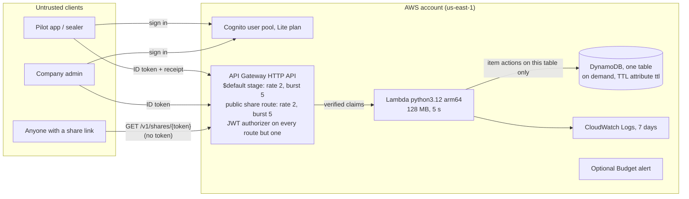

# Receipt registry on AWS (optional server)

The registry is an optional witness for HashWing receipts. A pilot's sealer sends a receipt v1 line; the registry
checks its Ed25519 signature against the company's enrolled key, stores only the commitment (who, which key, head,
count, when it arrived) and lets the company hand out short-lived, unguessable links that show that commitment.
It never sees the log, the file or anything about the flight.

**Status.** The code and its tests run locally. The CDK stack synthesises with no credentials. A LocalStack 4.12.0
community run exercised the Lambda and DynamoDB through a REST API v1 stand-in (see [COVERAGE.md](COVERAGE.md)).
Nothing has been deployed to real AWS, and no real-AWS behaviour is claimed.

## Shape

## Trust boundaries

| Boundary | What crosses it | What is checked |
|---|---|---|
| Internet to API Gateway | Bearer ID token, JSON body up to 4096 bytes | JWT signature, issuer, audience and expiry by the API Gateway authorizer; throttling at the stage; CORS for the allowlisted console origins only (see [CORS](#cors)) |
| API Gateway to Lambda | Verified claims (`sub`, `custom:org_id`, `custom:role`) | The Lambda trusts only these claims for identity. A body field named `org_id` (or any field not on the route's allowlist) is a 400 |
| Lambda to DynamoDB | Condition-guarded writes and transactions | IAM allows GetItem, PutItem, UpdateItem, DeleteItem, Query and ConditionCheckItem on the table ARN only. Transactions are authorised through those item actions ([AWS docs](https://docs.aws.amazon.com/amazondynamodb/latest/developerguide/transaction-apis-iam.html)); there is no separate TransactWriteItems permission |
| Company to registry | A company public key | Enrollment needs an admin and a fresh, single-use challenge signed by the new key |
| Registry to the public | `{head, count, key_fingerprint, received_at}` | Only through an active, unexpired share whose registration is still active |

The `org_id` and `role` custom attributes cannot be written by the app client; only an administrator
(`AdminUpdateUserAttributes`, with IAM credentials) can set them. Self sign-up is off.

## Identity adapter

`IDENTITY_ADAPTER` chooses how a request becomes `Identity(sub, org_id, role)`:

- `cognito` (the only value the CDK stack sets): reads `requestContext.authorizer.jwt.claims`, which the HTTP API
  JWT authorizer has already verified. The client sends the **ID token**: on the Lite plan the custom attributes are
  in the ID token, not the access token.
  The stack also sets `COGNITO_ISSUER` (`https://cognito-idp.<region>.amazonaws.com/<user pool id>`) and
  `COGNITO_CLIENT_ID` (the app client) from its own user pool, in both stages.
- `dev-hs256`: development and the LocalStack run only. HS256 bearer tokens checked against `DEV_TOKEN_SECRET`
  (at least 32 bytes) with an `exp` check. The stack never sets it or any `DEV_` variable; a synth test enforces this.
- Unset or anything else: every request is 401, and the function logs a configuration error.

All 401s have the same body.

## Data

### Stored

One table, string keys `PK`/`SK`:

| Item | Holds |
|---|---|
| `ORG#o / KEY#<fp>` | `kind` (`company` or `pilot`; missing means `company`), key state (active, rotated, retired, compromised; `retired` is for pilot keys only), enrolled_at, enrolled_by (the enrolling admin's `sub`, copied from the key tombstone when a restore brings the key back, or the placeholder `restore` or `unknown` when none was recorded; never returned to a client), changed_at. Pilot keys also hold `company_fp` (the fingerprint of the company key that authorized them) and `not_after` (epoch seconds). An item with `company_fp` or `not_after` is a pilot key whatever `kind` says. `fp` is the SHA-256 of the raw 32-byte public key |
| `ORG#o / ACTIVE_KEY` | the one active company fingerprint (a conditional pointer that keeps "at most one active company key" true under races); never a pilot key |
| `ORG#o / PILOT_COUNT` | `n`, the number of active pilot keys (cap 50), changed only inside the transactions that enroll, retire (by an admin or by a slot reclaim) or compromise a pilot key |
| `ORG#o / CHAL#<nonce>` | sub, `kind` (`company` or `pilot`; missing means `company`) and a 5-minute expiry; deleted when used |
| `ORG#o / EPOCH`, `ENV#<id>` | the org epoch; envelopes with sub, epoch and expiry (default 7 days) |
| `ORG#o / QUOTA#YYYYMM` | registrations this month (default limit 2000, `REG_QUOTA_PER_MONTH`) |
| `ORG#o / REG#<rid>` | fp, head, count, received_at, state, up to 10 share hashes |
| `ORG#o / IDEM#<key>` | payload hash, rid, received_at, expiry (`DEDUPE_SECONDS`, default 7 days) |
| `SHARE#<sha256(token)> / SHARE` | org, rid, state, expiry (default 30 days, 7 offered, at most 30) |
| `ORG#o / SIDEM#<key>` | share idempotency: rid, token hash, the share's expiry, and its own expiry (`DEDUPE_SECONDS`) |
| `TOMB#<org>#<id> / TOMB` | a withdrawal, deletion, key-state or epoch record, never expired. `kind` is the tombstone's own kind (`registration`, `share`, `key`, `epoch`), so a key tombstone stores the key's kind as `key_kind` (missing means `company`), plus `company_fp` and `not_after` for a pilot key |

### Never stored

File names, manifests, salts, per-file digests, log contents, GPS, notes, share tokens (only their SHA-256), and
public keys (only their fingerprint). The receipt line itself is not stored either; the registry keeps its parsed
head and count.

## Requests

Order (as in `app.py`): size (413 over 4096 bytes) → identity (401/403) → body schema (400) → idempotency lookup →
receipt format (400) → signature (422) → envelope (422 `envelope_expired`, `sub_mismatch` or `epoch_mismatch`;
only here does a lookup of an already committed registration happen, so a retry of a committed one gets its ack) →
key state (403) → one transaction. The signature is checked before the envelope and before any existence lookup,
so an unsigned request cannot learn whether a registration exists.

The pilot challenge and enroll routes check the `PILOT_KEYS_ORGS` switch right after identity and role, before the
body is parsed: an org not switched on gets 403 `pilot_keys_off` whatever it sends. Retire is not gated: revocation is
never blocked by the switch.

A pilot key (see Pilot keys) registers only when its org is in `PILOT_KEYS_ORGS`, its state is `active`, its
`not_after` is after the registry clock, and its parent company KEY item is `active`; anything else is 403
`key_not_active`. These are read before the transaction and checked again inside it as two `ConditionCheck` items (the
pilot KEY item: state active and `not_after` > now; the parent KEY item: state active), so a retire, compromise or
company key change that commits first wins. The company-key path is unchanged.

A new registration is one `TransactWriteItems`: put REG if absent, put IDEM if absent or expired, and add one to the
month's quota if it is under the limit. Either all three happen or none do, so a 429 leaves nothing behind. When the
transaction is cancelled, the function re-reads consistently: an IDEM hit returns the original ack (or 409 for a
different payload), an existing REG returns the original ack (or 410 if deleted), otherwise 429.

### Idempotency

- The same `idempotency_key` with the same `{receipt, envelope_id}` returns the original body: the same
  `registration_id`, the original `received_at`, and the current `disposition`. That covers a lost response: the
  client retries and learns what was committed. The quota is charged once.
- The same key with a different payload is 409.
- The same receipt under a new key, or after the idempotency record expired, finds the existing registration
  (`rid` is derived from org, fingerprint, head and count) and returns its ack, or 410 if it was deleted. A retry
  never creates a second registration or a new share.
- An envelope that is unusable blocks new registrations but not the retry of one that already committed. The 422
  says why: `envelope_expired` (expired, or unknown in this org, which includes TTL-deleted), `sub_mismatch` (issued to
  another user) or `epoch_mismatch` (issued before the last `POST /v1/epoch`). Any signed-in caller can read the
  current epoch with `GET /v1/epoch`, so a client can drop a cached envelope before it is refused.
- After a deletion, an identical retry with the original idempotency key still returns the original ack with
  `disposition: "deleted"` until the idempotency record expires (at most `DEDUPE_SECONDS`).
- A restore keeps deletions made after the backup: a registration the backup never had comes back as a deleted stub
  holding only its id and state. `GET /v1/registrations` lists it with just `registration_id` and
  `disposition: "deleted"`, and any retry, with a new or the original idempotency key, gets 410 `registration_deleted`.

### Company keys

- `GET /v1/keys/challenge` (admin) returns `{nonce, expires_at, message}`. `nonce` is 32 lowercase hex and `message`
  is exactly `hashwing-key-enroll v1\n<org>\n<nonce>`. Clients build those bytes themselves and sign only when
  `message` is byte-equal (`registry/registry/enroll_challenge.py`); they never sign the server's text as such.
- `POST /v1/keys` (admin) takes `{public_key, nonce, signature, confirm_replace?}` and returns
  `{key_fingerprint, state, replaced}`. A retry after a lost response is 409 `key_exists`; `GET /v1/keys` then shows
  that fingerprint as `active_key`.
- `GET /v1/keys?cursor` (any member) returns `{keys: [{key_fingerprint, state, enrolled_at, changed_at,
  enrolled_by_me}], active_key, next_cursor}`, 50 rows a page in fingerprint order. `enrolled_by_me` is true only
  when the caller's `sub` enrolled the key (false when a restore left only a placeholder); the stored `enrolled_by` is never returned.
  `active_key` is the active fingerprint or null. Pass `next_cursor` back as `cursor` (64 lowercase hex, else 400
  `bad_request`) for the next page; it is null on the last page, except that an exactly full page may return a
  cursor whose next page is empty, as with registrations. A row lacking `enrolled_at` or `changed_at` omits it.
- `POST /v1/keys/<fp>/compromised` (admin) returns `{key_fingerprint, state: "compromised", changed_at}`. It is
  idempotent: on a key already compromised it returns the stored `changed_at` and writes nothing, so the first date
  survives a repeat call and a backup restore. The write is conditioned on the state it read; if a concurrent
  request changed it, the function re-reads and returns the stored date when the key is now compromised, else 409
  `conflict`. Another org's fingerprint is the same 404 as an unknown one.

### Pilot keys (Option B, off by default)

Signing Option B lets a pilot's own key sign company receipts when the company key has authorized it (design
`design-key-enrollment-option-b.md` §4.2, spine AD-23 and AD-24). The server half is built; the browser half (Trust
pilot UI, Verify delegated path) is not. **Off everywhere by default.**

- **Switch:** `PILOT_KEYS_ORGS`, an operator-set Lambda environment variable: a comma list of org ids. An entry
  counts only if it is exactly an org id (`[A-Za-z0-9_-]{1,64}`, no spaces trimmed, no wildcard), so unset, empty,
  whitespace, `*` and malformed entries switch nothing on. Read once when the function starts. No route can set it
  and `infra/lib/stack.ts` never sets it (a synth test checks this). Off: the challenge and enroll routes below answer
  403 `pilot_keys_off`, pilot keys answer 403 `key_not_active` on register, and the stored data is kept. Retire and
  compromise still work, so an admin can always revoke. Switching off frees no slots.
- **Authorization** (`registry/registry/pilot_authorization.py`, vectors in `tests/fixtures/pilot-authorization.json`):
  the company key signs exactly `hashwing-pilot-authorization v1\npilot_key=<64 hex>\ncompany_key=<64 hex>\nnot_after=<YYYY-MM-DDTHH:MM:SSZ>`
  (no trailing newline). It travels as base64url without padding plus a 128-lowercase-hex signature; in a receipt
  message as one line `Authorized by company key: <base64url>.<sig>`. Anything not canonical is refused. `not_after`
  is at most 30 days ahead (default 14 in the client) and is compared with the registry clock only.
- `GET /v1/pilot-keys/challenge` (any member) returns `{nonce, expires_at, message}` with `message` exactly
  `hashwing-pilot-key-enroll v1\n<org>\n<nonce>`; the client rebuilds and compares it before signing
  (`enroll_challenge.bytes_to_sign(org, challenge, "pilot")`). The CHAL item has `kind: "pilot"`.
- `POST /v1/pilot-keys` (any member) takes `{public_key, nonce, signature, authorization, authorization_sig}` and
  returns 201 `{key_fingerprint, kind: "pilot", state: "active", company_fingerprint, not_after}`. Order: switch (403)
  → schema (400) → challenge signature by `public_key`, which also refuses weak keys (422 `bad_signature`) →
  authorization (422 `bad_authorization`: malformed, weak or mismatched `pilot_key`, `pilot_key` equal to
  `company_key`, signature not by `company_key`; 422 `authorization_expired`: `not_after` ≤ now or > now + 30 days) →
  `company_key` is this org's `ACTIVE_KEY` (422 `company_key_not_active`) → fingerprint ever seen in this org, any
  state or kind (409 `key_exists`) → one transaction: delete the CHAL item (exists, same `sub`, unexpired,
  `kind: "pilot"`; else 400 `bad_challenge`), put the KEY item if absent, put its tombstone, add 1 to `PILOT_COUNT`
  if `n` < 50, and check that `ACTIVE_KEY` still names the company key (else 422 `company_key_not_active`). If only
  the counter condition failed, the registry reclaims slots (below) and sends the same transaction once more; if
  that fails on the counter too, 409 `pilot_key_limit`. Each enroll route accepts only its own challenge kind; `POST /v1/keys` accepts a
  company challenge or one without `kind`. Pilot keys never go through `POST /v1/keys`, which rotates `ACTIVE_KEY`.
- `POST /v1/pilot-keys/<fp>/retire` (admin) returns `{key_fingerprint, state: "retired", changed_at}`. An already
  retired or compromised key returns its stored state and date and writes nothing. Unknown, another org's, or a
  company key: 404. In one transaction: the KEY item (condition: state active), its tombstone, and `PILOT_COUNT` − 1.
  It works whatever `PILOT_KEYS_ORGS` says.
- `POST /v1/keys/<fp>/compromised` works for both kinds; for an active pilot key it also subtracts 1 from
  `PILOT_COUNT`. The decrement has no floor condition, so the counter never blocks a revocation. If its transaction
  is canceled because the key changed meanwhile (a retire, a slot reclaim, a rotation), it reads the key again and
  retries once with the fresh state; a key already compromised answers its stored date.
- `GET /v1/keys` rows gain `kind`; pilot rows gain `company_fingerprint` and `not_after` (ISO). The response gains
  `pilot_keys` (true when the caller's org is switched on).
- **Renewal** is a new pilot key with a new authorization. A fingerprint once seen in an org is never enrolled again.
- **Slots: only a usable pilot key holds one** (design §4.2 "Pilot slots"). Usable = state `active`, `not_after`
  after the registry clock, and parent company KEY item `active`. Both ways to stop being usable are permanent, so
  when an enroll hits the cap the registry pages the org's KEY items and retires every active pilot key that is no
  longer usable, each with the admin-retire transaction (condition state `active` → `retired`, tombstone,
  `PILOT_COUNT` − 1), one transaction per key; a canceled one (a racing retire or compromise won) is skipped. It
  never touches a retired or compromised key and never changes `not_after`. So `PILOT_COUNT.n` always equals the
  number of active pilot keys. Until a cap hit triggers that reclaim, an ended pilot key still shows `active` in the
  list; it cannot register either way.
- Recipients (Verify, browser half, not built) never see registry key state; the 500-entry recipient compromised list
  lives in the recipient's browser. No share-view field reports pilot key state (a follow-up that needs an AD-9
  amendment first).

### Shares

`POST /v1/shares` takes `{registration_id, token_hash, idempotency_key, expires_days?}`. **The client makes the token**:
32 random bytes from `crypto.getRandomValues`, base64url (43 characters). It sends only the token's SHA-256 (64
lowercase hex) and keeps the token. The registry stores the hash, as it always did, so the stored data and the public
`GET /v1/shares/{token}` (which hashes the token it is given) are unchanged.

This was chosen over "rotate on retry" because a lost response then costs nothing. A retry with the same
`(idempotency_key, registration_id, token_hash)` returns 200 with the same share, and the client already holds the
token. A server-made token could only be recovered by issuing a new one.

- The same idempotency key with another registration or another token hash is 409 `idempotency_conflict`.
- **A token hash is never reusable.** Share records have no TTL, and deleting a registration leaves a withdrawn
  record (no TTL) for every share it issued, even one whose record was lost. A restore writes a withdrawn record for
  every share tombstone whose share is missing from the backup. So a hash used once stays claimed. Reusing it gets
  409 `conflict`, unless it is the same org and registration: then it is that caller's own retry, after the
  idempotency record expired, and it gets the share back with its current disposition. Without this, a link holder
  could re-register an old withdrawn hash once TTL had removed its record, and the old link would show their
  registration. Share records are about 150 bytes, at most 10 per registration.
- **Accepted low-severity disclosure: the 409 shows that a hash was used.** A signed-in member with an active
  registration who sends the hash of a token they hold gets 409 `conflict` if that hash was ever used (even when the
  share is withdrawn or expired), and 201 if it was not. So someone who already holds a link (or its hash) can learn
  that it was once real. A 201 is not free: it creates a live share on the caller's registration, which counts
  toward the 10-share limit. The response does not name the org, the registration or the state, and the shipped client makes a new
  256-bit token for every share, so this happens only when a token is reused on purpose. Hiding it would mean
  answering 201 for a share that was not created, which breaks the retry rules above, so this is documented
  rather than changed.
- A replay never reopens anything. It reports the share's current `disposition` (`active`, `withdrawn` or
  `expired`).
- A replay is answered before the 10-share limit is checked, so a retry at the limit still gets its share.
- The response has no token: `{registration_id, expires_at, disposition}`.
- **Enumeration resistance is unchanged.** In the Lambda (and the dev server), unknown, expired, withdrawn and
  malformed links get the same 404, with the same body and headers: every GET under `/v1/shares/` carries the
  public CORS header. On the deployed HTTP API, a path that is not exactly one segment after `/v1/shares/` (empty,
  or with an extra `/`) matches no route, so API Gateway answers its own 404 without calling the Lambda. That 404
  shows only the path's shape, which the caller already knows; it says nothing about any token. Not verified on
  AWS. The
  registry cannot check the randomness of a token it never sees, so a weak token chosen by a member only weakens that
  member's own link. The shipped client always uses 256 random bits.
- **The raw token is in the path of `GET` and `DELETE /v1/shares/{token}`.** Only `POST /v1/shares` sends just the
  token's SHA-256; AC-48's "the registry receives only its SHA-256" covers creating a share, not opening or
  withdrawing one. So API Gateway access logs (none are configured today) must never include `$context.path`,
  or the request URI.

### CORS

The console runs on another origin (GitHub Pages), so the API answers CORS for an allowlist of exact origins:

- **Stack:** the HTTP API's `corsPreflight` sets the allowed origins. The default is `https://anirudh763.github.io`;
  change it with `-c corsOrigins=https://a.example,https://b.example`. The settings are:
  - allowed methods: GET, POST, DELETE and OPTIONS
  - allowed headers: `authorization`, `content-type` and `idempotency-key`
  - exposed headers: `retry-after` (so the console can read it cross-origin)
  - `allowCredentials: false`, preflight cached 10 minutes

  API Gateway answers the preflight itself. The stack rejects `*`, wildcard hosts and non-https origins, and a
  synth test checks this.
- **Lambda (`CORS_ORIGINS`):** handles CORS where no API Gateway CORS is configured, which is the dev server and the
  LocalStack REST stand-in.
  - The value is a comma list of exact origins. A `scheme://host:*` entry allows any port; it is for dev only.
  - `*` and wildcard hosts are ignored.
  - An allowlisted `Origin` gets that origin back, with `Vary: Origin` and
    `Access-Control-Expose-Headers: retry-after`. Any other origin gets no CORS header.
  - Preflight is 204 for an allowed origin and 403 `cors_forbidden` otherwise. It is answered before identity
    and the restore gate, so the 503 or 401 that follows can be read by the console.
  - Credentials are never allowed: the token travels in `Authorization`, not in a cookie.
- **Public share view:** in the Lambda it sends `Access-Control-Allow-Origin: *` (and the same expose header) with no
  credentials, so any recipient's page can read it. On the deployed HTTP API, the API-wide CORS settings apply to this route too (API
  Gateway overrides integration CORS headers), so there it is limited to the allowlist.

### Retry-After

Every 429 and 503 the Lambda returns carries `Retry-After` in whole seconds: 429 `quota_exceeded` gives the seconds
until the next UTC month starts (when the quota resets); every 503 (`unavailable`, `restore_pending`, including on the
share view) gives 30. No other status carries it. API Gateway's own throttling 429 does not carry it, so a client
falls back to its own backoff there.

### PROPOSED routes (agreed contract, not built)

Recorded 2026-11-17 before any code, from the release brief (ledger R36, R39, R48, R49, R54) and spine AD-9, AD-15, AD-19 and AD-20, and revised after the PR #35 security review. None of these exist in `app.py` or `infra/lib/stack.ts` yet. Each needs the matching `stack.ts` route and registry tests in the same PR.

| Route | Who | Request | Response | Notes |
|---|---|---|---|---|
| `GET /v1/shares?limit&cursor` | any member of the org | none | `{shares: [{share_id, registration_id, state, created_at, expires_at}], next_cursor}` | One bounded query over the org-partition index items `ORG#<org> / SHARE#<created_at>#<hash>` (`created_at` as 12-digit zero-padded epoch seconds; a stub without it uses `withdrawn_at`), newest first. The index item holds the key, rid and a copy of the state; each row's state is read from its `SHARE#<hash>` item, which stays the source of truth. `share_id` is the stored `sha256(token)`; it cannot open a link, because the public route hashes what it is given. Expired is computed on read. Stub rows written by deletion or restore may lack `created_at` and `expires_at` and are listed as withdrawn. |
| `GET /v1/registrations/{rid}/shares` | any member of the org | path rid (32 hex) | same row shape | The same index, filtered to one registration. It does not rely on `REG.share_hashes`, because a restore can re-create a registration with `share_hashes: []` while a withdrawn share stub still points at it. Another org's rid is the same 404 as an unknown one. |
| `DELETE /v1/registrations/{rid}/shares/{share_id}` | any member of the org (same rule as today's withdraw) | path rid and `share_id` (64 hex) | `{withdrawn: true}` | Transaction conditions: `ORG#<caller org> / REG#<rid>` exists; the hash is in its `share_hashes` or has an index item under that rid; `SHARE.org` equals the caller's org and `SHARE.rid` equals rid. Otherwise the identical 404. The same withdraw items and tombstone as `DELETE /v1/shares/{token}`, so a reload or another admin can withdraw without the raw token. The token route stays. |
| `GET /v1/registrations/{rid}` | any member of the org | path rid | `{registration_id, state, received_at, disposition, recovery_version}` | The signed-in lookup behind Refresh. Deleted: `disposition: "deleted"`, no `received_at`. |
| `GET /v1/recovery` | any member | none | `{recovery_version}` | The function's `RESTORE_ID`, an opaque string (empty before any restore) that `registry.restore` generates and never reuses. Clients compare it for equality with what they saved, never for order. Nothing is stored in the table for it. Every ack also returns it. |
| `POST /v1/shares` (change) | unchanged | `expires_days` 1 to 30 | unchanged | 400 above 30. The cap applies at creation; reads check the stored `expires_at`, so an existing longer link keeps its expiry. No registry is deployed, so no production link exists to migrate. The transaction gains the index item and the journal creation record: five items (SHARE, SIDEM, the REG update, the index item, the journal record); registration becomes four (REG, IDEM, QUOTA, the journal record). The cost audit counts both. |

Proposed stored items (not built; added to "Stored" when built): the share index item above, and the security journal (spine AD-20): a second on-demand table holding a copy of every TOMB item and a creation record for each registration and share (org, id, original `received_at` or `created_at` and `expires_at`, fingerprint, head, count; never a token), written in the same transaction as the item it records, with PITR, deletion protection and RETAIN in production and `enrolled_by` scrubbed after 90 days like the KEY items. Restore applies the union of served-table and journal tombstones with the most revoked state per target (spine AD-20).

Registration lists: a future registration-list UI must accept stub rows from deletion or restore that have no `count`, `head` or `key_fingerprint`.

## Withdrawal, deletion and backups

- **Withdraw a share:** the share becomes `withdrawn` and a TOMB item is written in the same transaction. Its link
  then returns the same 404 as an unknown, expired or malformed link: same body, same headers.
- **Delete a registration (admin):** in one transaction, the registration becomes `deleted` and loses
  `received_at`, every share it issued is withdrawn, and a TOMB item is written for each. The registration item
  stays as a tombstone (fingerprint, head, count, state) so that a replay is answered 410 instead of re-registering.
- **Backup restore:** a restored table (from PITR or an on-demand backup) brings back whatever was live at backup
  time, including shares withdrawn afterwards. So:
  1. Restore to a new table and deploy the function against it with `RESTORED_FROM=<served table>` and a new
     `RESTORE_ID`. Until a marker names this table and this restore ID, every route answers 503 `restore_pending`
     (a marker copied in from the backup names an older table, so it does not count).
  2. Run `python -m registry.restore` with the served table as source. It refuses any other source, copies every
     TOMB item, re-applies it (registrations deleted, shares withdrawn, key states replayed, the org epoch
     moves forward), and writes the `SYSTEM/RESTORE` marker last. A key's state becomes the most revoked of the
     tombstone's and the restored item's (active < rotated < retired < compromised); `kind`, `company_fp` and
     `not_after` are written back onto the KEY item. `ACTIVE_KEY` is recomputed from company keys only; pilot keys
     keep their state, and `PILOT_COUNT` is recounted from the active pilot keys. If a tombstone and its KEY item
     disagree on kind, the restore stops with an error before the marker. If the source's
     tombstones cannot be read, it stops with an error and writes no marker, so the function stays closed.
  3. After that, withdrawn and deleted views are 404 again and active ones are served.

  This needs the source table to still be readable. If it is gone, tombstones written after the backup are lost and
  the restored table must stay closed until someone decides what to do (see [RUNBOOK_AWS.md](RUNBOOK_AWS.md)).

  **Known gap (not fixed):** a restore also drops every registration and share created after the backup. The
  browser outbox keeps its acknowledgement, so it may still show "Registered" for a proof the restored table no
  longer has. Nothing tells the browser, and the outbox does not resend a proof it already holds an ack for.

  **Known gaps found in the PR #38 review (not fixed):** (A) a share created after the backup, whose share and
  idempotency records were both lost, comes back on the client's retry (same token and idempotency key) as 201 active
  with a fresh 30 days, past its original expiry, so a link that had expired works again. (B) A registration created
  after the backup, when re-sent, gets a new `received_at` instead of the original. Both are fixed by the security
  journal (spine AD-20), which brings back the original times.

## What TTL does not guarantee

DynamoDB TTL deletes expired items in the background, typically within days, with no exact deadline. The registry
never relies on it: every read checks `expires_at` itself, so an expired envelope, challenge, idempotency record or
share is treated as gone even while the item still exists, and conditional writes treat an expired-but-present
idempotency record as absent. TTL only keeps the table small. Tombstones, registrations and share records have
no TTL (a share hash must stay claimed; see Shares).

## Failure behaviour

Any DynamoDB error while reading share, registration, key, idempotency, envelope or restore-marker state is a 503;
nothing is served from a partial read. All reads are strongly consistent.

## Not built

Per-user rate limits beyond the stage throttle, a WAF, custom domains, managed keys, and real (Cognito) sign-in in
the console. The console's registry screens ship only in a build with `VITE_REGISTRY_URL` ([OUTBOX.md](../OUTBOX.md)).
The rest are either fixed-fee services excluded by the cost target or out of scope for this packet.
